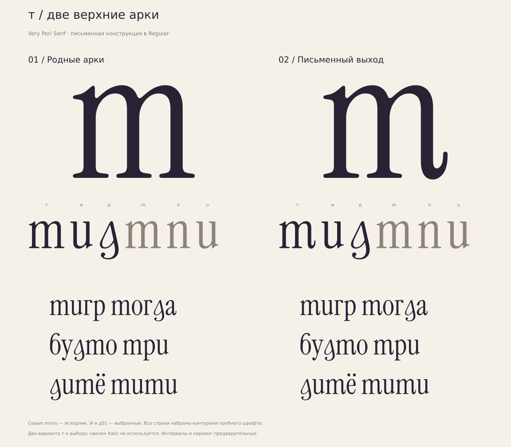

# Very Peri Serif

Рабочее кириллическое расширение **Instrument Serif Regular**.
Здесь сохранены исходники, SVG-презентации, пробные TTF/WOFF2 и проверки
совместной разработки. Полный алфавит и окончательный кернинг ещё не готовы.
Отдельный Italic пока отложен; строчные Regular используют письменные скелеты.

Порядок работы: [CLAUDE.md](CLAUDE.md), актуальные
[решения пользователя](docs/decisions.md), [инструкция](docs/instruction.md).
Сверка полезных правил и расхождений: [instruction-review.md](docs/instruction-review.md).
Статусы букв: [progress.json](data/progress.json), паспорта: [letters.json](data/letters.json).
Снимок сверки двух веток: [cross-branch-inventory.json](data/cross-branch-inventory.json).
Текущие добавления и выборы отражены в progress.json.
Есть материалы для **22 строчных**: 18 в наших пробных шрифтах и ещё
ш/ь/ы/ъ отдельными GLIF/SVG в ветке Клода. Из них 14 букв получили
отдельные исследования, 8 используют исходные латинские омоглифы.

## Текущие пробы

| Материалы | Состояние |
|---|---|
| [б](studies/regular/be/), [г](studies/regular/ghe/) | Основные «Капля», другие рисунки сохранены |
| [в](studies/regular/ve/) | Два варианта, выбор основного открыт |
| [ж](studies/regular/zhe-selected/) | Точный выбранный глиф из наработок пользователя с Клодом |
| [з](studies/regular/ze/) | Основная 01; вторая удалена по просьбе пользователя |
| [и](studies/regular/i-selected/) | Основная чашеобразная; диагональная — ss07 |
| [й](studies/regular/shorti/), [к](studies/regular/ka/) | Два рисунка каждой буквы, выбор основного открыт |
| [прежние д](studies/regular/de-loop/) | Сохранены; пользователь запросил переработку |
| [g-подобные д](studies/regular/de-native/) | Отклонены пользователем: читаются как g; сохранены для истории |
| [печатные д](studies/regular/de-cyrillic/) | Оба рисунка отклонены: не соответствуют письменному принципу строчных |
| [письменные д](studies/regular/de-cursive/) | Обе реализации отклонены: кривые и окончания не попали в стиль |
| [д](studies/regular/de-reimagined/) | Основная01 «Острый свод»;02 «Перьевой поворот» сохранён отдельно альтернативой |
| [т](studies/regular/te/) | 01 «Родные арки» /02 «Письменный выход»; выбор основного открыт |
| [ш, ь, ы, ъ в ветке Клода](https://github.com/rahatulyerbolat05-dotcom/Very-Peri-serif/tree/f8e2fb3cac2d33146871f2095aac52a343a5f2ef/docs/glyphs) | Выбраны R1 / S3 / Y1 / K2; пока отдельные эскизы, в наши шрифты не включены |

Сборки содержат **абвгдежзийкорстухё**, включая унаследованные а/е/о/р/с/у/х.
Некоторые формы и промежуточные метрики в ранних папках относятся к той
стадии разработки; последующие выбранные контуры находятся в поздних сборках.
История и резервные версии сохранены в [studies/archive](studies/archive/).



Актуальное направление строчных: письменные/курсивные скелеты с вертикальной
осью, контрастом и деталями Instrument Serif Regular. Отдельное начертание
Italic остаётся отложенным. Прежние запреты арок из исторической инструкции
исправлены; уже выбранные глифы сохраняются.

Текущая работа — [строчная т](studies/regular/te/): две верхние арки
на основе native m;01 сохраняет исходные окончания,02 использует правый
выход a/d. Основная т не выбрана. Д01 «Острый свод» выбрана пользователем;
её контур и метрики сохранены точно в обеих пробах т.

[Презентация т](studies/regular/te/comparison.svg) и [размерные пробы](studies/regular/te/sizes.svg).

Предшествующий [разбор кривых и окончаний](studies/reference-analysis/de-curves-deep/)
сохраняет измерения родных деталей и сравнение 40 внешних семейств.

[Исследование реальных кириллических конструкций д](studies/reference-analysis/cursive-de/)
сравнивает восемь форм/настроек из шести шрифтов с настоящими U+0434,
локализациями и ss10. Источники закреплены по коммиту и SHA-256.

Пробные шрифты можно скачать непосредственно из папок исследований.
Для к есть четыре сочетания двух головок и двух краток й. Новое исследование д
сохраняет эти сочетания; ни первая к, ни первая кратка й не назначены основной
по умолчанию. Переключатели ss02–ss07 и ограничения описаны в паспортах букв.

## Воспроизведение

Проверено на Python 3.12 с зависимостями из requirements-fonts.txt.
Установка для своей машины:

```bash
python3 -m venv .venv
.venv/bin/python -m pip install -r requirements-fonts.txt
.venv/bin/python tools/prepare_reference.py
.venv/bin/python tools/build_shorti.py
.venv/bin/python tools/build_ka.py --base-dir build/regular/shorti
.venv/bin/python tools/build_de_native.py --base-dir build/regular/ka
.venv/bin/python tools/build_de_cyrillic.py --base-dir build/regular/ka
.venv/bin/python tools/build_de_cursive.py --base-dir build/regular/ka
.venv/bin/python tools/build_de_reimagined.py --base-dir build/regular/ka
.venv/bin/python tools/build_te.py --base-dir build/regular/de-reimagined
.venv/bin/python tools/audit_de_reimagined.py
.venv/bin/python tools/research_cursive_de.py
.venv/bin/python tools/verify_studies.py
.venv/bin/python tools/verify_studies.py --rebuilt-dir build/regular
```

Выходы создаются в игнорируемой папке build/regular; сохранённые studies
и журнал выбора не перезаписываются. Для одиночной сборки к или д можно
использовать сохранённые studies как входные данные: это значения по умолчанию.

prepare_reference.py загружает только необходимые Regular-файлы на точном
коммите **65c0ef225f386a3c7e87570a4aa9cc0262c2fd81**, проверяет SHA-256
и отказывается заменять отличающийся исходник. Старый fetch_reference.sh
сохранён для прежних исследований; он следит за веткой upstream и поэтому
не используется как гарантия закреплённого источника новых сборок.

Проверки импорта, шрифтов и воспроизведения записываются в
[data/repository-verification.json](data/repository-verification.json).
FontBakery, Hyperglot и приёмка полного набора не заявлены как пройденные.

## Лицензия и атрибуция

Производные пробные шрифты распространяются под [SIL OFL 1.1](OFL.txt).
Исходные авторы: [AUTHORS.txt](AUTHORS.txt), участники: [CONTRIBUTORS.txt](CONTRIBUTORS.txt).
Сохранён Copyright 2022 The Instrument Serif Project Authors.
Наши материалы являются рабочим расширением и не выдаются за официальный
кириллический релиз Instrument. Эталонные бинарники, сгенерированные PNG,
пользовательские архивы и библиотеки Python в Git не добавляются.
