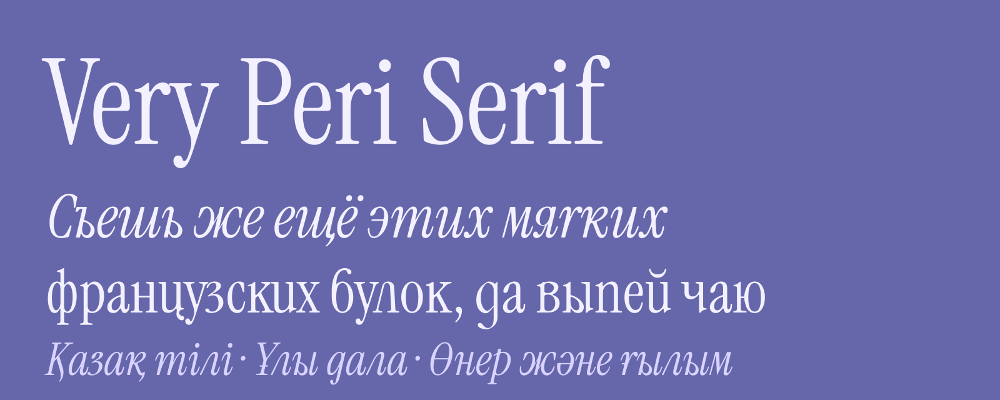

# Very Peri Serif

**[СКАЧАТЬ / DOWNLOAD — Very Peri Serif: Regular + Italic](dist/VeryPeriSerif-latest.zip)**

Current release: **1.113**. This link always points to the current packaged family.
The single working/default branch is `claude/upbeat-faraday-mzabid`.
[Repository and archive guide](docs/repository.md).

[Italic Cyrillic «л» — compare and download variants](docs/italic-el-arch-2.md):
**El Arch 2** combines the arch with the original exit; **El Arch 1** has a flat foot.
Both are separately installable design variants.

> A Cyrillic extension of [Instrument Serif](https://github.com/Instrument/instrument-serif): Russian and Kazakh, in the Regular and the Italic.



Very Peri Serif keeps the Latin of Instrument Serif exactly as it is and adds the Cyrillic it lacks. The new letters
are built from the parts of Instrument Serif's own glyphs (its stems, serifs, bowls, terminals and tails) by measured
rules, so that the Cyrillic has the same condensed proportions, contrast and display character as the Latin. Like the
original, it is made for large sizes.

[Русская версия](README.ru.md)

## Download

| | |
|---|---|
| [`dist/VeryPeriSerif-1.113.zip`](dist/VeryPeriSerif-1.113.zip) | everything below with the licence, in one archive |
| [`fonts/ttf`](fonts/ttf) | TrueType, for desktop apps (Windows, macOS, Linux, Figma, Adobe, Office) |
| [`fonts/otf`](fonts/otf) | OpenType CFF, the same design with cubic outlines (install TTF or OTF, not both) |
| [`fonts/webfonts`](fonts/webfonts) | WOFF2 and [`very-peri-serif.css`](fonts/webfonts/very-peri-serif.css) for websites |
| [`docs/specimen`](docs/specimen) | specimen PDF |

Regular and Italic share frozen release **1.113** (Italic I037). Lossless cleanup removes
57 stored points from 38 glyphs, with identical paths, metrics, hinting and shaping.
Author metadata: **Yerbolat Rakhatuly (DEW)**; upstream Instrument/Cormorant credits and OFL retained.
[Release checks and limitations](docs/final-1.113.md).

[Renamed installation copy of 1.113](dist/VeryPeriSerif-T1113.zip): two TTFs under
the distinct family **Very Peri Serif T1113**, for installation alongside the main family.

[Contour roughness review is ongoing](docs/final-1.113.md): new detectors,
a complete outline atlas and a candidate queue inspect the current release.
These diagnostics do not yet constitute completed optical acceptance.
The family includes complete Cyrillic stress-mark anchors,
full case-order and mixed-partner Italic kerning, opt-in tabular figures, and a revised narrower Italic ж.
The rounded Regular д retains its bowl with a quieter lower loop. [Acceptance and limits](docs/premium-acceptance.md).

## Language support

Latin: the 86 languages of Instrument Serif. Cyrillic: **Russian** and **Kazakh**. The alphabets of Bulgarian, Kyrgyz
and Mongolian are covered too (checked letter by letter); Belarusian, Ukrainian, Serbian, Tatar and Uzbek are not yet.

## OpenType features

| Feature | Regular | Italic |
|---|---|---|
| `kern` | Cyrillic kerning, every Cyrillic and mixed pair checked in HarfBuzz | Cyrillic kerning, tails below the line kept clear |
| `calt` | п, к, қ, н change their foot by the next letter | — |
| `ss01` | а с е ё from the native ss01 set of a c e ë | the same, from the native Italic set |
| `ss02`–`ss06` | — | д with an ascender, printed т, printed г, к and ж with an ascender, э from the native c |
| `ss07` `ss08` `ss09` | printed д, alternate т, previous tail style | — |
| `tnum` | tabular lining figures; proportional by default | the same |
| `locl` | — | Serbian and Macedonian forms of б г д п т |
| `aalt` `ccmp` `liga` `dlig` `case` `ordn` `mark` `mkmk` | native Instrument Serif features | native Instrument Serif features |

## Building

```sh
python -m pip install -r requirements.txt -r requirements-quality.txt
make
```

`make` builds both styles from the sources (`data/`, `tools/`, `font/`) and publishes `fonts/`, the reports in
[`docs/qa`](docs/qa) and the archive in `dist/`. Steps and checks: [font/README.md](font/README.md).

## Changelog

- 25.10.2026: frozen family 1.113, exact redundant-point cleanup and full author metadata.

- 25.10.2026: family 1.112, remove the transverse donor seam in Italic ч.
- 25.10.2026: family 1.111, first repair batch for the pointed Italic ц/щ/ң tail joins.
- 22.10.2026: family 1.110, wider default Italic г/ғ with unchanged stem weight.
- 21.10.2026: family 1.109, Regular я crown and Italic я stem/terminal corrections.
- 21.10.2026: family 1.108, complete glyph curve audit and reviewed corrections in both styles.
- 21.10.2026: family 1.107, the complete right-foot edge of Regular я redrawn as one convex curve.
- 21.10.2026: family 1.106, remaining kink removed from the inner edge of the right foot of Regular я.
- 21.10.2026: family 1.105, both leg-to-bowl shoulders of Regular я smoothed without changing its metrics.
- 21.10.2026: family 1.104, both donor seams of italic я smoothed without changing its metrics.
- 21.10.2026: family 1.103, italic я lower bowl strengthened from 9 to 15 units without changing its advance.
- 21.10.2026: family 1.102, consistent italic г/ғ, restored round bottom of д, rebuilt kerning and regression proofs.
- 21.10.2026: family 1.101, default italic г from the native Serbian body without the macron; locl and ss04 retained.

- 20.10.2026: family 1.100, stress marks, native hinted homoglyphs, tabular figures, broader Italic kerning, optical review and immutable archives.

- 20.10.2026: one release archive, OTF and web fonts next to TTF; licence and authors files checked.
- 19.10.2026: Regular 1.016, straight edges and fairing; Regular and Italic linked as one family.
- 17–20.10.2026: Italic test builds I001–I026.
- 17.10.2026: Regular 1.000, first release; 1.001–1.015 spacing, kerning and outline polish.

Every decision is recorded in [CLAUDE.md](CLAUDE.md); older notes in [docs/history.md](docs/history.md).

## Acknowledgements

Instrument Serif was designed by [Rodrigo Fuenzalida](https://rfuenzalida.com) with direction from
[Jordan Egstad](https://egstad.com), [JD Hooge](http://jdhooge.com/) and [Jack De Caluwé](https://jackdecaluwe.com/) on
behalf of [Instrument](https://instrument.com). The Cyrillic extension is by [Yerbolat Rakhatuly (DEW)](https://github.com/rahatulyerbolat05-dotcom).
The Cyrillic de of the Regular is a modified outline of [Cormorant Garamond](https://github.com/CatharsisFonts/Cormorant)
by the Cormorant Project Authors. Very Peri Serif is not made or endorsed by Instrument.

## AI disclosure

The Cyrillic outlines, spacing and kerning were made with the assistance of AI systems (Anthropic Claude, OpenAI Codex)
under the direction of the author, who wrote the brief, selected and corrected designs, and drew some of them.
Release 1.100 was independently checked by the assistant at the author’s request; platform limits are recorded in the acceptance report. The Latin
is Instrument Serif, unchanged. Details: [FONTLOG.txt](FONTLOG.txt), [font/ai-disclosure.json](font/ai-disclosure.json).

## License

This Font Software is licensed under the SIL Open Font License, Version 1.1 ([OFL.txt](OFL.txt)). This license is
available with a FAQ at: https://openfontlicense.org

## Reusable Cyrillic-extension workflow

The methods, successful techniques and failure controls are saved as the
[Claude Code / Codex skill](skills/ofl-cyrillic-extension/README.md), with a
[standalone instruction](docs/cyrillic-extension-playbook.md) and
[portable installation ZIP](dist/skills/ofl-cyrillic-extension-1.0.0.zip).
It derives a new font model from each input instead of copying Very Peri geometry.
