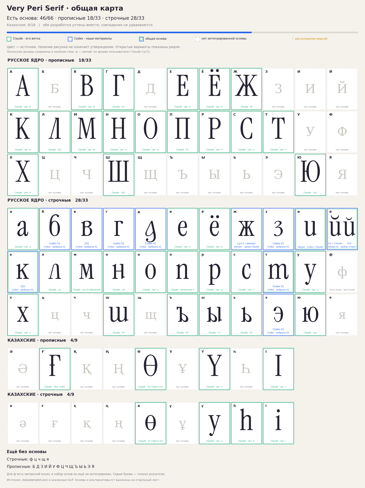
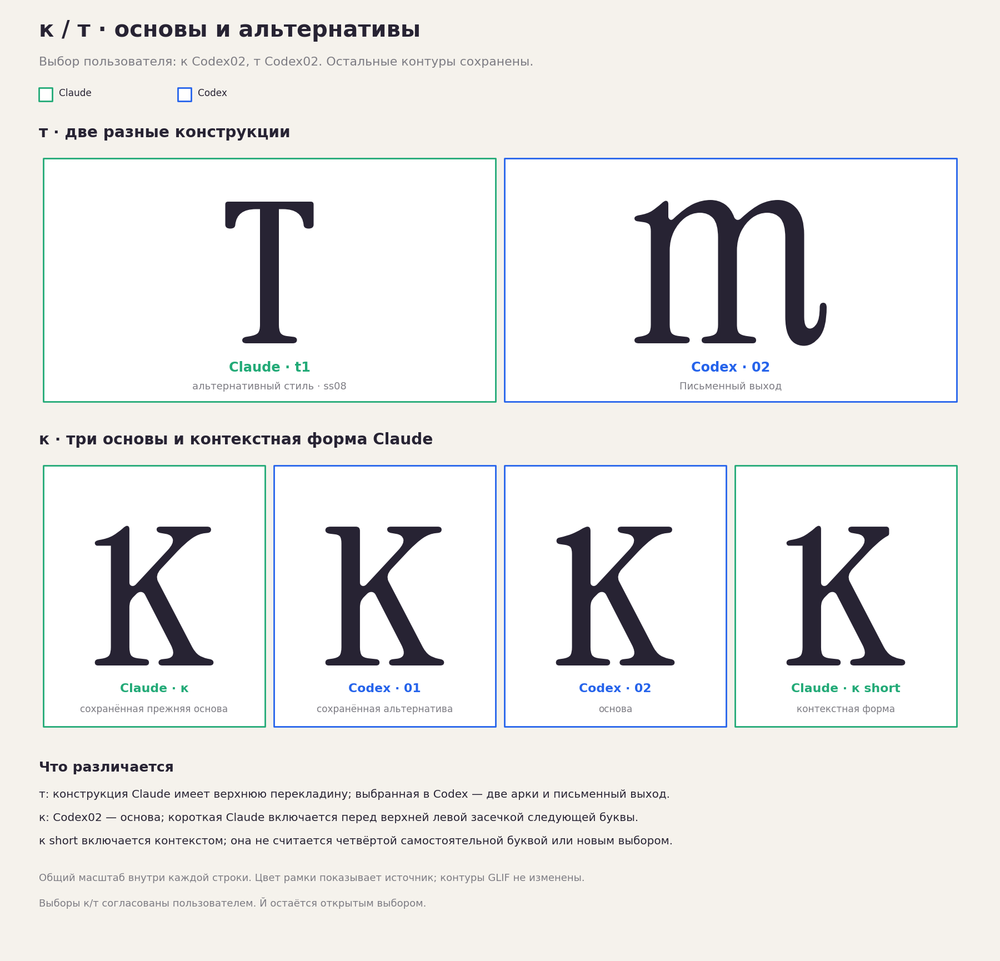

# Общая карта алфавита: Codex и Claude

**[РЕШЕНИЕ · 15.10.2026]** По просьбе пользователя карта
[alphabet_status.png](img/alphabet_status.png) объединяет материалы обеих
веток. Обводка синяя у материалов Codex, зелёная у Claude. Совпадающие
основы и разные версии отмечаются отдельно. Изображение и его SVG-версия
явно разрешены пользователем для сохранения в этой ветке.



**[ИЗМЕРЕНО]** Представлены рисунки46 из66 русских букв:18 прописных,
28 строчных. Казахские:8 из18. Это наличие контуров для просмотра;
выбор основной формы, доводка, интервалы и сборка полного шрифта могут
оставаться открытыми.

Из строчных ещё не интегрированы **ф ц ч щ я**. У ф сохранён
[авторский SVG](img/author_ef_vector.svg), но он пока не назначен готовой
основой; на карте это отмечено. Прописные без интегрированной основы:
**Б Д З И Й У Ф Ц Ч Щ Ъ Ы Ь Э Я**.
Казахские без основы: **Ә Қ Ң Ұ Һ / ә ғ қ ң ұ**.

## Два расхождения для выбора

**[ОТКРЫТО]** Пользователь просил показать конфликтующие записи и выбрать
форму самостоятельно. Поэтому данные `done` из Claude не заменены
вариантами Codex. На карте видны оба источника.



| Буква | Ветка Codex | Ветка Claude | Состояние общей карты |
|---|---|---|---|
| т |02 «Письменный выход», m-образная; выбрана пользователем в этой беседе |t1, Т-образная; в документах этой ветки записана выбранной |Два разных записанных выбора; требуется выбор пользователя для объединения |
| к |01 «Головка u»,02 «Головка k»; обе понравились, основная не выбрана |Основная к с головкой ı и отдельная короткая контекстная форма |Три основные версии показаны рядом; короткая к подписана как контекстная, а не четвёртый кандидат |

**[ИЗМЕРЕНО]** И совпадает в обеих ветках: родная u, advance454.
Клодова й совпадает с нашей01: родная ŭ; компактная кратка02 остаётся
другим вариантом в Codex. а/е/ё/о/р/с/у/х в строчном наборе используют
те же латинские контуры. Строчная ж из Cyr11 и прописная Ж этой ветки
не конфликтуют: у них разный регистр. Исходный автор строчной ж —
совместные наработки пользователя с Claude; Codex сохранил и интегрировал её.

**[РЕШЕНИЕ]** Новая э02 «Капля a — ниже» выбрана пользователем: «оставь 02».
Э01 сохранена в исходной ветке отдельной альтернативой. В пока имеет два
невыбранных варианта; на карте показаны оба. Ж, г, д, т и другие ранее
выбранные контуры не перерисовывались ради карты.

## Источники и воспроизведение

**[ИЗМЕРЕНО]** Карта Claude с добавленными Ғ/Ө/ө: commit
`d2cd2ee856a85d99aa4880b8f44b126ee49a1eca`. Контуры Codex импортированы из
сохранённых TTF в [data/codex/manifest.json](../data/codex/manifest.json):
там пути, исходный commit, SHA-256 и метрики каждого глифа.
Точный roundtrip GLIF проверяется по каноническим сегментам и ширине.
Отражение, масштабирование и упрощение контуров при импорте не применяются.

Карта читает `data/alphabet.json`: `done` — существующие основы Claude,
`codex` — отдельные импортированные варианты и статусы. Это слой для
просмотра и выбора; конфликтующие основы не назначаются автоматически
для классов `calt` или производственной сборки. После выбора потребуется
согласовать `built_bases` и пересчитать контекстные классы по их критериям.

```bash
python3 -m pip install fonttools matplotlib
python3 tools/import_codex_alphabet.py /path/to/Very-Peri-serif-codex
python3 tools/alphabet_sheet.py
```

Второй запуск не требует отдельной копии Codex: сохранённых GLIF достаточно.
Контуры рисуются напрямую через fontTools и matplotlib без промежуточной
сборки шрифта. PNG и SVG показывают одни и те же векторные пути.
Лицензия импортированных проб: [SIL OFL1.1](../data/codex/OFL.txt).

`[РЕШЕНИЕ · 15.10.2026]` В — Codex01 «Структурная»; к — Codex02 «Наклонная головка k»; т — Codex02 «Письменный выход». Короткая к Claude (`data/ka/ka_short.glif`) — автоматическая контекстная форма: к стоит СЛЕВА от следующего глифа с верхней левой головной засечкой на x-height. Реализация — `calt`, не склеивание букв. Т Claude (`data/te/t1.glif`) — стилистическая альтернатива `ss08`. Прежние варианты сохранены; й пока не выбрана. Это решение выше старых записей о конфликте к/т.

Текущий выбор: **в C01, к Codex02, т Codex02**. Короткая к Claude — `calt` перед верхней левой головной засечкой следующего глифа; т Claude — `ss08`. Расхождения к/т разрешены. [Пробные шрифты и проверки](https://github.com/rahatulyerbolat05-dotcom/Very-Peri-serif/tree/codex/cyrillic-studies/studies/regular/context-selected).

`[ИСПРАВЛЕНИЕ · 16.10.2026]` По изображению пользователя основная к — **Codex02, наклонная головка k**. Предыдущая запись Codex01 была ошибкой идентификации. Codex01 сохранена альтернативой; короткая Claude остаётся контекстной.
