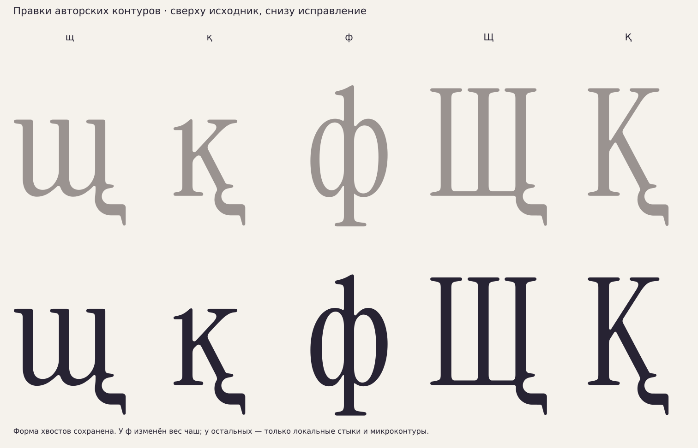

# Исправления авторских кривых · 16 октября 2026

[РЕШЕНИЕ] Пользователь попросил исправить все технические замечания
предыдущего аудита. Изменены щ, қ (основная, запасная, контекстная), ф,
Щ и Қ. Исправления находятся в `data/author-curve-fixes/`; исходные
SVG/GLIF сохранены без изменения. В карте авторские буквы остаются
фиолетовыми; поле `original_glif` указывает сохранённый исходник.



## Выполнено

- [ИЗМЕРЕНО] У щ удалён микроконтур0,063 единицы². У всех трёх форм қ
  удалены мелкие петли и наложения площадью менее1 единицы² каждая.
  Теперь у каждой из этих четырёх форм по одному простому контуру.
- [ИЗМЕРЕНО] У щ/қ/Щ/Қ обнаружен также возвратный участок SVG-экспорта
  высотой около0,025 единицы на внутренней горизонтали хвоста.
  Вырожденный обход заменён прямым соединением его соседних участков.
- [ИЗМЕРЕНО] Выбраны и выровнены касательные у нижних стыков Щ и хвостов
  щ/қ/Қ. Длины управляющих ручек сохранены; сдвинуты только нужные ручки.
  Глобальное сглаживание, изменение силуэта хвоста и масштаба не применялись.
- [ИЗМЕРЕНО] У ф на y250 обе внешние боковые стенки чаш теперь76
  (было около60,6–60,8). Внешняя граница чаш и центральная стойка68 сохранены;
  уменьшены внутренние контрформы по горизонтали. Высота глифа не менялась.
- [РЕШЕНИЕ] Острый внутренний стык ф возле(307,15) заменён локальным
  скруглением с подрезкой8 единиц. Вход и выход касаются соседних сегментов.
  У верхнего соединения возле(312,466) выровнены касательные.
- [ИЗМЕРЕНО] Все10 активных фиолетовых основных форм зарегистрированы в
  `built_bases`. Оба геометрических класса пересчитаны непосредственно по
  текущим GLIF. Ранее проверка пропускала8 авторских букв.

## Проверки

[ИЗМЕРЕНО] Повторный аудит всех12 активных авторских GLIF (включая две
дополнительные формы қ), проверка конечных координат, Unicode основных
форм, замкнутости, SHA256, числа контуров и семплированных колец прошли.
У исправленных щ/қ нет дополнительных микро-колец. У ф три контура
(внешний и две контрформы); толщина стойки сохранена68.

[ИЗМЕРЕНО] Все12 вариантов скомпилированы в пробный TTF с допуском
кубических→квадратичных кривых0,1. Проверены перечитывание TTF, ширины,
число контуров и геометрические границы с допуском1. Проверена растровая
отрисовка в150/100/24/12px. Оба раздела `check_context_classes.py` проходят.
Это проверка контуров и критериев классов, а не готовой производственной
подстановки calt: отдельная проверка набранных пар при сборке остаётся нужна.

[НАБЛЮДЕНИЕ] Оставшиеся красные кандидаты аудита на головных засечках
қ и ф — намеренные типографические углы. Они не сглаживались по одному
лишь превышению диагностического порога5°. Крупных семплированных
самопересечений в проверенных исправленных контурах не найдено.

[ОТКРЫТО] Согласование точных уровней авторских хвостов (около−199…−201),
финальные интервалы, кернинг и производственная проверка OpenType.
Формы авторских хвостов не менялись ради приведения к другому уровню.

## Воспроизведение

```sh
XDG_CACHE_HOME=/workspace/.cache MPLCONFIGDIR=/workspace/.cache/matplotlib \
  /workspace/very-peri-venv/bin/python -I tools/fix_author_curves.py
/workspace/very-peri-venv/bin/python -I tools/check_context_classes.py
XDG_CACHE_HOME=/workspace/.cache MPLCONFIGDIR=/workspace/.cache/matplotlib \
  /workspace/very-peri-venv/bin/python -I tools/audit_author_glyphs.py
XDG_CACHE_HOME=/workspace/.cache MPLCONFIGDIR=/workspace/.cache/matplotlib \
  /workspace/very-peri-venv/bin/python -I tools/alphabet_sheet.py
```

Генератор всегда начинает с сохранённого исходника, а не применяет
исправления повторно к уже изменённым кривым. Операции для каждого
варианта записаны в `data/author-curve-fixes/manifest.json`.
Сырые результаты повторного аудита — `build/purple-audit/audit.json`,
пробный TTF/PNG — `build/author-curve-fixes/` (игнорируются Git).
