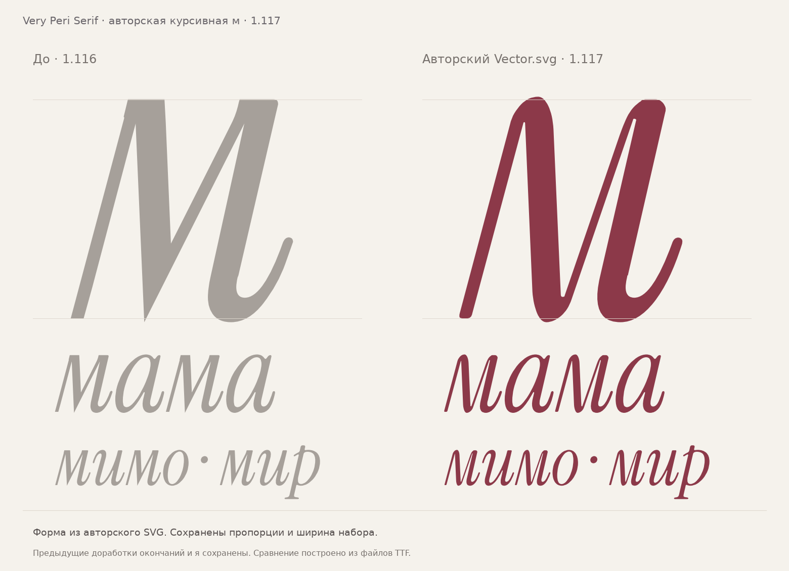

# Авторская курсивная «м» — 1.117 / I041

Выпуск от **11.11.2026** встраивает исправленный `Vector.svg`, который автор
прислал для строчной курсивной **м**. Форма перенесена без художественной
переработки. Отозванный файл `м.svg` и предыдущие машинные варианты не используются.

[Скачать семейство 1.117](../dist/VeryPeriSerif-1.117.zip) ·
[Копия T1117 для параллельной установки](../dist/VeryPeriSerif-T1117.zip) ·
[PDF сравнения и слов](specimen/VeryPeriSerif-Author-Em-1.117.pdf)



## Что изменено

Единственный изменённый рисунок — `uni043C` в Italic. Ширина знакоместа остаётся
**523**; левое поле TTF равно **−9** и получено из границы нового контура.
Остальные глифы, их хинтинг и метрики, кернинг, привязки знаков и OpenType-таблицы
сохранены из 1.116. Сохранены округлённые верхние окончания одиннадцати букв,
новое ушко я и основная арочная л. Рисунок Regular не меняется; оба начертания
получают номер семейства 1.117.

## Исходник и перенос

Оригинал: [`data/italic-author-em/Vector.svg`](../data/italic-author-em/Vector.svg).
SHA256: `14bcccb7ea410050586e6ddc39e57e085717d28c162fa8a8a639d4a91f48c6c8`.

Преобразование из координат SVG в единицы шрифта:

```text
x = (svg_x − 42.77) / 5.3
y = 516 − svg_y / 5.3
```

Масштаб одинаков по обеим осям; отражение Y переводит экранные координаты в
шрифтовые. Сохранённые автором опорные точки хвоста совмещаются с прежними
координатами: например, (1733.47, 2226) → (319, 96),
(1987.87, 2782.5) → (367, −9), (2157.47, 2480.4) → (399, 48).

Редактируемые контуры: [кубический GLIF](../data/italic-author-em/uni043C.cubic.glif)
и [квадратичный GLIF](../data/italic-author-em/uni043C.glif).
Они генерируются из оригинального SVG:

- OTF/CFF хранит исходные преобразованные кубические кривые с точностью 16.16.
- TTF/WOFF2 используют Cu2Qu с допуском 0.1 единицы, обратным направлением
  контура и последующим переводом координат на целочисленную сетку TrueType.
- Дополнительного сглаживания, растяжения или ручной подправки точек нет.

Параметры и происхождение закреплены в
[`manifest.json`](../data/italic-author-em/manifest.json).

## Воспроизведение

`make family` запускает [`tools/author_em.py`](../tools/author_em.py).
Входная семья берётся из неизменяемого `dist/VeryPeriSerif-1.116.zip`:
SHA256 `ea93f22b17b3faf3e3531c3e8371d9b136144c82a4d1c77b1d519514ea3e8ef4`.
Затем применяется SVG и обновляется версия. Этот рецепт воспроизводит изменение
опубликованной семьи; старые генераторы остальных глифов не запускаются.
Архив 1.116 является обязательной входной зависимостью.

`make` продолжает независимые и общие проверки, создание образцов и упаковку.
Исторические генераторы остаются в репозитории; их прежние выпуски следует
воспроизводить из соответствующей версии кода. [Инструкция сборки](../font/README.md).

## Проверка реальных файлов

Независимый [`tools/check_author_em.py`](../tools/check_author_em.py) отдельно
разбирает SVG, проверяет его SHA и преобразование, затем сравнивает все шесть
файлов с опубликованной 1.116. Результат:
[`docs/qa/author-em.json`](qa/author-em.json).

| Проверка | Результат |
|---|---|
| Проверки источника, метаданных, области изменений и форматов | 6341 PASS, 0 FAIL |
| OTS | Все 6 файлов приняты |
| Шейпинг | 609 случаев на каждый из 6 файлов; совпадает с 1.116 |
| Соседи м | 465 видимых партнёров, 1858 сочетаний порядка и kern on/off; пересечений нет |
| Отклонение TTF/WOFF2 от исходного SVG | Не более 0.50975 единицы; предел проверки 1 единица |
| Максимальное отклонение координат кубических контролей CFF | 0.00000756 единицы |
| Контур м | Один замкнутый контур, без обнаруженных самопересечений |
| Остальные рисунки и раскладка | Совпадают с 1.116 в своём формате |

Отчёт содержит три информационные записи диагностики — по одной на каждый
курсивный формат. Исходный SVG имеет короткую ступеньку около 0.417 единицы
у стыка хвоста и микросегмент плеча около 0.290 единицы. Они принадлежат
авторскому рисунку и сохранены; диагностические кандидаты не объявляются
дефектами и не сглаживаются автоматически. Эти записи не являются ошибками
санитайзера или топологии.

Дополнительные общесемейные проверки: 4475 PASS, 0 FAIL. FontBakery Universal:
163 PASS, 2 WARN по ранее известным значениям числа контуров, 0 FAIL/ERROR.
Hyperglot подтверждает русский и казахский с проверкой шейпинга.

Эта целевая проверка подтверждает перенос авторского рисунка и сохранность
семейства. Она не закрывает прежнюю общую очередь оптического разбора.
Результаты общесемейных и браузерных проверок публикуются в отдельных отчётах
`docs/qa/`, привязанных к SHA256 соответствующих файлов.
