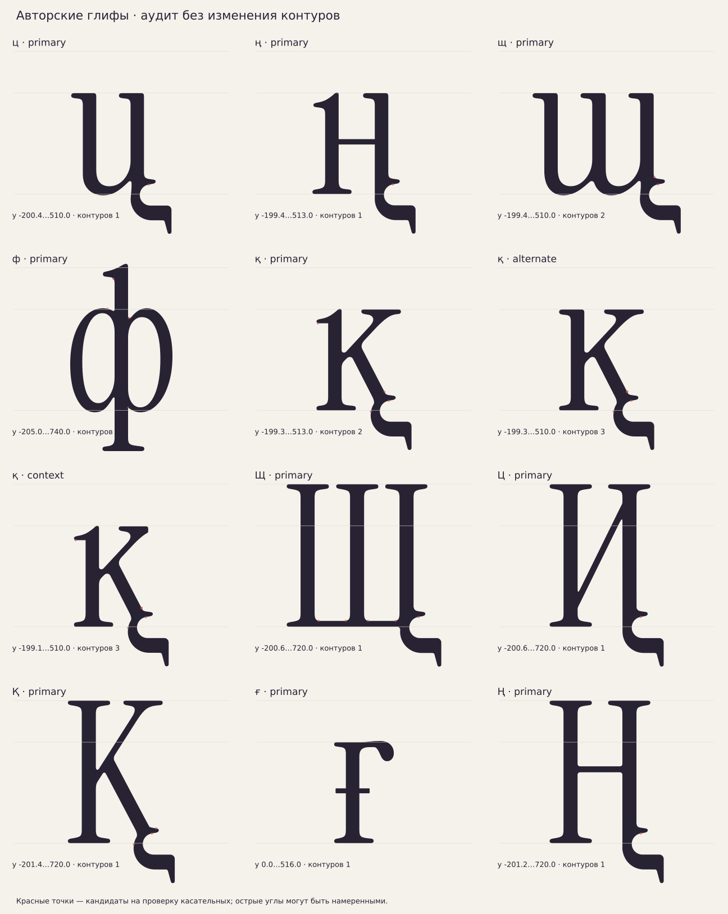
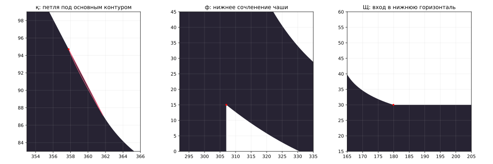

# Проверка фиолетовых авторских глифов · 16 октября 2026

Срез проверки — коммит3e59ef3, до следующей правки конструкции Ц/ү/ұ.
После аудита пользователь отклонил диагональную Ц: она сохранена
в архиве, а активная карта показывает исправленную вертикальную форму.
Историческое подтверждение Ц ниже больше не действует. Остальные
замечания аудита к авторским контурам этой правкой не устранены.

Проверены все10 букв, которые карта действительно окрашивает фиолетовым:
ц ң щ ф қ Щ Ц Қ ғ Ң. Вместе с alternate/context формами қ проверены12 GLIF.
Архивные У/Ұ зелёные и в эту проверку не входят. Авторские SVG и GLIF
не изменены; автоматическая очистка применялась только к диагностической копии.

## Найденные проблемы

### 1. Микроконтуры щ и қ

[ИЗМЕРЕНО] В щ есть дополнительный контур площадью0,063 единицы²,
границы x530,28…532,03, y48,31…49,94. Он исчезает после диагностической
нормализации заливки. Это отдельный мелкий фрагмент, а не полезная деталь
основного силуэта.

[ИЗМЕРЕНО] Во всех трёх формах қ есть мелкие наложенные контуры у входа
нижней ноги в хвост. В основной форме один фрагмент площадью0,834,
границы x357,79…361,74, y87,10…94,71. В alternate два фрагмента площадью
0,819/0,868; в context —0,764/0,866. У одного малого контура каждой формы
семплированное кольцо самопересекается; разворот касательной около174°.
Число контуров после нормализации: primary2→1, alternate3→1, context3→2.
В context после нормализации остаётся дополнительный контур — одного
слепого удаления наложений недостаточно, нужна локальная проверка.

[РЕШЕНИЕ] Кандидаты на техническую очистку с сохранением силуэта.
Малые фрагменты не удалены: исходный рисунок пользователя сохранён.

### 2. Толщина чаш ф

[ИЗМЕРЕНО] На середине чаш, y250, толщина левой наружной стенки
76,005−15,221=60,784, правой530,525−469,943=60,582.
Вертикальная центральная стойка68 соответствует n/p/d.

[ИЗМЕРЕНО] По `data/params.json` боковая стенка родной o76,
допуск в CLAUDE.md §3.1 —±4. Стенки чаш ф тоньше эталонной o примерно
на15,2–15,4, то есть выходят за этот допуск. Это расхождение с текущим
правилом, а не ошибка SVG-парсинга. Исправление требует решения о весе
чаш, а не равномерного увеличения всего глифа.

### 3. Изломы: требуют ручной оценки

[ИЗМЕРЕНО] В ф при x307,y15 угол между входящей и выходящей
касательными128,66°: острый внутренний вход чаши в стойку. В верхнем
сочленении x312,y466 —12,53°.

[ИЗМЕРЕНО] У Щ на y30 четыре входа кривых в нижнюю горизонталь
имеют смену касательной17,21–17,57°. У щ на x629,486,y85,628 —15,62°.
Это локальные скачки направления; на увеличении они видны.

[ОТКРЫТО] Сам по себе угол не доказывает ошибку: острые стыки могут
быть намеренными. Порог5° в диагностике нужен для поиска мест, а не
является правилом шрифта. Нельзя сглаживать все красные точки подряд.

### 4. Контекстные проверки пропускали8 букв

[ИЗМЕРЕНО] Только ғ и Ң зарегистрированы в `built_bases` как текущие
фиолетовые основы. Восемь остальных — ц ң щ ф қ Щ Ц Қ — не зарегистрированы.
Поэтому успешный обычный `check_context_classes.py` не проверял их формы.
Аудит отдельно применил его геометрические критерии непосредственно к GLIF.

| Буква | `@serif_bl`: записано → геометрия | `@head_tl`: записано → геометрия |
|---|---|---|
| ц | да → нет | да → да |
| ң | нет → да | нет → да |
| щ | нет → нет | да → да |
| ф | нет → нет | нет → нет |
| қ | нет → да | нет → да |
| Щ | нет → да | не применяется |
| Ц | да → да | не применяется |
| Қ | нет → да | не применяется |
| ғ | да → да | да → да |
| Ң | да → да | не применяется |

[РЕШЕНИЕ] Перед сборкой нужно синхронизировать основы и классы.
В рамках проверки таблицы не переписаны: это изменило бы поведение calt.
Окончательная проверка — реальная подстановка в набранных строках,
а не только геометрический критерий.

### 5. Метрики и согласованность хвостов

[ИЗМЕРЕНО] Нижние границы хвостов этой группы находятся около−199…−201,4.
Эталонные уровни−205 для прямого и−215 для крюка не достигнуты.
У ң и основной қ верх513 вместо плоского510; остальные соответствуют
своим зарегистрированным высотам. Все глифы укладываются в метрики990/−310.

[ОТКРЫТО] Это требует согласования высоты хвостов и верхних флажков;
не объявляется автоматической ошибкой, поскольку решения о хвостах
в проекте остаются открытыми, а формы импортированы из авторских рисунков.

## Что прошло проверку

[ИЗМЕРЕНО] Все12 GLIF читаются, содержат конечные координаты, замкнутые
контуры и положительную ширину. Все10 основных форм имеют правильные
Unicode. Alternate/context қ не имеют Unicode — это нормально для форм
подстановки. SHA256 всех12 файлов совпадают с реестром.
В основных крупных контурах семплированных самопересечений не найдено.
Семплирование не является математическим доказательством отсутствия
пересечений между всеми кривыми.

[ИЗМЕРЕНО] Толщины обычных стоек в ц/ң/щ/қ/ғ около68, в Щ/Ц/Қ/Ң около71,
в пределах заявленного допуска. Горизонтальную ширину диагональных
штрихов нельзя сравнивать с толщиной по нормали: такого ложного
сравнения аудит не использует.

[РЕШЕНИЕ] Диагональная авторская Ц ранее подтверждена пользователем.
Её силуэт не считается нарушением стандартной конструкции Ц.
У ғ явных геометрических дефектов и скачков касательных выше5° не найдено.
У Ң, ц, ң, Ц и Қ крупных геометрических дефектов эта проверка не выявила;
это не утверждение окончательной готовности интервалов и OpenType.

## Воспроизведение и иллюстрации

```sh
XDG_CACHE_HOME=/workspace/.cache MPLCONFIGDIR=/workspace/.cache/matplotlib \
  /workspace/very-peri-venv/bin/python -I tools/audit_author_glyphs.py
```

Результаты: `build/purple-audit/audit.json`, `overview.svg/png`, `details.svg/png`.
JSON содержит точные границы, площади, срезы и координаты кандидатов
для всех12 файлов. Срезы делаются полосой0,01 единицы; кольца для поиска
пересечений семплируются по64 точки на сегмент. Нормализация Skia
проверяет геометрию копии и не перезаписывает исходники.




