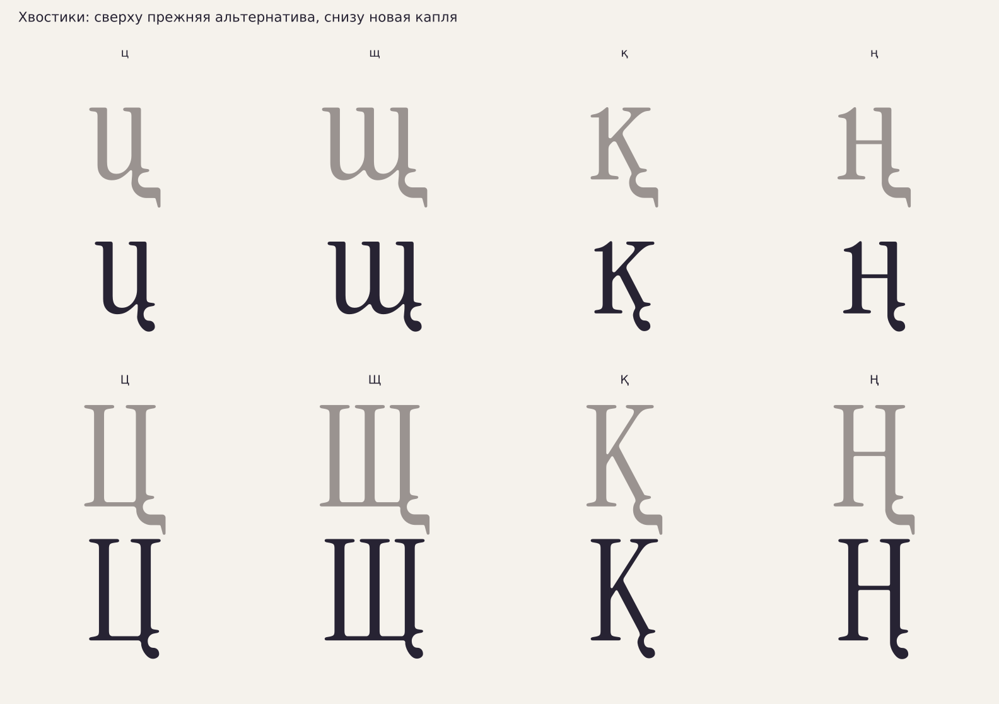

# Каплевидные хвостики и прежняя альтернатива

[РЕШЕНИЕ · 16.10.2026] Пользователь прислал изображение щ с коротким
округлым каплевидным окончанием и попросил сделать такой тип основным,
а нынешнюю форму сохранить как альтернативную.



Основной тип заменён у **ц щ қ ң Ц Щ Қ Ң**, включая запасную и контекстную
формы қ: всего10 новых контурных файлов. Новая капля продолжает авторский
вход в хвост; нижняя угловая горизонталь и направленный вниз носик
заменены округлой каплей. Подключение к корпусу сохранено.

[ИЗМЕРЕНО] Геометрическая XOR-разность выше базовой линии у всех10
контуров менее0,02 единицы² (порог численной проверки). Ширины глифов
сохранены, чтобы основной и альтернативный хвосты не меняли набор.
Новые соединения имеют согласованные касательные. Новых контрформ
и микроконтуров не добавлено; замкнутость и семплированные кольца проверены.

[РЕШЕНИЕ] Пропорции капли выбраны по изображению, а не объявляются
измерением латинского донора. Глубина нового хвоста около130 единиц,
нормированная на ширину существующей шейки; прежняя глубина около200
сохранена в альтернативе. Числа построения записаны в генераторе.

## Где находятся варианты

[ИЗМЕРЕНО] Пробный TTF включает22 авторских варианта:12 текущих и10
со старым хвостом. Проверены перечитывание, ширины, число контуров и
геометрические границы с допуском1 после кубических→квадратичных кривых
с допуском0,1. Основные формы отрисованы в150/100/24/12px. Оба
контекстных критерия проходят. Проба не назначает stylistic set.

- `data/drop-tail-variants/` — новые основные GLIF и manifest.
- `data/alphabet.json`, `user[буква].variants` — текущие каплевидные формы.
- `user[буква].tail_alternatives` — прежние формы со старыми хвостами,
  с сохранёнными путями, ширинами, ролями и SHA256.
- `tail_styles` — общий выбор `drop` и альтернатива `previous`.

[ИЗМЕРЕНО] Старые GLIF не перезаписаны. Для қ сохранены альтернативные
хвосты отдельно для primary, alternate и context — выбор хвоста не
стирает существующие варианты корпуса и контекстную форму.

[ОТКРЫТО] Это зарегистрированные контурные альтернативы. Номер OpenType
stylistic set ещё не назначен; переключение через ssXX в релизном шрифте
должно быть добавлено при производственной сборке. Здесь не заявлена
готовая OpenType-подстановка. Финальный кернинг и интервалы открыты.

## Воспроизведение

```sh
XDG_CACHE_HOME=/workspace/.cache MPLCONFIGDIR=/workspace/.cache/matplotlib \
  /workspace/very-peri-venv/bin/python -I tools/drop_tail_variants.py
/workspace/very-peri-venv/bin/python -I tools/check_context_classes.py
XDG_CACHE_HOME=/workspace/.cache MPLCONFIGDIR=/workspace/.cache/matplotlib \
  /workspace/very-peri-venv/bin/python -I tools/alphabet_sheet.py
```

Генератор начинает с сохранённых `tail_alternatives`, поэтому повторный
запуск не переделывает уже готовую каплю ещё раз. Карта показывает новые
основные формы. Прежние технические исправления чаш ф и корпусов букв
не отменяются.
