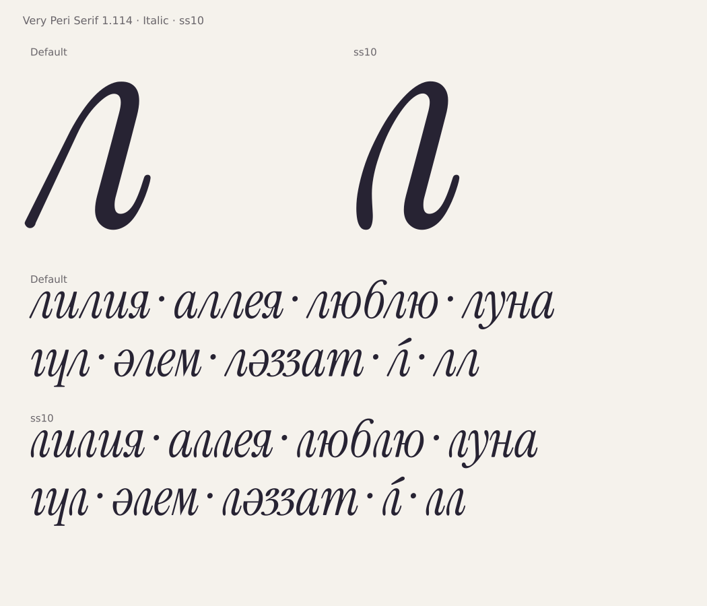

# Very Peri Serif 1.114: альтернативная курсивная л

**Обновление 1.115:** арочная л теперь основная, а ss10 возвращает прежнюю
диагональную форму. [Актуальный выпуск и инструкция](el-default-1.115.md).
Ниже сохранено описание версии 1.114.

Принятый автором гибрид **El Arch 2** встроен в основной Italic.
Для него используется стилистический набор **ss10**:
**«л: округлая арка и хвост» / “Cyrillic el: rounded arch and exit”**.
Буква также доступна через OpenType `aalt` в меню альтернативных глифов.
Обычная л остаётся по умолчанию.



**[Скачать актуальный комплект Regular + Italic](../dist/VeryPeriSerif-latest.zip)** ·
[Зафиксированная 1.114](../dist/VeryPeriSerif-1.114.zip) ·
[PDF с альтернативой](specimen/VeryPeriSerif-El-Alternate-1.114.pdf)

## Как включить

Установить оба TTF из комплекта; выбрать **Very Peri Serif**, **Italic**.
В OpenType-настройках программы включить **стилистический набор 10 / ss10**.
Дополнительное семейство El Arch для этого больше не требуется.

Для сайта:

```css
.arched-el {
  font-family: "Very Peri Serif", serif;
  font-style: italic;
  font-feature-settings: "ss10" 1;
}
```

Набор меняет только строчную кириллическую **л**. Прописная Л, латинские буквы
и Regular сохраняют обычное поведение. Другие стилистические наборы можно
включать одновременно; локализованные формы SRB/MKD продолжают работать.

## Исходник и сборка

Имя глифа — `uni043B.ss10`, без отдельной кодовой точки Unicode.
Он берётся из принятого [GLIF](../data/italic-el-arch-2/uni043B.glif) с 56 точками,
шириной 392 и левым полем 10. Контур не сглаживается и не аппроксимируется заново.
Свои якоря ударения/нижних знаков и пары устанавливаются после сборки прежнего
шрифта. У обычной л контур, поля и пары сохраняются.

[Настройки OpenType](../data/italic-el-arch-2/opentype.json) ·
[Встраивание](../tools/italic_el_alternate.py) ·
[Независимая проверка](../tools/check_italic_el_alternate.py)

```sh
make
```

При сборке сначала сохраняются прежние 491 глиф Italic, затем добавляется
единственный не закодированный глиф. Новые lookup добавляются к существующим;
прежние lookup, имена наборов и нумерация старых глифов сохраняются.
Исторические проверки контуров используют обратимое представление базовых
глифов без нового добавления. Оно не копирует таблицы эталона: отдельная
проверка требует его точного совпадения с реальными таблицами версии 1.113.

## Проверки выпуска

Независимая проверка ss10: **4353 PASS, 0 FAIL** во всех шести
файлах семейства; **929 пар** нового глифа. Проверка базового замороженного
рисунка: **1271 PASS**. FontBakery Universal: **163 PASS, 2 WARN, 71 SKIP,
0 FAIL**; сетевые проверки пропущены. Русский/казахский Hyperglot — PASS
в обоих начертаниях.

Что проверено:

- Реальные подстановки HarfBuzz: ss10 и aalt, ru/kk/sr/mk, все 64 сочетания ss01–ss06.
- Совпадение TTF/WOFF2 с принятым GLIF; экспорт CFF с контролем управляющих и замыкания.
- Все прежние контуры, hints, метрики и поведение по умолчанию в обоих начертаниях.
- Все видимые партнёры нового глифа, включая не закодированные альтернативы:
  настоящий кернинг HarfBuzz и векторные пересечения.
- Ударения, OpenType Sanitizer, FontBakery Universal, покрытие русского и казахского.

Отчёт: [el-alternate-1.114.json](qa/el-alternate-1.114.json).
Кандидаты скачков кривизны сохранены для просмотра. Это выпуск альтернативы,
а не объявление всей прежней художественной очереди закрытой. Нативные приложения
и физическая печать отдельно не проверялись. Встроенное имя автора
**Yerbolat Rakhatuly (DEW)**, уведомления Instrument/Cormorant и OFL сохранены.
