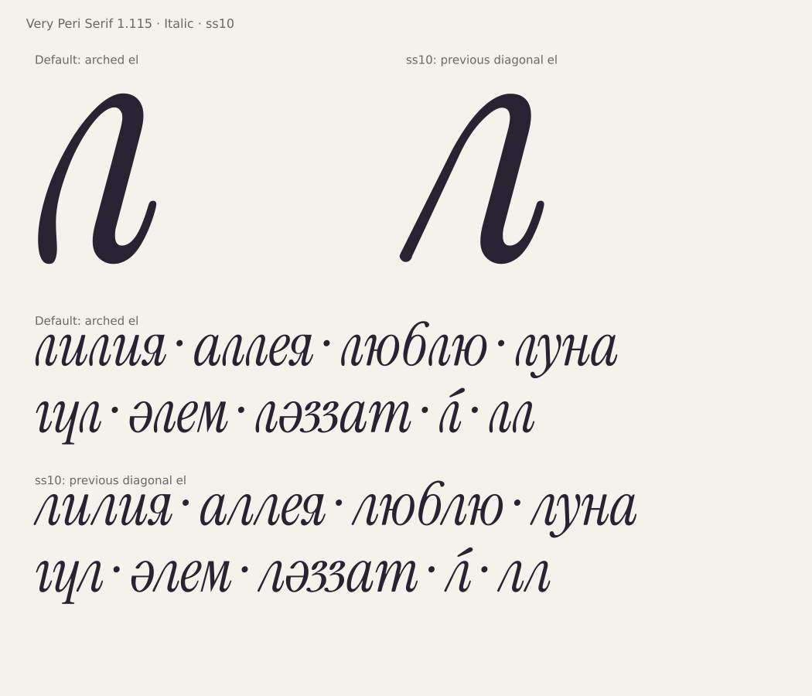

# Very Peri Serif 1.115: новая л — основная

По решению Yerbolat Rakhatuly (DEW), **арочная строчная л с выходным хвостом
теперь используется по умолчанию в Italic**. Включать стилистические наборы
для неё не требуется. Regular сохраняет прежнее написание.

**[Скачать актуальный комплект](../dist/VeryPeriSerif-latest.zip)** ·
[Зафиксированная версия 1.115](../dist/VeryPeriSerif-1.115.zip) ·
[PDF со словами и ударениями](specimen/VeryPeriSerif-El-Alternate-1.115.pdf)

Установите оба TTF из архива и выберите **Very Peri Serif / Italic**.
Для прежней диагональной л включите **стилистический набор 10 (`ss10`)**
или выберите её в меню альтернатив `aalt`. Название набора:
**«л: прежняя диагональная форма»**.

## Что перенесено

У двух готовых рисунков переставлены контуры, ширины и поля, все классы/пары
кернинга и якоря знаков. Арочная форма сохраняет 56 точек, ширину 392 и левое
поле 10. Прежняя — ширину 443 и левое поле −20. Новая аппроксимация не выполнялась.

Код Unicode, порядок глифов и правило GSUB `uni043B → uni043B.ss10` сохраняются.
Основное имя `uni043B` теперь содержит арку, а `uni043B.ss10` — прежний рисунок.
Остальные глифы, метрики, native hints, локализации и лигатуры сохранены.
Все шесть шрифтов семейства получают общую версию **1.115 / Italic I039**.

## Проверки выпуска

**10508 PASS, 0 FAIL** — независимая проверка физических файлов
семейства; **1856 пар** с обеими формами л. Базовый замороженный
рисунок: **1271 PASS**. FontBakery Universal: **163 PASS, 2 WARN, 71 SKIP,
0 FAIL**. Русский/казахский Hyperglot — PASS в обоих начертаниях.
Сетевые проверки FontBakery пропущены.

Метод:

[Независимая проверка](../tools/check_el_default.py) сравнивает фактические
TTF/OTF/WOFF2 с 1.114, разрешая только обмен этими двумя рисунками.
Все CFF-программы должны совпадать со своими прежними рисунками точно.
Проверяются реальные результаты HarfBuzz в ru/kk/sr/mk, ударения, оба
написания и все 64 сочетания прежних стилистических наборов.

Каждая видимая пара с обеими л проверяется по прежнему кернингу, фактическому
HarfBuzz и векторным пересечениям. Обратная перестановка должна точно
восстановить таблицы 1.114; исторические проверки замороженного базового
рисунка продолжают работать через это обратимое представление.

[Отчёт](qa/el-default-1.115.json) ·
[Исходный GLIF арки](../data/italic-el-arch-2/uni043B.glif) ·
[Встраивание и обратимая перестановка](../tools/italic_el_alternate.py)

Это изменение основного написания одной буквы. Глобальная очередь
художественного аудита остаётся открытой. Презентация 1.114 сохранена как
отдельный исторический комплект той версии. Авторство, OFL и предыдущие архивы
сохранены. Сборка — `make` из корня репозитория.
