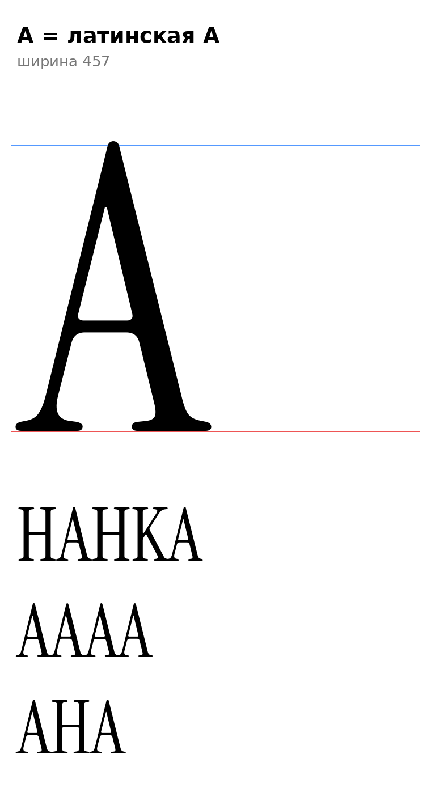

# А (U+0410, A-cy), заглавная

Статус на 15.10.2026: **А = латинская A оригинала без изменений** (омоглиф, правило проекта о двойниках, раздел 3.3 CLAUDE.md; старая разработка сделала так же). Нарисованного заново нет.

- Контур A: ширина 457, x −18…475, y 0…730, 2 контура. Поля как у A.
- Правило `serif_bl`: входит в класс (левая ножка с засечкой на −18, проверено).
- `[ОТКРЫТО]` Якоря top и bottom как у A (раздел 6), кернинг латинской группы A.

Файлы: `data/A/A.glif`, `.svg`.
