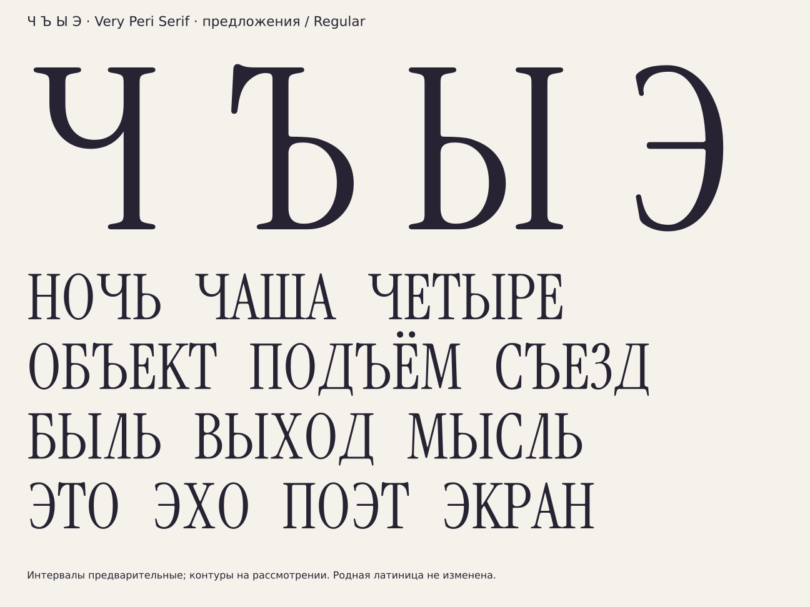

# Ч, Ъ, Ы, Э — прописные Regular

[РЕШЕНИЕ · 16.10.2026] По запросу пользователя построены четыре новых
предложения. Вариант 01 у каждой буквы; выбор пользователем ещё не сделан.
Строчные и ранее утверждённые контуры не изменены.



## Силуэт, ход и форма

| Буква | Силуэт и ход | Доноры и детали |
|---|---|---|
| Ч | Левая ветвь вниз, нижняя дуга вправо, правая стойка до базовой линии. Открытый верх чаши. | Чаша U поднята без масштаба; две верхние засечки I, правая стойка и ножка I (F2). |
| Ъ | Левое верхнее плечо вправо, стойка вниз, нижняя чаша вправо. | Существующая прописная Ь Codex01 из B/I, левая головная засечка заменена плечом T. Ножка F2. |
| Ы | Стойка и нижняя чаша Ь, затем отдельная правая стойка. | Прописная Ь Codex01 и I без масштаба; ножки F2, просвет между компонентами сохранён. |
| Э | Вход слева сверху, дуга вправо вниз, открытый выход слева; средняя горизонталь внутрь чаши. | Пропорции дуг C, новые верхнее и нижнее окончания, перекладина толщины H (капительная версия F7). Не готовое зеркало C. |

[ИЗМЕРЕНО] Плоская высота 720, круглая высота 730, нижний круглый
овершут −9, стойка H 71, перекладина H 30 с центром 373 — из
`data/params.json`. Кривые доноров используются без растяжения.

[РЕШЕНИЕ] У Ч круглое дно U поднято к нижней грани перекладины H (358).
У Ъ верх плеча сохраняет родной овершут T 735. У Ы расстояние между
чашей и ближайшей засечкой I составляет две толщины кончика ножки из
`params.json` (44). Эти композиционные решения и окончания Э — новые
предложения, а не измеренные характеристики существующей кириллицы.

## Проверки и файлы

[ИЗМЕРЕНО] Генератор проверяет точное восстановление контуров из записанных
GLIF булевой разностью в обоих направлениях и совпадение ширины/границ.
В `data/capitals-che-hard-yeru-e/manifest.json` записаны границы,
ширины, число контуров и SHA256. GLIF содержат описание хода и F-деталей.

[ИЗМЕРЕНО] В геометрическом классе `@serif_bl` находится Ы. Ч, Ъ и Э
не проходят критерий; у Ъ нижняя засечка смещена вправо относительно
начала верхнего плеча. Обе части `check_context_classes.py` проходят
для построенных контуров. Непостроенные члены классов остаются непроверенными.

Воспроизведение из корня репозитория:

```sh
/workspace/very-peri-venv/bin/python -I tools/sketch_missing_caps.py
/workspace/very-peri-venv/bin/python -I tools/check_context_classes.py
/workspace/very-peri-venv/bin/python -I tools/alphabet_sheet.py
```

Генератор создаёт GLIF/SVG, реестр предложений, векторный лист и пробный
TTF/PNG в игнорируемом `build/capitals-che-hard-yeru-e/`. В пробном TTF
другие прописные взяты из текущей карты для проверки слов; это не утверждает
их выбор. Латинские контуры сохранены, семейство пробы переименовано.

[ОТКРЫТО] Финальные интервалы и кернинг, утверждение четырёх форм,
полная производственная сборка и проверка OpenType. Проба TTF проверяет
отрисовку контуров, а не завершённость полного шрифта. Лицензия — SIL OFL 1.1,
эталон Instrument Serif, коммит 65c0ef2; авторы Rodrigo Fuenzalida и Jordan Egstad.
