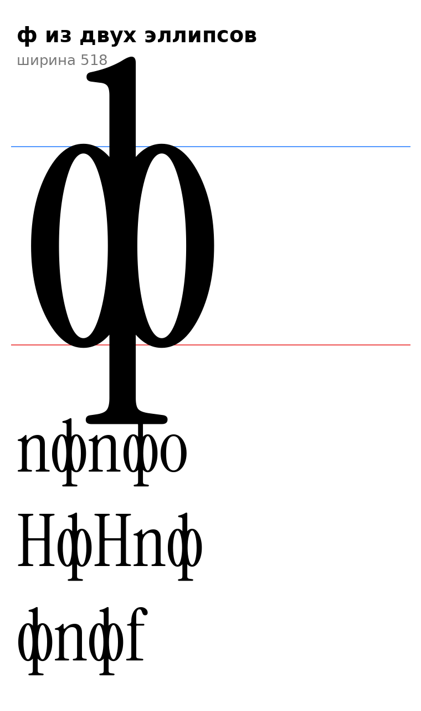

# ф (U+0444, ef-cy), строчная

Статус на 15.10.2026: **отклонена автором проекта** («эту парашу не бери»), в шрифт и в азбуку не идёт, эскиз для истории. Ниже: чем он отличался от старой разработки (по замеру).

Замер старой ф (только для сравнения, ничего не берётся): овал шире и легче: ширина 472 (x 36–508) против нашего 360 (овал о), стенки овала 52–63 против 76, стойка та же 68. Наш эскиз сделан из узкого о, поэтому стойка 68 перегружала овал.

## Конструкция

`ef_sign`: овал о оригинала без масштаба (516 / −9) и сквозная стойка 68 по оси овала (x=203): сверху выносной элемент l (740, флажок F1), снизу выносной элемент p (−205, опорная засечка F2, bowl p не берётся: срез ниже y=−20). Стойка проходит через контрформу овала.

- Высоты `[ИЗМЕРЕНО]`: верх 740 (как b, d, l), низ −205 (как p, q). Овал о без изменений, толщина боковой стенки 76, контраст 3:1.
- F-пункты: F1 (флажок l вверху), F2 (опорная засечка внизу, на −205), F5 нет.
- Ширина 406, поля 23 и 23, как у о.
- `[ОТКРЫТО]` В старой разработке есть варианты со стойкой только вверх или только вниз (ss07 up/dn): у нас не делались. Толщина стойки внутри овала 68 против волосной 25 на вершине о: проверить на строке, нужна ли тоньше. Кернинг.

## Файлы

`data/ef/ef.glif`, `.svg`; код: `tools/sketch_batch2.py`, `tools/glyphparts.py`.

## Новая постановка автора проекта: ф из двух эллипсов (15.10.2026, ждёт оценки)

Автор проекта: ф «должна состоять из двух эллипсов, а не из одного». Первый эскиз (один овал о со сквозной стойкой) отклонён.

`ef2_sign` (`tools/glyphparts.py`): два овала-кольца по обе стороны сквозной стойки; внутренние боковые стенки колец скрыты в стойке, виден «глаз» слева и справа.

| Параметр | Значение | Источник |
|---|---|---|
| Овал, высота | 516 / −9 | `[ИЗМЕРЕНО]` круглые строчные |
| Полуось каждого эллипса | 135 (ширина овала 270, наложение на стойку 68) | `[РЕШЕНИЕ]` общая ширина 472 как у старой ф (замер) |
| Боковая стенка | 72 | `[ИЗМЕРЕНО]` у о 76; 72 внутри допуска ±4 |
| Верх и низ колец | 25 | `[ИЗМЕРЕНО]` волосная у вершины о |
| Стойка | 68, сверху от l (740, флажок F1), снизу от p (−205, засечка F2) | `[ИЗМЕРЕНО]` |
| Ширина буквы | 518, поля 23 | `[РЕШЕНИЕ]` как у о |

- `[ОТКРЫТО]` Я понял «два эллипса» как два овала слева и справа от стойки. Если имелись в виду другие два эллипса (например овал внутри овала, или овал и наклонный овал), скажи. Ширина овалов, толщина стенок, нужна ли стойка выше и ниже одновременно.
- В азбуку и классы правил не добавлена до подтверждения (файлы `data/ef/ef2.glif`, `.svg`).
