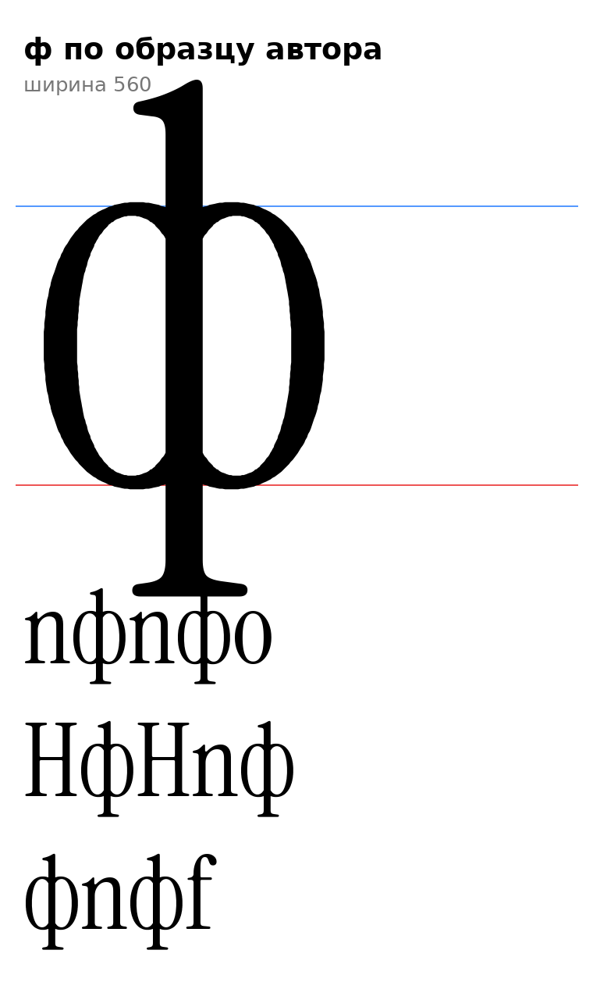

# ф (U+0444, ef-cy), строчная

Статус на 15.10.2026: **ф по образцу автора проекта** (`docs/img/author_ef_reference.svg`): два овала по обе стороны сквозной стойки. Контур нарисован заново из параметров, замеренных по образцу, и из деталей оригинала (l сверху, p снизу), образец не обводился.

История: первый эскиз (один овал о со сквозной стойкой) и второй (два эллипса, стенка 72) отклонены автором проекта: в них потерялись изгибы первоисточника (овалы образца не эллипсы).

## Замеры образца (`[ИЗМЕРЕНО]`, масштаб SVG 945/272 = 3,474 единицы на пиксель, высота 740 … −205)

| Параметр | Образец |
|---|---|
| Стойка | 68 (x 223–291, ось 257) |
| Боковая стенка овалов | 61 |
| Верх и низ колец | 25 |
| Высота овалов | 516 / −9 |
| Ширина буквы | 514,5 |
| Форма овалов | не эллипсы: верх плоский, доходит до стойки, контрформа «D» прижата прямым краем к стойке, плечи скошены |
| Ножка сверху | выносной элемент 740 с небольшим флажком слева |
| Ножка снизу | прямая стойка с плоской опорной засечкой на −205 (около 62 слева и 82 справа от стойки) |

## Наше построение (`ef3_sign`, `tools/glyphparts.py`)

Левый овал это левая половина суперэллипса (центр 170, левый край 0, n=2,2), срезанная осью стойки; контрформа аналогично (левый край 61, a=100, n=2,2, волосная 25); правый овал зеркало левого. Стойка 68; сверху от l (740, флажок F1), снизу от p (−205, опорная засечка F2). Параметры подобраны сеткой по минимуму площади расхождения овалов с образцом (остаток около 9%).

- Ширина 560, x 23–537, высота −205…740, три контура (внешний и две контрформы).
- `` образец и наша ф рядом и наложением (образец красный).
- `[НАБЛЮДЕНИЕ]` Отличия от образца: у образца плечи овалов скошены (овал ближе к восьмиугольнику), контрформы внизу уже и со срезом у стойки, овалы не зеркальны (небольшая асимметрия по ductus), флажок сверху тоньше, засечка внизу плоская без скобки. У нас овалы зеркальны и плавнее, ножки от l и p.
- `[ОТКРЫТО]` Скос плеч, асимметрия левого и правого овала, форма флажка сверху и засечки снизу; кернинг.

Файлы: `data/ef/ef.glif`, `.svg`; код: `tools/sketch_batch2.py`, `tools/glyphparts.py`.
