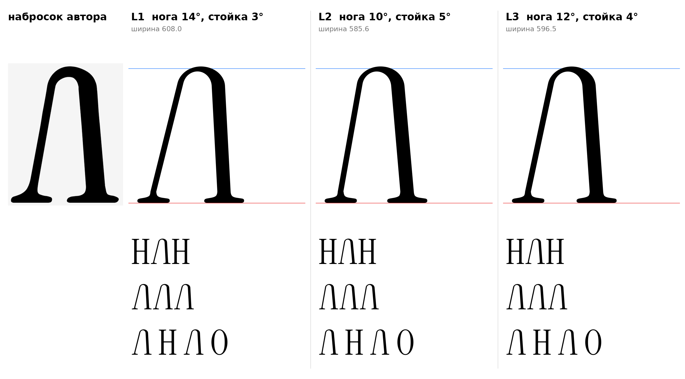

# Л (U+041B, el-cy), заглавная, прямое начертание

Статус на 15.10.2026: три варианта углов, выбор за автором проекта (D20). Основа построена по наброску автора (`docs/img/author_sketch_el.png`), набросок не обводился: арка и ноги построены параметрически (`tools/glyphparts.py`, `el_sign`).

## Конструкция

- Арка: эллипс, внешние полуоси a=128, b=110 (b/a=0,86). `[НАБЛЮДЕНИЕ]` Замер наброска: купол шириной около 256 и высотой около 110.
- Верх арки на 730 (круглый овершут прописных). `[ИЗМЕРЕНО]` Правило из params.json.
- Толщины по шрифту: левая нога 30 (тонкая диагональ "/"), правая стойка 71 (стебель H), верх арки 27 (волосная). `[ИЗМЕРЕНО]` Набросок автора плотнее (44 и 100): по шрифту толщины не увеличивались (запрет 11, дисплейный шрифт).
- Контрформу арки подбирает метод опорной функции: толщины ног выдерживаются точно, а не приближённо.
- Низ: засечки взяты от H (левая половина под тонкой ногой, правая под стойкой), скобка входит в стойку на высоте 60. `[ИЗМЕРЕНО]` Параметры из H.
- Хвост-выход (F3) не ставится: у Л справа плоская опорная засечка, как у H (F2).
- Левое поле 19, правое 19, как у H. `[РЕШЕНИЕ]` До подбора кернинга.

## Углы

| | Левая нога | Правая стойка | Ширина | Зазор у базы |
|---|---|---|---|---|
| **L1** | 14° | 3° | 608 | 326 |
| **L2** | 10° (замер наброска) | 5° (замер наброска) | 586 | 304 |
| **L3** | 12° | 4° | 597 | 315 |

- `[ИЗМЕРЕНО]` Тонкие диагонали A и V отклонены от вертикали на 14°, строчные v, y, w на 15,5–16,2°. Отсюда L1: чистое правило шрифта.
- `[ИЗМЕРЕНО]` На наброске автора левая нога 10,3°, правая 4,9°. Отсюда L2.
- `[РЕШЕНИЕ]` Рекомендация: L3 (12° и 4°). Нога менее раскинута, чем у A и V, потому что её верх уходит в арку, а не в острую вершину, и глаз читает такую ногу как более наклонную; ширина ближе к H и О в строке. Это решение проекта, не измерение.
- `[ОТКРЫТО]` Зазор у базы 304–326 против контрформы H 226: Л шире H. Если нужно уже, уменьшать a (для зазора 226 нужно a около 76, купол станет острее наброска).
- `[ОТКРЫТО]` Кернинг и поля не подобраны.

## Файлы

`data/el/L1..L3.glif`, `.svg`, `meta.json`; код: `tools/sketch_el.py`, `tools/glyphparts.py`.
