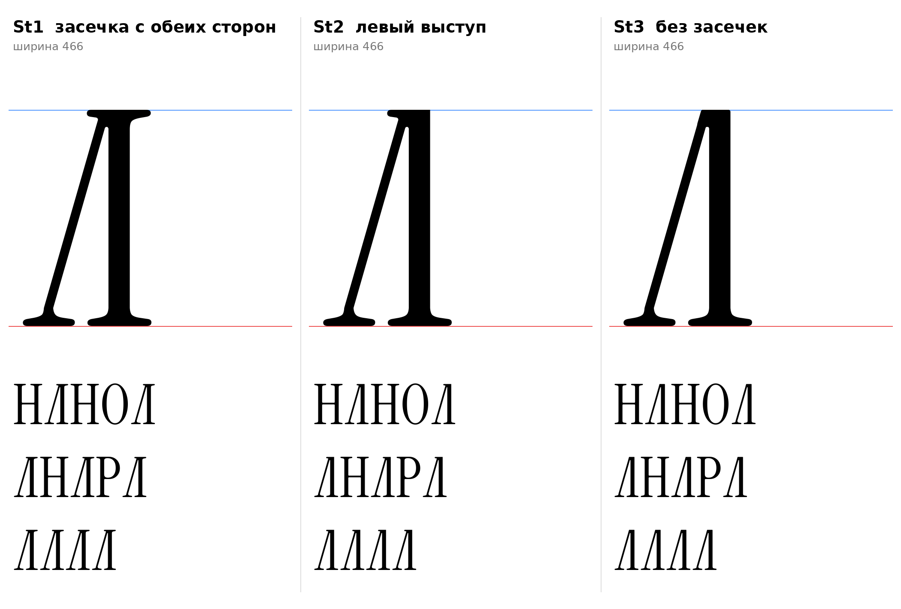
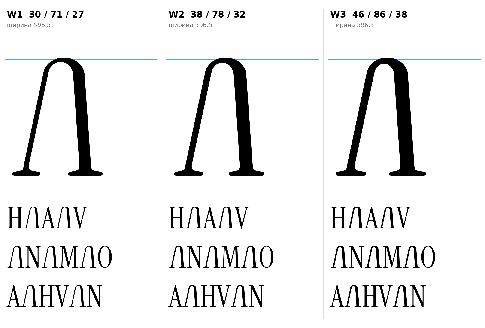

# Л (U+041B, el-cy), заглавная, прямое начертание

Статус на 15.10.2026: **основа St2 (стандартная форма, плоская вершина, левый выступ засечки)**: форма по просьбе автора проекта («сделай большую Л более стандартной формы»), вариант вершины выбран им («St1 левый выступ»); St1 и St3 запасные. Прежняя форма с куполом (L1–L3, ниже) и веса W2, W3 запасные (D20).

## Стандартная форма (St1–St3)

Плоская вершина вместо купола: правая стойка вертикальная 71 (H), левая нога тонкая диагональ 30 под углом 16°, правый край ноги встаёт на левый край стойки на высоте 700, верх на плоской линии 720. Низ как в L1: вертикальные пеньки до y=60 и половины опорной засечки H.

| | Вершина | Комментарий |
|---|---|---|
| **St1** | головная засечка H с обеих сторон стойки | запасной |
| **St2** | левый выступ засечки, правая сторона стойки плоская | основа |
| **St3** | без засечек: плоский срез, углы скруглены радиусом 6 | |

- `[ИЗМЕРЕНО]` Стойка 71 и опорные засечки H; тонкие диагонали A и V 14° от вертикали.
- `[РЕШЕНИЕ]` Угол ноги 16°, а не 14°: при 14° просвет между опорной засечкой ноги и засечкой стойки у основания всего 24, при 16° он 47,5 (у H между буквами 19+19). Это решение проекта, не измерение; ширина 466 (H 546).
- Внутренний угол между ногой и стойкой скруглён радиусом 6 (shapely, только зона вершины контрформы); верх St3 с радиусом 6.
- Один контур, поля 19/19. Класс `@serif_bl` по геометрии выполняется (A x=19, B 96, C True).
- `[ОТКРЫТО]` Ширина Л (466 против H 546) и угол ноги, кернинг пар Л с О, А, Н.

Файлы: `data/el_std/St1.glif`, `St2`, `St3` (`.glif`, `.svg`), `meta.json`; код: `tools/sketch_el_std.py`, `tools/glyphparts.py` (`el_std_sign`).

## Прежняя форма с куполом (L1–L3, запасные)

## Конструкция

- Арка: эллипс, внешние полуоси a=128, b=110 (b/a=0,86). `[НАБЛЮДЕНИЕ]` Замер наброска: купол шириной около 256 и высотой около 110.
- Верх арки на 730 (круглый овершут прописных). `[ИЗМЕРЕНО]` Правило из params.json.
- Толщины по шрифту: левая нога 30 (тонкая диагональ "/"), правая стойка 71 (стебель H), верх арки 27 (волосная). `[ИЗМЕРЕНО]` Набросок автора плотнее (44 и 100): по шрифту толщины не увеличивались (запрет 11, дисплейный шрифт).
- Контрформу арки подбирает метод опорной функции: толщины ног выдерживаются точно, а не приближённо.
- Низ: засечки взяты от H (левая половина под тонкой ногой, правая под стойкой), скобка входит в стойку на высоте 60. `[ИЗМЕРЕНО]` Параметры из H.
- Хвост-выход (F3) не ставится: у Л справа плоская опорная засечка, как у H (F2).
- Левое поле 19, правое 19, как у H. `[РЕШЕНИЕ]` До подбора кернинга.

## Углы

| | Левая нога | Правая стойка | Ширина | Зазор у базы |
|---|---|---|---|---|
| **L1** | 14° | 3° | 608 | 326 |
| **L2** | 10° (замер наброска) | 5° (замер наброска) | 586 | 304 |
| **L3** | 12° | 4° | 597 | 315 |

- `[ИЗМЕРЕНО]` Тонкие диагонали A и V отклонены от вертикали на 14°, строчные v, y, w на 15,5–16,2°. Отсюда L1: чистое правило шрифта.
- `[ИЗМЕРЕНО]` На наброске автора левая нога 10,3°, правая 4,9°. Отсюда L2.
- `[РЕШЕНИЕ]` Основа L1 (14°/3°): единственный вариант, где все числа измерены (угол ноги 14° как у A и V, толщины как у A и H). Ранее рекомендовался L3 (12° и 4°), теперь запасной: Нога менее раскинута, чем у A и V, потому что её верх уходит в арку, а не в острую вершину, и глаз читает такую ногу как более наклонную; ширина ближе к H и О в строке. Это решение проекта, не измерение.
- `[ОТКРЫТО]` Зазор у базы 304–326 против контрформы H 226: Л шире H. Если нужно уже, уменьшать a (для зазора 226 нужно a около 76, купол станет острее наброска).
- `[ОТКРЫТО]` Кернинг и поля не подобраны.

## Файлы

`data/el/L1..L3.glif`, `.svg`, `meta.json`; код: `tools/sketch_el.py`, `tools/glyphparts.py`.

## Вес линий (проверка 15.10.2026)

Автор проекта: ощущение, что линии тонкие. Углы L3 (12°/4°), три веса рядом с H, A, V, N, M, O (`tools/sketch_el_weight.py`):

| | Нога | Стойка | Верх арки |
|---|---|---|---|
| **W1** | 30 | 71 | 27 (по шрифту) |
| **W2** | 38 | 78 | 32 |
| **W3** | 46 | 86 | 38 |

- `[НАБЛЮДЕНИЕ]` В строке с A и H тонкая нога W1 светлее соседей по цвету; W2 ближе к ним, W3 заметно тяжелее.
- `[ОТКРЫТО]` W2 и W3 выходят за допуск ±4 от донора (раздел 3.1): выбор веса за автором проекта, правило допуска тогда правится для Л (D20).
