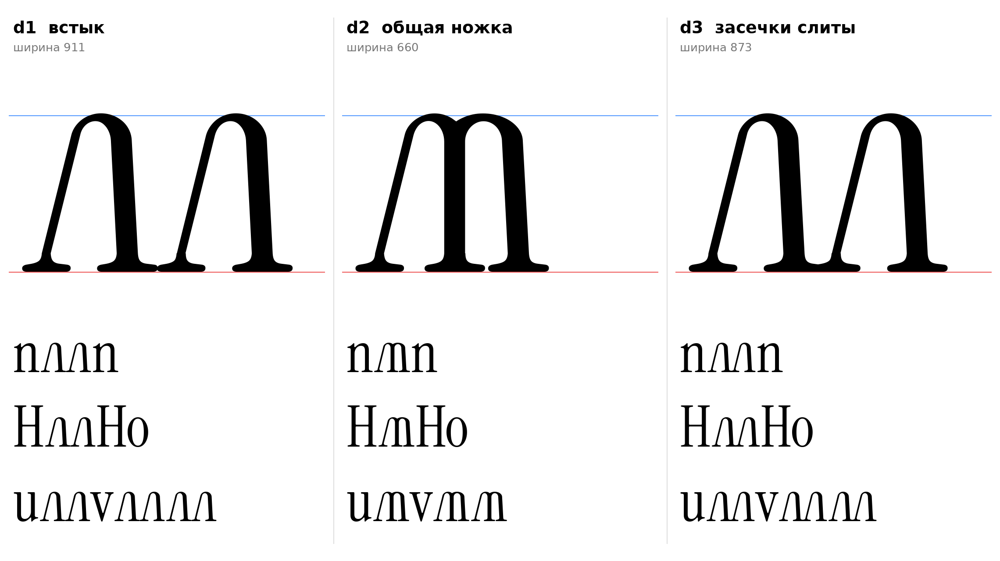

# лл, двойная л (лигатура, кандидат в dlig)

Статус на 15.10.2026: три варианта, выбор за автором проекта (D24). Запрос автора проекта: «попробовать удвоить эл (л)». Понято как лигатура двух строчных л в одном глифе; если имелось в виду другое, сказать.

## Основа

Две л основы л1 (`docs/glyphs/el_lower.md`: 14°/3°, 28/68/25), построены `el_sign` (`tools/glyphparts.py`). `[ИЗМЕРЕНО]` В оригинале нет лигатур двух одинаковых букв: dlig только f_b, f_h, q_j, liga только f_f_i, f_f_l, f_i, f_l. Лигатура лл новая деталь (`[РЕШЕНИЕ]` проекта).

| | Что | Ширина |
|---|---|---|
| **d1** | Встык: засечки соседних ног касаются (перекрытие 2). Два л читаются отдельно | 911 |
| **d2** | Общая ножка: толстая стойка первой л служит левой ногой второй (вертикальная, 0°, толщина 68), вторая арка шире (a=128), чтобы контрформа не сузилась. Читается как «m» с наклонной первой ногой | 660 |
| **d3** | Как d1, но засечки сливаются в одну (сдвиг на 40 внутрь) | 873 |

- `[НАБЛЮДЕНИЕ]` d1 и d3 различаются только местом стыка засечек; d3 компактнее, d1 свободнее.
- `[НАБЛЮДЕНИЕ]` d2 теряет образ «две л»: с м и ш (перевёрнутая m) её легко спутать, форма близка латинской m. Верх между арками образует бугор (арки перекрыты).
- `[ОТКРЫТО]` Нужна ли лигатура вообще: кернинг пары лл (расстояние между засечками) может дать тот же эффект без новой глифы.
- `[ОТКРЫТО]` Имя глифа `el_el-cy` и фича (dlig или liga для cyrl) не заданы; в эскизе кодовая точка PUA U+E001.
- `[ОТКРЫТО]` Для заглавных ЛЛ лигатура не строилась.

## Файлы

`data/el_double/d1..d3.glif`, `.svg`, `meta.json`; код: `tools/sketch_el_double.py`.
