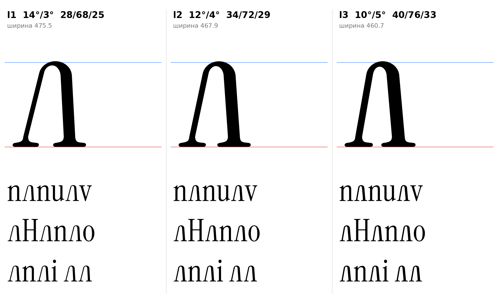

# л (U+043B, el-cy), строчная, прямое начертание

Статус на 15.10.2026: три варианта (угол и вес вместе), выбор за автором проекта (D21). Тот же построитель, что у заглавной Л (`el_sign`, `docs/glyphs/el.md`), донор засечек ı, высота 516. Контуры строились параметрически, латинские контуры не масштабировались.

## Конструкция

- Арка: эллипс, внешние полуоси a=100, b=92, верх 516 (круглый овершут строчных). `[ИЗМЕРЕНО]` Высота и овершут из params.json; полуоси `[РЕШЕНИЕ]`, подобраны на глаз по пропорции Л (b/a около 0,9), измерения оригинала для такой арки нет.
- Низ: половины опорной засечки ı (стойка ı 79–147, скобка встаёт на высоте 60). F2 применён, F1 и F3 не нужны (верх арка, хвоста справа нет). `[ИЗМЕРЕНО]`
- Один контур у каждого варианта (контрформа открыта вниз).
- Правое поле 15 по аналогии с i и n слева. `[РЕШЕНИЕ]` Кернинг не подобран.

## Варианты

| | Углы (нога / стойка) | Нога | Стойка | Верх арки | Ширина | Зазор у базы |
|---|---|---|---|---|---|---|
| **л1** | 14° / 3° | 28 | 68 | 25 | 475,5 | 216 |
| **л2** | 12° / 4° | 34 | 72 | 29 | 467,9 | 198 |
| **л3** | 10° / 5° | 40 | 76 | 33 | 460,7 | 181 |

- `[ИЗМЕРЕНО]` л1 по шрифту: тонкие диагонали строчных 24–31, стебель n 68, волосная верха n 25.
- `[РЕШЕНИЕ]` л2 и л3 плотнее из-за ощущения автора проекта, что тонкая линия заглавной Л слабая; л2 на пределе допуска ±4 по ноге, л3 за допуском (D21).
- `[ОТКРЫТО]` Ширина, полуоси арки, кернинг, связь веса с заглавной Л (D20).

## Файлы

`data/el_lower/l1..l3.glif`, `.svg`, `meta.json`; код: `tools/sketch_el_lower.py`, `tools/glyphparts.py`.
