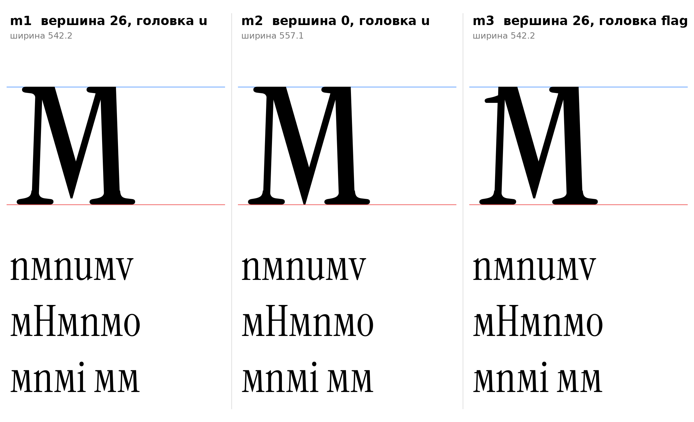

# м (U+043C, em-cy), строчная, прямое начертание

Статус на 15.10.2026: **основа m1** (выбрана по правилам), m2 и m3 запасные (D22: подтверждение автора проекта).

## Конструкция

Две стойки и V между ними, одним контуром. Роли штрихов от латинской M (инструкция 16.2, строка «м» в справочнике): левая стойка тонкая, правая толстая, «\\» толстая, «/» тонкая. Построено параметрически (`em_sign` в `tools/glyphparts.py`), латинские контуры не масштабировались.

| Деталь | Значение | Источник |
|---|---|---|
| Левая стойка | 30 | `[ИЗМЕРЕНО]` M: 31 |
| Правая стойка | 68 | `[ИЗМЕРЕНО]` стебель n 68 (у M 70) |
| Диагональ «\\» | 67 | `[ИЗМЕРЕНО]` v: 67 |
| Диагональ «/» | 29 | `[ИЗМЕРЕНО]` v: 30, y: 29 |
| Наклон стоек внутрь | 2° (88° и 92°) | `[ИЗМЕРЕНО]` M |
| Наклон диагоналей от вертикали | 16° | `[ИЗМЕРЕНО]` строчные v, y, w (106° и 73–74°); у заглавных A, V, M 14° |
| Вершина V над базовой линией | 26 | `[ИЗМЕРЕНО]` M: 37 из 720, то есть 26 из 510 по пропорции высоты; `[РЕШЕНИЕ]` перенос пропорцией |
| Верх стоек | головка слева, как у u и v | `[НАБЛЮДЕНИЕ]` v и w со своими диагональными ветвями берут плоскую головку u; F1 (флажок ı) оставлен в m3 |
| Низ стоек | половины опорной засечки ı, симметрично | F2 `[ИЗМЕРЕНО]` |
| Диагонали входят в стойки сверху | на 18 | `[РЕШЕНИЕ]` без этого контакт в точке |
| Плоская вершина V | 8 | `[РЕШЕНИЕ]` вместо острого шипа |

## Варианты

| | Вершина V | Головка левой стойки | Ширина |
|---|---|---|---|
| **m1 (основа)** | 26 | u | 542 |
| **m2** | 0 (на базовой линии) | u | 557 |
| **m3** | 26 | флажок ı (F1) | 542 |

- Основа m1 выбрана по правилам: все числа измерены, вершина как у M, головки как у v и u.
- m2: допущение инструкции «вершина доходит до базовой линии (ПРОВЕРИТЬ)», измерение M его не подтвердило.
- m3: правило F1 буквально (косой флажок на свободном верху). Тонкая стойка 30 с длинным флажком читается как «1».
- `[ОТКРЫТО]` Поля и кернинг (по группе стоечных, левое 15 как у n и i), форма курсивной м (D13), вес (на заглавной Л автор проекта отметил ощущение тонкости: проверить на м).
- `[ОТКРЫТО]` Верх справа: тонкая «/» и толстая стойка сливаются в плоскую массу у линии 510; проверить на строке и при необходимости отрисовать вручную.

## Файлы

`data/em/m1..m3.glif`, `.svg`, `meta.json`; код: `tools/sketch_em.py`, `tools/glyphparts.py`.
