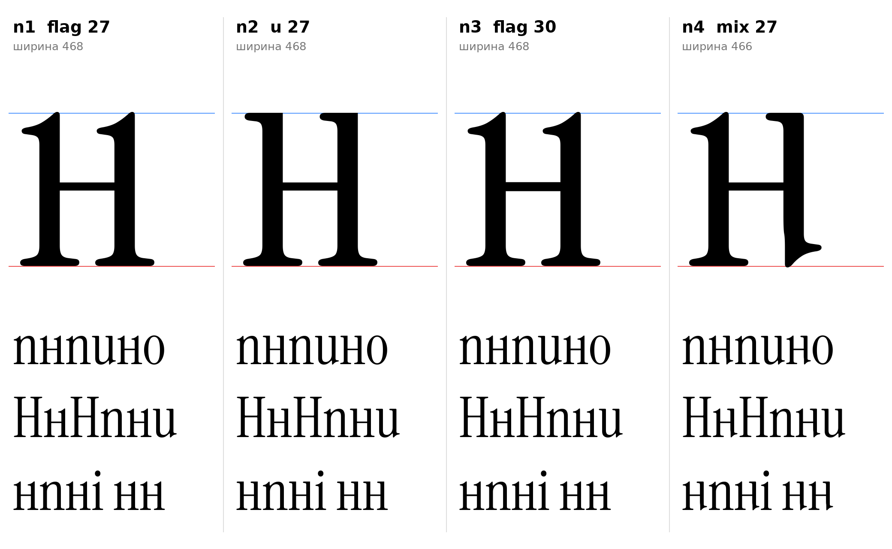

# н (U+043D, en-cy), строчная, прямое начертание

Статус на 15.10.2026: **основа n4 (mix), выбрана автором проекта** (D27 закрыто): по просьбе автора проекта (верх слева флажок, низ справа флажок-хвост, верх справа как у латинской u); n1, n2, n3 запасные (D27).

## Письмо (ductus) и F-пункты

Инструкция, раздел 7: две стойки и перекладина по середине высоты x, H-образная; левая стойка, перекладина, правая стойка. Не строится из латинской n (арка принадлежит курсиву).

- F1: свободные верхи обеих стоек (флажок ı), в n2 заменён плоской головкой u.
- F2: ножки обеих стоек (опорная засечка ı, симметричная).
- F3, F4, F5: не применяются.

## Конструкция

Построено `en_sign` (`tools/glyphparts.py`), стойки это ı оригинала без масштаба.

| Деталь | Значение | Источник |
|---|---|---|
| Стойки | 68, левые края 74 и 324 (расстояние 250) | `[ИЗМЕРЕНО]` n: стойки 74–142 и 324–392 |
| Перекладина | 27 (n1, n2), 30 (n3) | `[ИЗМЕРЕНО]` H: 30, e: 25; 27 внутри допуска ±4 `[РЕШЕНИЕ]` |
| Центр перекладины | 264 (51,8% высоты x) | `[ИЗМЕРЕНО]` H: центр 373 при высоте 720, то есть выше середины (инструкция, оптическая поправка) |
| Поля | 15 слева, 11 справа, ширина 468 | `[ИЗМЕРЕНО]` n: 15/11, ширина 470; `[РЕШЕНИЕ]` группа стоечных |
| Высота | 510 (flat), флажок до 513 | `[ИЗМЕРЕНО]` ı |

## Варианты

| | Головки | Перекладина |
|---|---|---|
| **n4 (основа)** | слева ı: флажок вверху слева, обычная ножка; справа стойка латинской u: головка вверху, хвост-выход (F3) внизу справа | 27 |
| n1 | флажок ı на обеих стойках | 27 |
| n2 | плоские головки u | 27 |
| n3 | флажок ı | 30 (как у H) |

- `[РЕШЕНИЕ]` n4: просьба автора проекта 15.10.2026 «верхний левый и нижний правый угол флажком, верхний правый как английская u». Правая стойка взята от u оригинала (как в ы: головка и хвост-выход, левый край сужен с 312 до 317 к y=62, без наплыва чаши), расстояние между стойками 250. Правая стойка уходит на −5 ниже базовой линии (кончик хвоста, как у u). F3 (хвост-выход справа внизу) у н применён по просьбе автора проекта; по правилу CLAUDE.md F3 для остальных букв решает ductus.
- `[НАБЛЮДЕНИЕ]` В n1 и n3 флажок правой стойки смотрит внутрь буквы, на крупном кегле читается как «1H1»; в строке нормально. n2 читается чище, но F1 требует флажок на свободном верху.
- `[ОТКРЫТО]` Поля, кернинг, форма курсивной н (арочная, как n, перекладина уходит).

## Файлы

`data/en/n1..n3.glif`, `.svg`, `meta.json`; код: `tools/sketch_en.py`, `tools/glyphparts.py`.

## Исправление 15.10.2026 (левый край правой стойки)

Аудит узлов n4 (по просьбе автора проекта, который заметил дефект на картинке узлов) нашёл косой отрезок (324,150)→(329,62) на левом краю правой стойки: прямая «почти вертикаль» с изломами на концах (угол −86,75°). Он появился от прежней отсечки чаши u (`poly` с наклонной стороной). Заменено на плавный S-изгиб (`_u_taper` в `tools/glyphparts.py`: две квадратичные кривые, касательные вертикальные на концах, левый край 324 выше y=170 и 329 ниже y=62). Узлов стало 69 вместо 67, изломов нет, форма отличается не более чем на 5 единиц.

- `[ИЗМЕРЕНО]` Остальные отрезки n4 проверены (шаг, косые «почти прямые»): остался только слегка наклонный низ опорной засечки (196,23)→(171,26), он от H/ı оригинала, не менялся.
- `[ОТКРЫТО]` Тот же прежний прямой скос остался в ы (`tools/sketch_yery.py`) и в `pe-cy.flag` (`pe_flag`), эти буквы не менялись без просьбы автора проекта.
