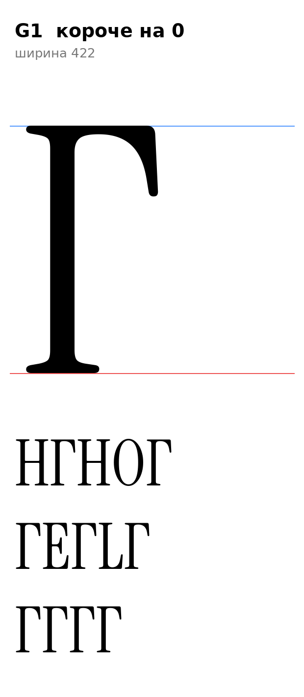

# Г (U+0413, ge-cy), заглавная, прямое начертание

Статус на 15.10.2026: **один вариант G1**, ждёт подтверждения автора проекта.

## Письмо (ductus) и F-пункты

Инструкция, раздел 7: стойка и верхняя горизонталь с правым носиком вниз; горизонталь тонкая; не шире прописной. Метод как у П, Ш, Ю: детали оригинала без масштаба.

- F2: опорные засечки внизу стойки (от H).
- Головная засечка слева вверху, горизонталь и наклонный правый носик взяты от E оригинала (у E тот же верх): `[ИЗМЕРЕНО]` стойка 89–160 у H и E, горизонталь минимальна на x≈231 (низ 695, толщина около 25), носик до x=403.
- F1 к заглавным не относится.

## Конструкция

`ge_cap_sign` (`tools/glyphparts.py`): низ стойки от H (y ≤ 330, засечки), стойка 89–160 между ними, верх стойки и горизонталь с носиком от E (y ≥ 505). Один контур, шва между E и H нет (стойки одинаковой ширины и на одном месте). Ширина 422, поля 19 слева (H, E) и 19 справа (`[РЕШЕНИЕ]`, как у L; носик Г стоит дальше правого поля E, кернинг решит остальное).

## Что отброшено

Укороченные горизонтали (на 16, 24, 30, 60) отклонены: резать горизонталь E приходится по точкам с равным низом, но на шве остаётся излом 3–17° (на 30 и 60 заметен на увеличении). Сглаживание зоны шва (shapely) давало ступеньки на границе зоны. Короче горизонталь можно получить только перерисовкой, а не булевой сборкой; пока оставлен оригинал E.

## Класс и правила

В `@serif_bl` по геометрии (A x=19, B 70, C True): перед Г п получает `pe-cy.flag`. К `@head_tl` не относится (заглавная).

## Открыто

- `[ОТКРЫТО]` Длина горизонтали (перерисовка), правое поле, кернинг пар Г с о, а, е, у и точкой (инструкция: Г–о как L–o).

Файлы: `data/ge_cap/G1.glif`, `G1.svg`, `meta.json`; код: `tools/sketch_ge_tse_cap.py`.
