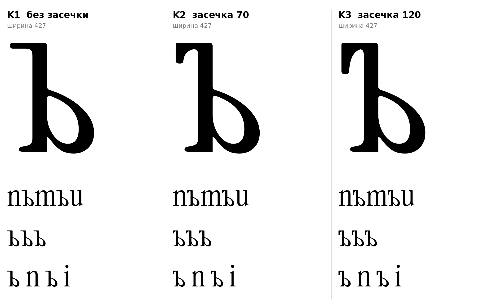

# ъ (U+044A, hardsign-cy), строчная, прямое начертание

Статус на 14.10.2026: **выбран K2 (засечка вниз глубиной 70)** автором проекта (D19 закрыто). K1 и K3 не выбраны, остаются в репозитории как запасные.

## Конструкция

По инструкции (раздел 7): стойка с верхней левой перекладиной с засечкой и чаша справа. Чаша и низ те же, что у ь (`docs/glyphs/soft.md`, общий код `tools/glyphparts.py`). Головка стойки это головка `u` (S4), удлинённая в перекладину слева: перекладина не доходит до чаши.

| | Левый конец перекладины | Ширина |
|---|---|---|
| **K1** | плоский закруглённый кончик, без засечки | 427 |
| **K2** | засечка вниз глубиной 70 | 427 |
| **K3** | засечка вниз глубиной 120 (ближе к `T`) | 427 |

- Перекладина с засечкой построена одним контуром, как левый конец перекладины `T`: левый край вертикальный, верхний угол закруглён, вогнутая скобка плавно входит в низ перекладины. Форма засечки задана по замеру `T` (ширина 70 на глубине 40, 54 на 100, 37 на 140), но короче: у `T` засечка уходит на 217 вниз, для ъ это слишком много.
- `[ИЗМЕРЕНО]` Два контура в каждом варианте: внешний и контрформа чаши. Левая граница 3, правая 397, верх 510, низ −9.
- `[ИЗМЕРЕНО]` Толщина перекладины 27 (кончик головки `u` 24–26, у стойки 28–32).
- `[РЕШЕНИЕ]` Выбор K2.
- `[ОТКРЫТО]` Длина перекладины слева от стойки около 105: догадка (вдвое длиннее головки `u`), не измерение. Нужна подгонка на строке.
- `[ОТКРЫТО]` Поле справа 30 взято как у ь. Поле слева не подобрано.
- `[ОТКРЫТО]` В вариантах с засечкой на стыке моей скобки со скобкой головки `u` остаётся излом в 1–2 единицы: нужна ручная отрисовка.
- Головка здесь от `u` (S4), а у ь выбран флажок (S3): у ъ сверху перекладина, поэтому флажок не подходит. Согласованность головок ь, ы и ъ решает автор проекта.

## Что было неверно и исправлено

Первая сборка склеивала кончик головки `u`, прямоугольник и засечку из трёх кусков: на кончике был бугорок, на стыке засечки ступенька в 4 единицы, у входа скобки излом. Теперь перекладина с засечкой это один контур.

## Файлы

`tools/sketch_hard.py` (воспроизводит эскизы), `tools/glyphparts.py` (`hard_sign`), `data/hard/K1.glif`…`K3.glif` (имя `hardsign-cy`), `K1.svg`…`K3.svg`, `meta.json`.

Эскиз из деталей оригинала, не финальный контур.
