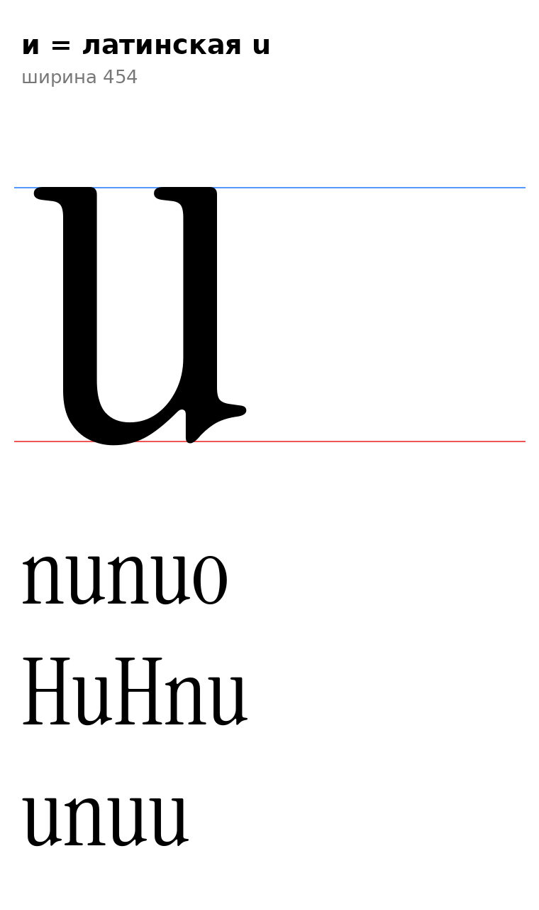

# и (U+0438, ii-cy), строчная

Статус на 15.10.2026: **и = латинская u оригинала без изменений** (по просьбе автора проекта; как п = n и м = m: арочная форма в прямом, исключение из инструкции раздел 7, D1, D26, D29). Масштаб не применялся.

- Контур u: ширина 454, поля 11 и 15, x 11–439, y −9…510, один контур. Хвост-выход справа внизу (F3) и головки слева вверху на обеих стойках.
- `[НАБЛЮДЕНИЕ]` В старой разработке и = u с чуть укороченным хвостом (xmax 425 против 439): это деталь, которую можно рассмотреть отдельно.
- Правило `serif_bl`: низ слева круглый, засечки нет, и не входит в класс (п перед и остаётся обычной); правило `ka-cy.short`: входит в класс.
- `[ОТКРЫТО]` й = и + бреве (диакритика, D9), укорочение хвоста, форма курсивной и, поля.

Файлы: `data/ii/ii.glif`, `.svg`.
