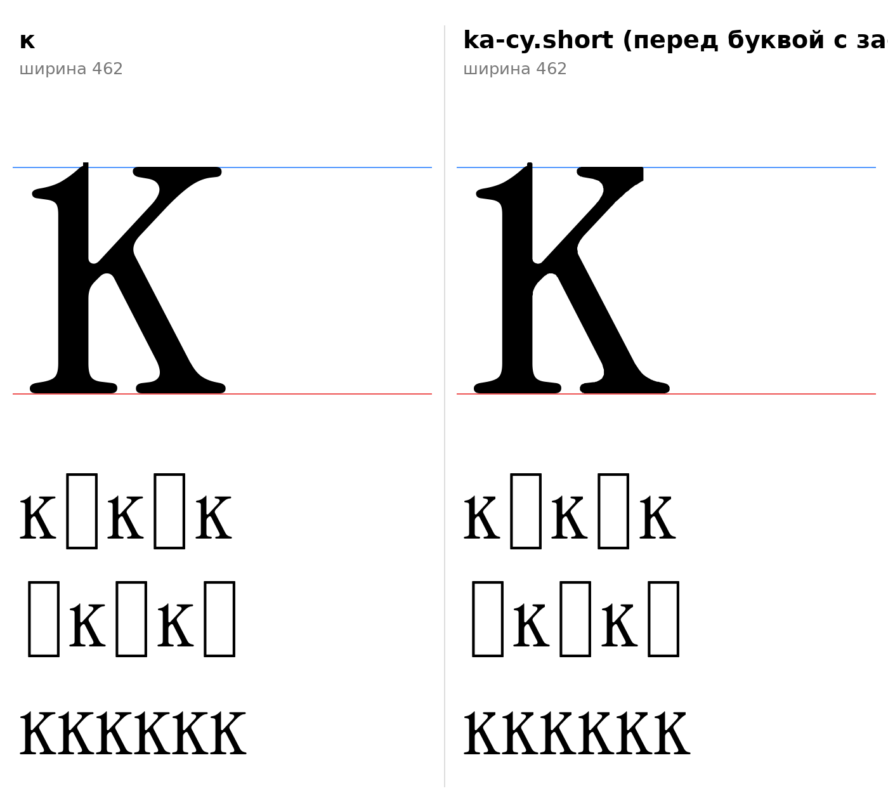

# к (U+043A, ka-cy), строчная, и контекстная форма ka-cy.short

Статус на 15.10.2026: по просьбе автора проекта (понравилась в старой разработке идея и логика; контуры нарисованы заново из деталей оригинала, чужой вектор не берётся).

## Конструкция

`ka_sign` (`tools/glyphparts.py`): стойка ı оригинала (флажок F1 слева вверху, опорная засечка F2, сдвиг −5: стойка 74–142 как у латинской k) и ветви k оригинала правее стойки: верхняя тонкая «/» с головкой на кончике, нижняя толстая «\\» с ножкой. Выносной элемент k выше x-height отсечён. Толщины стойки 68, ветвей как у k. Ширина 462, поля 10 и 11.

## ka-cy.short (контекстная форма, обязательный пункт сборки)

Верхняя ветвь к заканчивается головкой шириной около 195 (x 243–440). Следующая буква со стойкой у левого края на x-height (головка, флажок) ставит такую же засечку на той же высоте, и вверху получается сплошная полоса. В `ka-cy.short` правая часть головки ветви укорочена: обрезана по x=392 и скруглена (радиус 4), разрыв между засечками сохраняется.

- `[РЕШЕНИЕ]` Правило: `feature calt { script cyrl; sub ka-cy' @head_tl by ka-cy.short; } calt;`, класс `@head_tl` определяется геометрией, а не списком.
- **Критерий класса `@head_tl`** (все условия, `data/context/serif_bl.json`, раздел `ka_short`): C1: на y=380 самый левый участок контура это стойка шириной 55–90; C2: на уровне x-height (y 470–512) контур доходит до левого края этой стойки (не правее её края + 10). Круглые (о, ф, с) не проходят C2, тонкая нога л не проходит C1.
- **Проверка:** `python3 -I tools/check_context_classes.py` (вторая часть вывода). Сейчас в классе: н, п, и, к, м (латинская m), ш, ь, ъ, ы, ю, т; не в классе: л, ф. Не проверены (нет контура): б, в, г, ж, р, у, х, ц, ч, щ.
- **Как в старой разработке:** там та же задача решена списком соседей (calt, к перед н, п, г, т, в, ь, ъ, ы, и, й, м, ц, ч, ш, щ, ж, к, а также p, x, y), здесь критерий вместо списка, как у правила п → `pe-cy.flag` (`docs/glyphs/pe.md`).
- `[ОТКРЫТО]` Автор проекта сказал «соседство с буквой, на верхнем правом углу которой есть засечка». Реализовано как «справа стоит буква со стойкой у левого края на x-height» (так и работало в старой разработке). Если имелась в виду буква слева, правило переворачивается.
- `[ОТКРЫТО]` Форма обрезанного кончика (сейчас прямой срез со скруглением 4, эскиз), поля и кернинг пары, другие буквы с ветвью и головкой (х, у, ж, К заглавная).

## Файлы

`data/ka/ka.glif`, `ka_short.glif` (в эскизе PUA U+E003), `.svg`; код: `tools/sketch_batch2.py`, `tools/glyphparts.py`.
