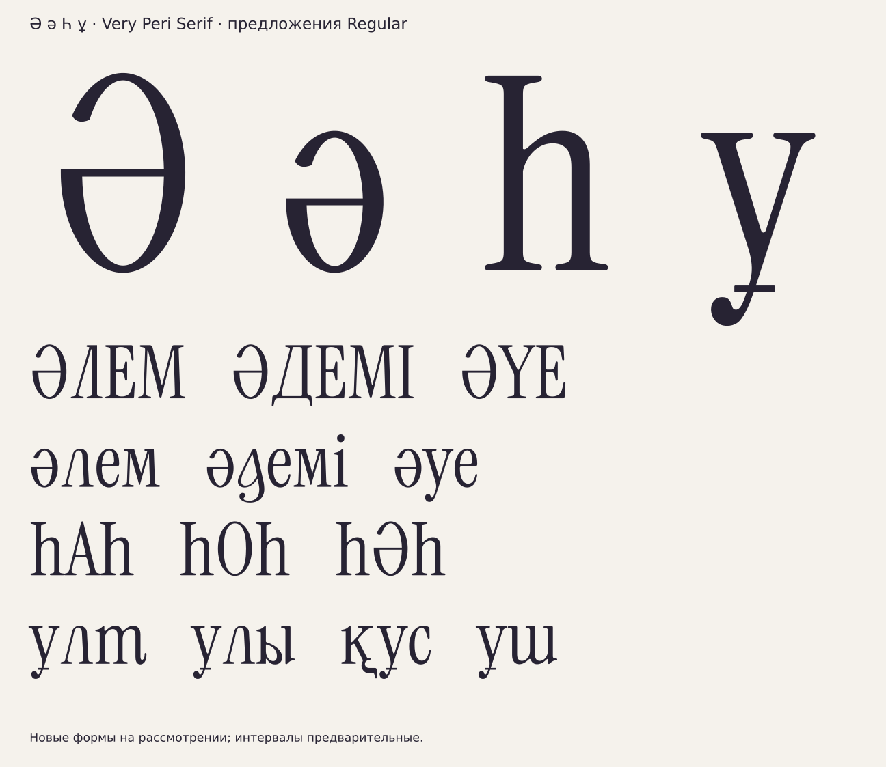

# Ә ә Һ ұ — оставшиеся казахские буквы

[РЕШЕНИЕ · 16.10.2026] По запросу пользователя созданы четыре новых
предложения Regular. Они добавлены в общую карту; прежние варианты
остальных букв и авторские SVG не менялись. Новые формы ещё не утверждены.



## Построение

| Буква | Силуэт и ход | Контур и детали |
|---|---|---|
| Ә | Нижняя закрытая чаша, правая дуга и открытый верх слева. Вход сверху слева, дуга вправо вниз, нижний овал и горизонталь. | Новые кубические дуги по пропорциям O, самостоятельный верхний терминал. Горизонталь по круглой капительной волосной (F7). |
| ә | Та же схема на x-height; письмо от верхнего входа вокруг нижней чаши с замыканием горизонталью. | Отдельный контур по размерам o, а не масштаб Ә и не поворот e. Волосная o/e (F7). |
| Һ | Высокая левая стойка, плечо и правая стойка. Левая стойка вниз, плечо вправо, правая стойка вниз. | Капительная стойка I и родное плечо h без масштаба; ножки F2. |
| ұ | Две ветви, родной нижний вынос и поперечная черта. Ход унаследован от существующей ү, поперечина отдельным движением. | Основа ү = родная y (D31); добавлена черта на нижнем выносе. Сохранены капля F5 и хвост F8. |

[ИЗМЕРЕНО] Параметры из `data/params.json`: круглая капительная зона
730/−9, строчная516/−9, плоская капительная720, боковые толщины O79/o76,
волосные O27/o25. Ширины Ә540 и ә408 совпадают с донорами O/o.
У Һ капительная стойка I толщиной71, родная правая стойка h68.

[РЕШЕНИЕ] Для Ә/ә применены новые эллиптические кубические дуги,
середина горизонтали по центру овала и новый скруглённый верхний срез.
Это композиционные решения, а не измерения уже существующей швы.
Сочетание Һ с плечом на строчной высоте соответствует h-образному силуэту.
У ұ сохранена существующая в проекте форма ү = y; её новое начертание
не подменяет неутверждённый архивный вариант прописной Ұ.

## Проверки

[ИЗМЕРЕНО] GLIF проверены обратным чтением: ширина, границы и булева
разность контуров. Пробный TTF перечитан целиком; проверены Unicode,
ширины, число контуров и геометрические границы с допуском1 после
перевода кубических кривых в квадратичные. Родные латинские контуры
в пробе побайтно совпадают с оригиналом. Есть отрисовка в100/24/12px.
Оба раздела `check_context_classes.py` проходят для построенных основ.

[НАБЛЮДЕНИЕ] Действующий численный критерий `@head_tl` включает ә:
он принимает её правую стенку за первую стойку и сравнивает с верхней
дугой. Перед производственной сборкой требуется проверить это правило
в реальном наборе к + ә; прохождение проверки класса не доказывает
нужность контекстной короткой к перед этой формой.

```sh
python -I tools/sketch_remaining_kz.py
python -I tools/check_context_classes.py
python -I tools/alphabet_sheet.py
```

Контуры, SHA256 и измеренные границы: `data/kz-completion/`.
Проба TTF и PNG: игнорируемый `build/kz-completion/`.
Инструмент использует зависимости ранее подготовленного Python-окружения.

[ОТКРЫТО] Утверждение новых форм, интервалы, кернинг и реальная проверка
OpenType. На карте теперь есть все18 казахских букв; это набор рисунков,
а не готовый релиз шрифта. Доноры Instrument Serif65c0ef2, лицензия SIL OFL1.1.
