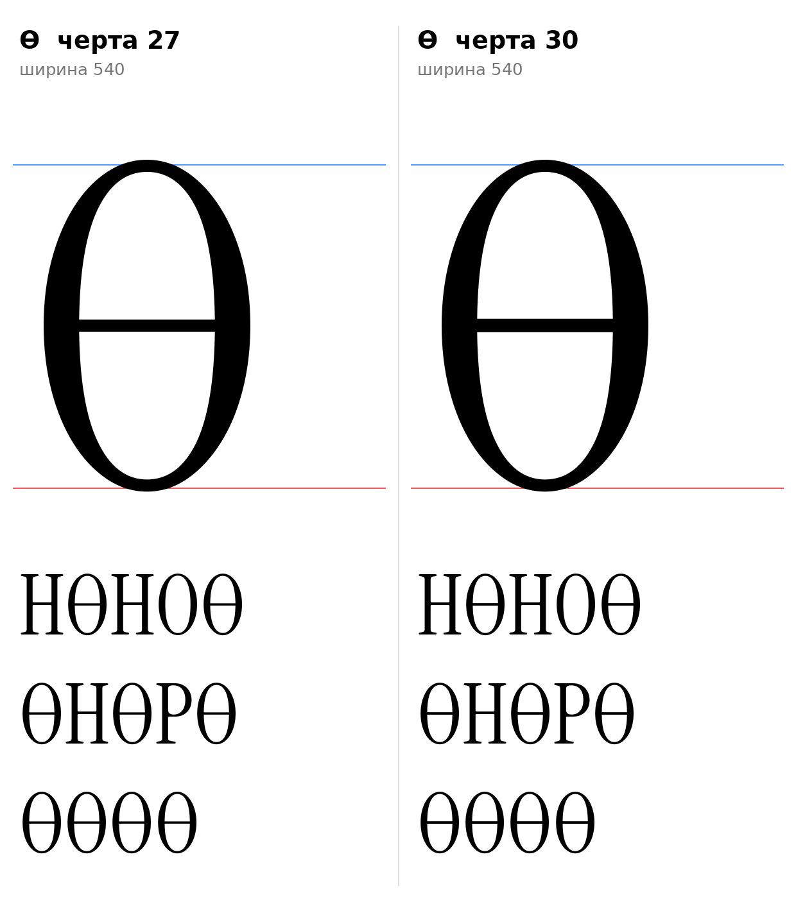
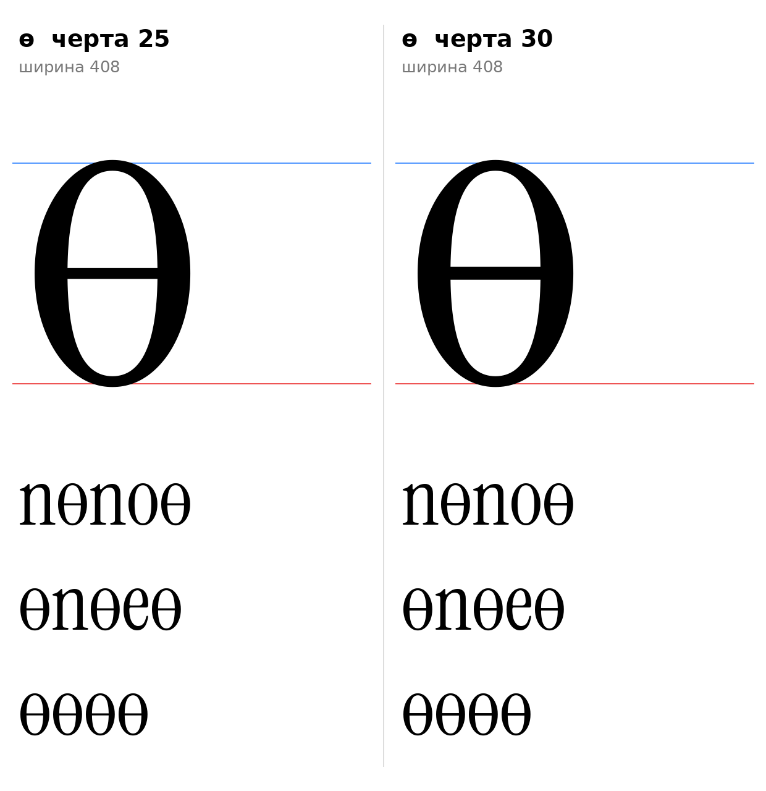
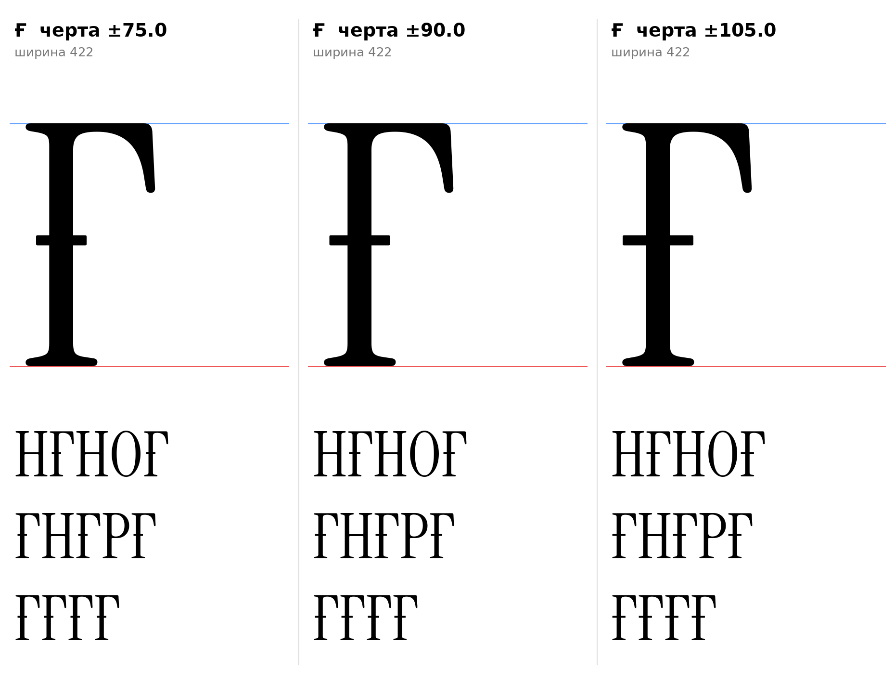

# Ө, ө, Ғ (казахские), эскизы 15.10.2026

Статус: основы O1, o1, Gh2 (ждёт подтверждения автора проекта); запасные O2, o2, Gh1, Gh3.

## Ө и ө

Инструкция, раздел 7: О с горизонтальной чертой через овал. `obar_sign` (`tools/glyphparts.py`): О (о) оригинала без масштаба и прямая черта по центру овала по высоте: (730 − 9)/2 = 360,5 у Ө, (516 − 9)/2 = 253,5 у ө. Черта входит в обе стенки на 15 (стенки 79 и 76, `[ИЗМЕРЕНО]`) и наружу не выходит. Контур остаётся с двумя контрформами.

| | Толщина черты | Источник |
|---|---|---|
| O1 (основа Ө) | 27 | `[ИЗМЕРЕНО]` волосная О 27 |
| O2 | 30 | перекладина H |
| o1 (основа ө) | 25 | `[ИЗМЕРЕНО]` волосная о 25, перекладина e 25 (F7) |
| o2 | 30 | запасной |

Ширина как у О (540) и о (408). Круглые формы, в `@serif_bl` и `@head_tl` не входят.

## Ғ

Инструкция, раздел 7: Г с поперечной чертой на стойке. `ghe_stroke_sign`: наша Г (G1, `docs/glyphs/ge_cap.md`) и черта через стойку (центр стойки 124,5), центр высоты 373 как у перекладины H (`[ИЗМЕРЕНО]` 358–388), толщина 30, концы скруглены кривыми радиусом 4. Один контур. Ширина 422 как у Г.

| | Половина длины черты |
|---|---|
| Gh1 | 75 |
| Gh2 (основа) | 90 |
| Gh3 | 105 (левый конец не левее поля 19) |

В `@serif_bl` по геометрии (как Г): добавлена в список по результату проверки.

## Открыто

- `[РЕШЕНИЕ]` Высота 373 и симметрия черты выбраны по аналогии с H; у кириллической Ғ черта часто длиннее влево. Подтверждение автора проекта.
- `[ОТКРЫТО]` Строчная ғ после строчной г.

Файлы: `data/kz2/*.glif`, `.svg`, `meta.json`; код: `tools/sketch_kz2.py`, `tools/glyphparts.py`.
