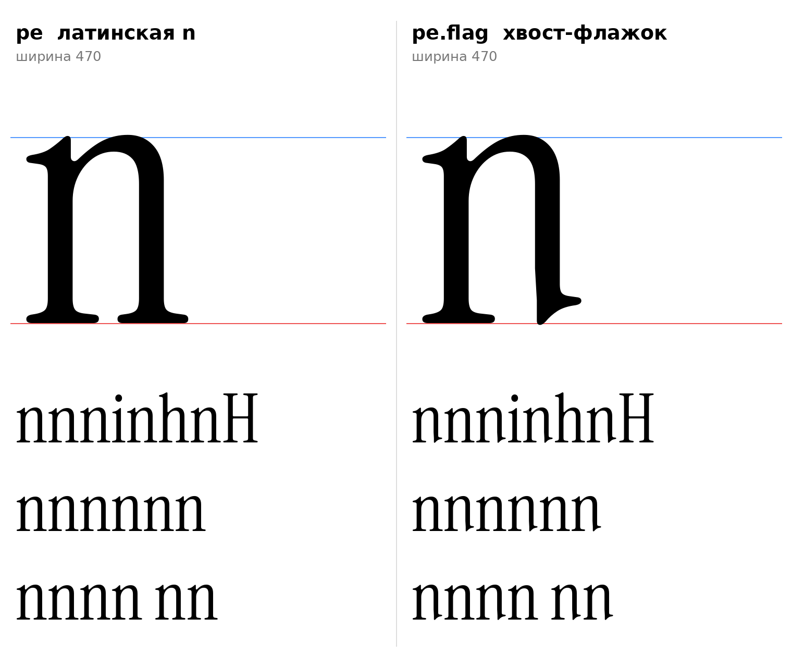

# п (U+043F, pe-cy), строчная, прямое начертание

Статус на 15.10.2026: **п = латинская n оригинала без изменений** по решению автора проекта (D29), плюс обязательная контекстная форма **п.flag** (`pe-cy.flag`).



Скриншот автора проекта с соседством: `docs/img/author_screenshot_pe_neighbor.png`.

## Решение автора проекта

- «Используй в качестве п английскую n.» Контур n оригинала (ширина 470, поля 15/11, вертикаль 0–516) ставится на U+043F без изменений, масштаб не применяется. Это исключение из инструкции (раздел 7, «п: не арка n, арка принадлежит курсиву») и из D1; сделано по просьбе автора проекта, как и арочная м (D26).
- `[РЕШЕНИЕ]` Обязательный пункт сборки шрифта: **скриптовая (контекстная) лигатура**. Если справа от п стоит буква, у которой в нижнем левом углу опорная засечка (F2), нижний правый угол п автоматически превращается во флажок (хвост-выход), «для органичности»: п заменяется на `pe-cy.flag`.

## pe-cy.flag

Построено `pe_flag` (`tools/glyphparts.py`): n оригинала, у правой стойки ниже y=150 стойка заменена стойкой u (хвост-выход вправо, сдвиг +12; левый край сужен до 317 к y=62, как в ы и н n4). Выше y=150 без изменений.

| Параметр | Значение |
|---|---|
| Ширина | 470, как у п |
| Границы | x 15–451, y от −5 (кончик хвоста, как у u) до 516 |
| Контур | один |
| F-пункты | F1 флажок слева вверху (n), F3 хвост-выход справа внизу (по решению автора проекта) |

## Правило подстановки (для features.fea)

```
languagesystem cyrl dflt;
@serif_bl = [ ... ];                        # буквы с опорной засечкой в нижнем левом углу (кандидаты ниже)
feature calt {
    script cyrl;
    sub pe-cy' @serif_bl by pe-cy.flag;     # п перед такой буквой -> п.flag
} calt;
```

- Сейчас в классе `@serif_bl` (нижний левый угол с засечкой F2): строчные н, п, к, г, л, м, ц, б, в, ь, ъ, ы, ю, х; заглавные Н, П, К, Г, Р, Л, М, Ц, Б, В, А, Ж, Е, Х, Ш (прямой низ с засечкой), Ю. И, Й (и = латинская u) и р (круглая чаша на базовой линии) в класс не входят, как и ш, щ. Список это следствие правила, проверка по контурам: `tools/check_context_classes.py`. ш, щ, Щ не входят: у основы ш (R1) низ арок круглый (заглавная Ш с прямым низом входит). Список это следствие правила ниже, а не сам принцип.
- Не срабатывает: перед о, с, е, а, э и другими буквами без засечки внизу слева, перед пробелом и знаками препинания, в конце слова.
- `[ОТКРЫТО]` Распространять ли правило на латинскую n, на другие буквы с хвостом справа (н n4 уже с хвостом) и на курсив.
- В `calt` включено по умолчанию, пользователь не должен ничего включать.

## Логика правила (принцип, который перепроверяется при каждой сборке)

**Зачем.** Основа п (латинская n) заканчивается справа плоской опорной засечкой (F2), которая выступает вправо до x=459. Следующая за ней буква со своей опорной засечкой в нижнем левом углу подставляет рядом вторую плоскую засечку, и внизу строки получается сплошная полоса из двух плоских засечек. Хвост-флажок (F3) у правой стойки уходит вправо и вверх на 8 единиц короче (до x=451), поэтому засечка соседа не наезжает на него и пара читается как рукописное соединение. Перед буквой без засечки внизу слева (о, с, е, а, э, т, у) такой пары нет, и п остаётся обычной.

**Критерий принадлежности к классу** (все три условия, пороги в `data/context/serif_bl.json`):
1. A: самая левая точка контура на высоте 0–12 не правее x=60 (засечка у левого края глифа).
2. B: на высоте 150 самая левая точка контура правее точки A минимум на 35 (засечка выступает влево от стойки, это не круглое дно и не диагональ).
3. C: контур имеет точку с y ≤ 3 левее x=120 (засечка стоит на базовой линии).

**Что делать при изменении набора или формы букв.** Класс в `features.fea` не переписывается по памяти:
1. Обновить `built_bases` в `data/context/serif_bl.json` (путь к основе каждой готовой буквы, в том числе новых).
2. Запустить `python3 -I tools/check_context_classes.py`. Он считает A, B, C по контуру каждой основы и сравнивает с `declared_class` и `expected_not_in_class`; при расхождении печатает его и завершается с кодом 1.
3. Решить по расхождению: поправить `declared_class` (и список в `@serif_bl`), либо форму буквы, либо порог критерия, и записать причину в `history` того же файла.
4. Только после «все готовые основы согласованы» собирать `features.fea`.

**Что уже нашла проверка (15.10.2026).** Первый список, написанный по памяти, включал ш и щ. Проверка показала, что у основы ш (R1) нижний левый угол круглый (A x=118, B −40, C нет), поэтому ш, щ, Ш, Щ из класса убраны. У ъ засечка стоит на x=44 из-за сдвига перекладиной, порог A поднят с 40 до 60, чтобы ъ входила, а т (x=81, стойка в центре) нет.

**Остаётся открытым.** Расширение на латинскую n и курсив; поведение перед арочным м и ш при смене их основ (проверка это сама покажет); буквы без контура (Б В Г И Й К Н П Р Ц б в г и й к р ц) проверяются по мере появления.

## Файлы

`data/context/serif_bl.json` (правило, критерий, класс, готовые основы), `tools/check_context_classes.py` (проверка), `data/pe/pe.glif`, `pe_flag.glif` (в эскизе кодовая точка PUA U+E002), `.svg`, `meta.json`; код: `tools/sketch_pe.py`, `tools/glyphparts.py`.
