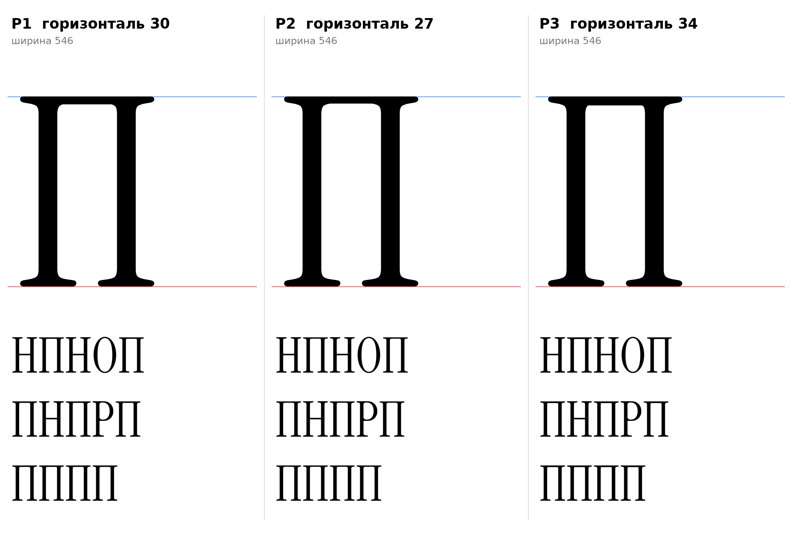

# П (U+041F, pe-cy), заглавная, прямое начертание

Статус на 15.10.2026: **основа P1** (горизонталь 30), P2 и P3 запасные (ждёт подтверждения автора проекта).

## Письмо (ductus) и F-пункты

Инструкция, раздел 7: две стойки и верхняя горизонталь с засечками (П-образная); горизонталь слева направо, левая стойка, правая стойка; не арка n, горизонталь тонкая, углы с засечками.

- F2: плоские опорные засечки внизу обеих стоек (от H).
- Головные засечки H на обеих стойках сохранены; верхняя горизонталь лежит на плоской линии 720 заподлицо с ними (круглых форм на 720 нет).
- F1 к заглавным не относится (косая головная засечка только на x-height у строчных).

## Конструкция

`pe_cap_sign` (`tools/glyphparts.py`): H оригинала, у которого вырезана перекладина (между стойками, x 160–386, стойки не задеты), и добавлена горизонталь от y = 720 − t до 720 между стойками с заходом в обе. Стойки 71, засечки, ширина 546 и поля 19/19 как у H, масштаб не применяется. Один контур.

| Вариант | Горизонталь | Комментарий |
|---|---|---|
| P1 | 30 | как перекладина H [ИЗМЕРЕНО], основа |
| P2 | 27 | как верх Л и L |
| P3 | 34 | плотнее |

## Класс и правила

В классе `@serif_bl` по геометрии (A x=19, B 70, C True): перед П п получает `pe-cy.flag` (проверено `tools/check_context_classes.py`). К `@head_tl` не относится (строчные).

## Открыто

- `[ОТКРЫТО]` Ширина П против H (сейчас равна H, 546); в кириллице П часто чуть уже.
- `[ОТКРЫТО]` Кернинг пар П с округлыми (О, С) и с Л, Н.

Файлы: `data/pe_cap/P1.glif`, `P2`, `P3` (`.glif`, `.svg`), `meta.json`; код: `tools/sketch_pe_cap.py`.
