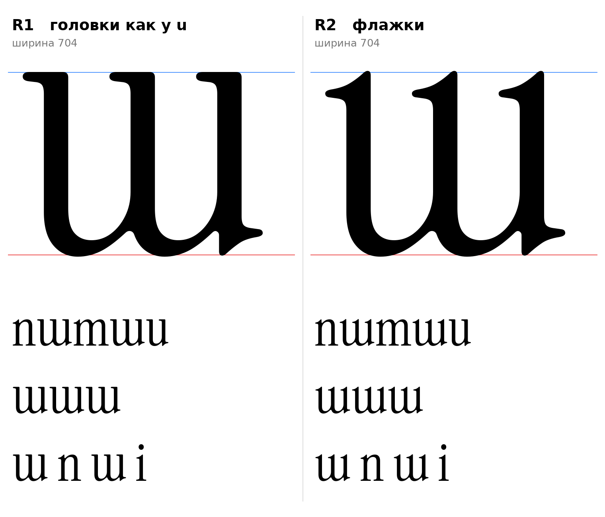

# ш (U+0448, sha-cy), строчная, прямое начертание

Статус на 14.10.2026: **две кандидатуры сохранены, окончательный выбор не сделан** (D15).

## Кандидатуры

Обе строятся одинаково: латинская `m` повёрнута на 180° вокруг центра x-height (преобразование `x' = 704 − x`, `y' = 510 − y`), прежние засечки снизу (теперь сверху) сняты на высоте 410, на верхушки стоек поставлены новые детали.

| | Верхушки стоек | Откуда деталь |
|---|---|---|
| **R1** | плоская засечка слева, как головка у `u` | левая стойка `u` выше y=400, сдвиг по стойкам |
| **R2** | наклонный флажок | головка `ı` (dotlessi) выше y=400, сдвиг по стойкам |

Общее:
- `[ИЗМЕРЕНО]` Ширина 704, как у `m`. Стойки 68, левые края 78, 320, 562 (у `m` были 74, 316, 558).
- `[ИЗМЕРЕНО]` Верх стоек ровно на 510 (R1), у R2 пик флажка 513 (как у донора `ı`).
- `[ИЗМЕРЕНО]` Дно арок на −6. Зона круглых низов оригинала −9 (раздел 2 CLAUDE.md), то есть не хватает 3 единиц (D16).
- `[НАБЛЮДЕНИЕ]` Шпора справа внизу появилась сама: это головной флажок `m` (вход пера), перевёрнутый вниз. Она читается как выход пера и перекликается с хвостами у a, d, u (реестр, F3). В обеих кандидатурах оставлена.
- Нижняя часть и сопряжения стоек с арками взяты как есть у `m`, поэтому они уже согласованы по толщине и подкосам.

## Расхождение с инструкцией

Инструкция (`docs/instruction.md`, раздел 3 и справочник в разделе 7) описывает прямую ш как три стойки и общую нижнюю линию и считает арку признаком курсива. Обе кандидатуры имеют круглый низ (форма ɯ). Если принимается одна из них, раздел 3 и описание ш в разделе 7 нужно править. До решения D15 не править.

## Что отброшено

Пять вариантов с прямой нижней линией (A без ножек, B опоры по краям, C ножки у каждой стойки, D хвост справа, E плоские верхи) рассматривались раньше и не выбраны: `docs/img/sha_A-E_not_chosen.png`. Скрипта для них в репозитории нет.

## Файлы

- `tools/sketch_sha.py`: воспроизводит эскизы из эталона (`tools/fetch_reference.sh`, затем `python3 -I tools/sketch_sha.py`). Функции в `tools/sketchlib.py`.
- `data/sha/R1.glif`, `R2.glif`: контуры для `.ufo` (имя `sha-cy`). `R1.svg`, `R2.svg`: те же контуры для просмотра. `meta.json`: размеры.

Ограничение: это эскизы из деталей оригинала, не финальные контуры. Обязательно отрисовать вручную: сопряжения арок со стойками в новых местах, форму шпоры, контрформы по правилу равных зазоров, поля и кернинг.
