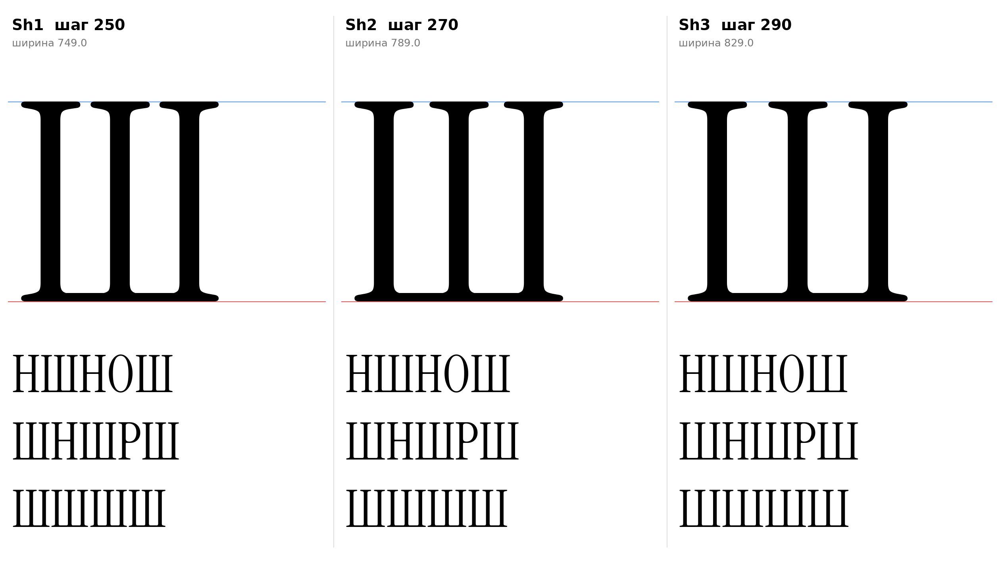

# Ш (U+0428, sha-cy), заглавная, прямое начертание

Статус на 15.10.2026: **основа Sh1** (шаг стоек 250), Sh2 и Sh3 запасные (ждёт подтверждения автора проекта).

## Письмо (ductus) и F-пункты

Инструкция, раздел 7: три стойки и общая нижняя линия, контрформы равны, нижняя линия тонкая. Тем же методом, что П (`docs/glyphs/pe_cap.md`): стойки и засечки H оригинала, горизонталь вместо перекладины.

- Строчная ш по решению автора проекта имеет круглый низ (D15, перевёрнутая латинская m). У заглавной нет латинского донора с аркой (M с V-образной серединой), поэтому прямой низ по инструкции. `[ОТКРЫТО]` нужен ли круглый низ у заглавной для единства с ш.
- Головные засечки H на всех трёх стойках (по 66 слева и 69 справа), опорные засечки H внизу крайних стоек; нижняя горизонталь толщиной 30 заподлицо с ними (y 0–30), у средней стойки нижние засечки уходят в неё.
- F2 на крайних стойках внизу. F1 к заглавным не относится.

## Конструкция

`sha_cap_sign` (`tools/glyphparts.py`): левая половина H (стойка 89–160) без перекладины для левой и средней стоек, правая половина H (386–457) для правой; шаг стоек pitch (у H между стойками 297); горизонталь от левой стойки до правой. Стойки 71, масштаб не применяется. Один контур, контрформы равны по построению, внутренние нижние углы со скруглением от засечек H.

| Вариант | Шаг | Ширина | Просвет между головными засечками |
|---|---|---|---|
| Sh1 | 250 | 749 | 36 (равен зазору между буквами 19+19, основа) |
| Sh2 | 270 | 789 | 56 |
| Sh3 | 290 | 829 | 76 |

Шаг 230 (ширина 709) отброшен: просвет засечек 15, слишком тесно. Числа просвета измерены по контуру (`top_pieces` в `data/sha_cap/meta.json`).

## Класс и правила

В `@serif_bl` по геометрии (A x=19, B 70, C True), в отличие от строчной ш: перед Ш п получает `pe-cy.flag`. К `@head_tl` не относится (заглавная).

## Открыто

- `[ОТКРЫТО]` Круглый или прямой низ (см. выше), ширина Ш, кернинг пар Ш с П, О, Н.
- Щ и Ц строятся от Ш отдельно.

Файлы: `data/sha_cap/Sh1.glif`, `Sh2`, `Sh3` (`.glif`, `.svg`), `meta.json`; код: `tools/sketch_sha_cap.py`.
