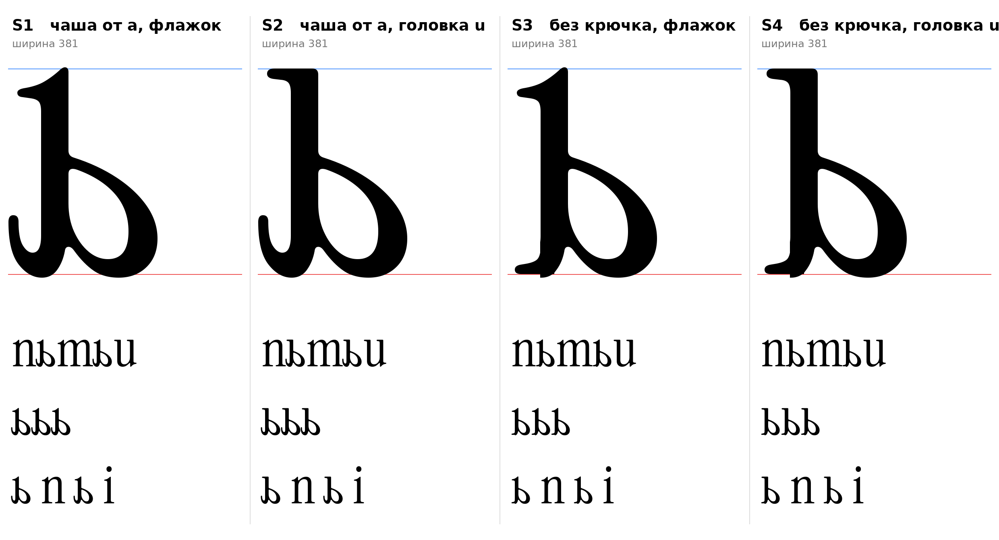

# ь (U+044C, softsign-cy), строчная, прямое начертание

Статус на 14.10.2026: **четыре эскиза, выбор не сделан** (D18).

## Что построено

Чаша взята от нижней чаши двухэтажной латинской `a` и отражена по горизонтали (в прямом начертании ось нажима вертикальна, отражение сохраняет распределение толщин). Стойка 62–130 (68), как у `b`. Верх стойки: флажок `ı` или плоская засечка слева, как у `u`.

| | Чаша | Низ слева | Головка | Ширина |
|---|---|---|---|---|
| **S1** | от `a` | хвост `a` (крючок) | флажок ı | 381 |
| **S2** | от `a` | хвост `a` (крючок) | как у `u` | 381 |
| **S3** | от `a` | крючок снят, опорная засечка ı слева | флажок ı | 381 |
| **S4** | от `a` | крючок снят, опорная засечка ı слева | как у `u` | 381 |

- `[ИЗМЕРЕНО]` Нижняя чаша `a`: низ −9, верх стыка со стойкой около 295 (58% x-height), слева от стойки 221 (у `b` справа от стойки 272). Чаша ниже и уже, чем у `b`, что совпадает с ловушкой из инструкции («чаша не заходит слишком далеко вправо»).
- `[ИЗМЕРЕНО]` Правая граница чаши 351, поле справа задано 30 (между `o` 25 и `b` 40), это догадка для кернинга, не измерение.
- `[НАБЛЮДЕНИЕ]` Крючок в S1 и S2 это отражённый выходной хвост `a` (F3): виден крупно, перекликается с хвостами `a`, `d`, `u`, но его место слева внизу нетипично для ь.
- `[НАБЛЮДЕНИЕ]` В S3 и S4 на стыке опорной засечки со стойкой есть небольшая ступенька: сопряжение не отрисовано.

## Что отброшено

Чаши от `b` и `p` на всю высоту x-height (как в первых эскизах ы): буква читается как «D». Эти варианты удалены из скрипта.

## Файлы

`tools/sketch_soft.py` (воспроизводит эскизы; функции в `tools/sketchlib.py`), `data/soft/S1…S4.glif` (имя `softsign-cy`), `S1…S4.svg`, `meta.json`.

Ограничение: эскиз из деталей оригинала, не финальный контур.
