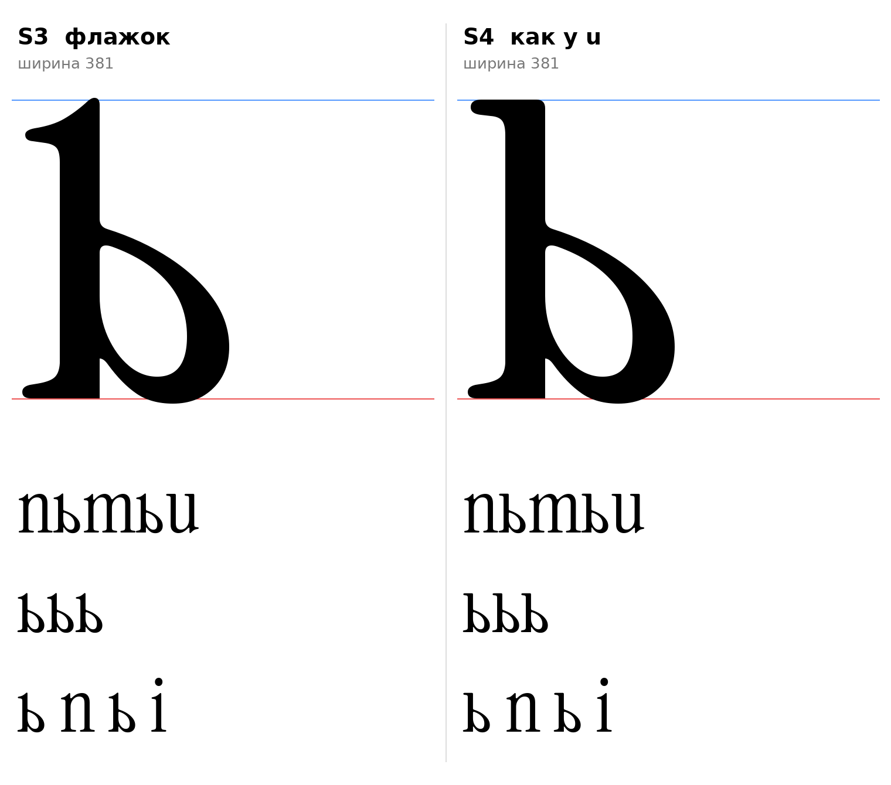

# ь (U+044C, softsign-cy), строчная, прямое начертание

Статус на 14.10.2026: **выбрана S3 (флажок)** автором проекта (D18 закрыто). S4 (головка как у `u`) не выбрана, остаётся в репозитории как запасной вариант. Выбранная ь используется в ы (`docs/glyphs/yery.md`, чаша вливается в правую стойку от `u`).

## Что построено

Чаша взята от нижней чаши двухэтажной латинской `a` и отражена по горизонтали (в прямом начертании ось нажима вертикальна, отражение сохраняет распределение толщин). Хвост и стойка от `a` не используются. Стойка собрана прямоугольником 62–130 (68, как у `b`) до базовой линии, слева опорная засечка `ı`. Справа низ стойки прямой, под чашей остаётся узкая щель, как у `b`.

| | Верх стойки | Ширина |
|---|---|---|
| **S3** | наклонный флажок ı | 381 |
| **S4** | плоская засечка слева, как у `u` | 381 |

- `[ИЗМЕРЕНО]` Нижняя чаша `a`: низ −9, верх стыка со стойкой около 295 (58% x-height), слева от стойки 221 (у `b` справа от стойки 272). Чаша ниже и уже, чем у `b`: совпадает с ловушкой из инструкции («чаша не заходит слишком далеко вправо»).
- `[ИЗМЕРЕНО]` Правая граница чаши 351; поле справа задано 30 (между `o` 25 и `b` 40), это догадка для кернинга, не измерение.
- `[ИЗМЕРЕНО]` Каждый вариант состоит из двух контуров: внешний и контрформа чаши; лишних дырок нет.

## Что отброшено и почему

- Чаши от `b` и `p` на всю высоту x-height: буква читается как «D».
- Левый крючок (отражённый хвост `a`, варианты S1, S2): крючки-выходы в этом шрифте бывают только справа (F3), слева они чужеродны. Наблюдение автора проекта.
- Опорные засечки с двух сторон: между правой засечкой и дном чаши остаётся замкнутая дырка, перемычка превращается в грубый блок.
- Заострённая шпора слева, как у `b`: повторяет `b`, но справа остаётся прямой вертикальный срез у стыка с дном чаши, закрыть без ручной отрисовки не получается.
- Ошибки ранних сборок (исправлены): зуб ниже базовой линии (низ стойки `a` на −8) и ступенька у засечки.

## Открытое

- `[РЕШЕНИЕ]` Выбор S3 (флажок). Согласованность с ш: флажки у ш это R2, головки как у `u` это R1 (D15 не решено).
- `[ОТКРЫТО]` Низ справа: щель под чашей и прямой срез стойки у основания надо отрисовать вручную (сопряжение, подкос).
- Эскиз из деталей оригинала, не финальный контур; поля и кернинг не отрисованы.

## Файлы

`tools/sketch_soft.py` (воспроизводит эскизы), `tools/glyphparts.py` (код ь), `tools/sketchlib.py` (общие функции), `data/soft/S3.glif`, `S4.glif` (имя `softsign-cy`), `S3.svg`, `S4.svg`, `meta.json`.
