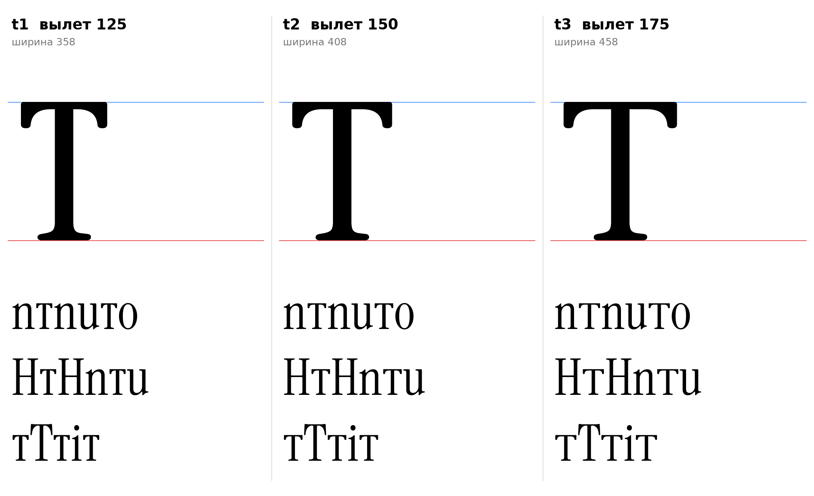

# т (U+0442, te-cy), строчная, прямое начертание

Статус на 15.10.2026: **основа t3** (вылет горизонтали 175, как у T), t1 и t2 запасные (D25: ждёт подтверждения автора проекта).

## Письмо (ductus) и F-пункты

Инструкция, раздел 7: горизонталь с короткими засечками вниз по краям, затем центральная стойка с ножкой. Силуэт Т-образный, не арка (раздел 3 инструкции) и не латинская t (CLAUDE.md, F3: хвост-выход у т не ставится).

- F2: опорная засечка у основания стойки (ножка ı, симметричная).
- F1 не нужен: верх стойки входит в горизонталь, свободного верха нет.
- F3, F4, F5: не применяются.

## Конструкция

Построено `te_sign` (`tools/glyphparts.py`), латинские контуры не масштабировались.

| Деталь | Значение | Источник |
|---|---|---|
| Горизонталь, толщина | 27 | `[ИЗМЕРЕНО]` перекладина ъ K2 (кончик головки u 24–26, у стойки 28–32); у заглавной T горизонталь около 43, но «горизонталь тонкая» (инструкция) и единый элемент с ъ `[РЕШЕНИЕ]` |
| Конец горизонтали | засечка вниз 70, одним контуром, скобка по замеру T (ширина 70 на глубине 40, 54 на 100, 37 на 140) | `[ИЗМЕРЕНО]` T; глубина 70 как у ъ K2 (D19, выбрано автором проекта) |
| Стойка | 68 | `[ИЗМЕРЕНО]` n 68 |
| Ножка | опорная засечка ı | F2 `[ИЗМЕРЕНО]` |
| Вылет горизонтали | 175 (t3), 150 (t2), 125 (t1) | `[ИЗМЕРЕНО]` у T по 175 с каждой стороны стойки (горизонталь 20–441, стойка 195–266); t1 и t2 `[РЕШЕНИЕ]` |
| Верх, низ | 510, 0 | `[ИЗМЕРЕНО]` плоские высоты |
| Левое поле | 20 (кончик горизонтали) | `[РЕШЕНИЕ]` как у T (20); поля не подобраны |

## Варианты

| | Вылет | Ширина | Комментарий |
|---|---|---|---|
| **t3 (основа)** | 175 | 458 | Вылет как у T, ширина рядом с u (454) и n (470) |
| t2 | 150 | 408 | Уже, ближе к знаку Т-образного ъ |
| t1 | 125 | 358 | Узкая |

- `[НАБЛЮДЕНИЕ]` В строке с H и n т выглядит как капитель T на высоте x; тонкая горизонталь 27 отличает её от буквы T.
- `[ОТКРЫТО]` Поля и кернинг (группа Т-образных: т и у, г), форма курсивной т (m-образная, допустима только в курсиве, D2), нужны ли болгарские формы (locl BGR для т, ПРОВЕРИТЬ по инструкции раздел 11).

## Файлы

`data/te/t1..t3.glif`, `.svg`, `meta.json`; код: `tools/sketch_te.py`, `tools/glyphparts.py`.
