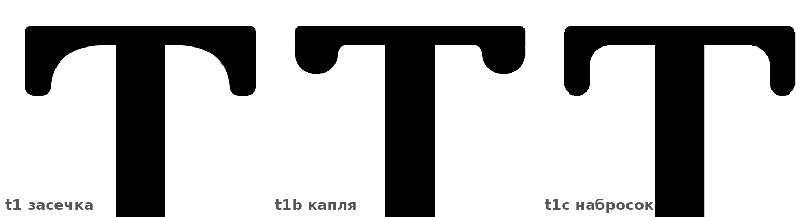
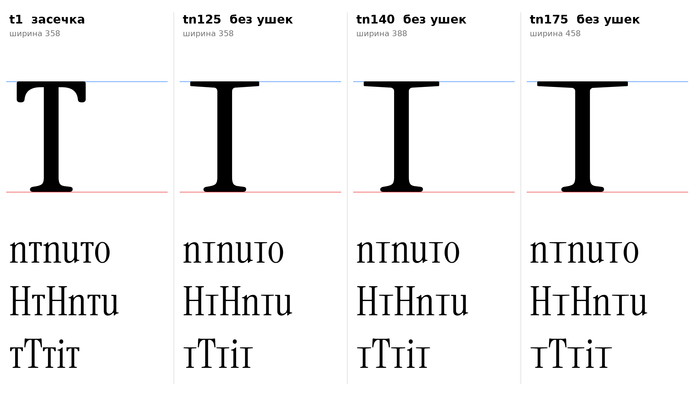

# т (U+0442, te-cy), строчная, прямое начертание

Статус на 15.10.2026: **основа t1** (вылет 125), выбрана автором проекта (D25 закрыто). Рядом t1b (те же размеры, другие ушки: капля) и запасные t2, t3.

## Письмо (ductus) и F-пункты

Инструкция, раздел 7: горизонталь с короткими засечками вниз по краям, затем центральная стойка с ножкой. Силуэт Т-образный, не арка (раздел 3 инструкции) и не латинская t (CLAUDE.md, F3: хвост-выход у т не ставится).

- F2: опорная засечка у основания стойки (ножка ı, симметричная).
- F1 не нужен: верх стойки входит в горизонталь, свободного верха нет.
- F3, F4, F5: не применяются.

## Конструкция

Построено `te_sign` (`tools/glyphparts.py`), латинские контуры не масштабировались.

| Деталь | Значение | Источник |
|---|---|---|
| Горизонталь, толщина | 27 | `[ИЗМЕРЕНО]` перекладина ъ K2 (кончик головки u 24–26, у стойки 28–32); у заглавной T горизонталь около 43, но «горизонталь тонкая» (инструкция) и единый элемент с ъ `[РЕШЕНИЕ]` |
| Конец горизонтали | засечка вниз 70, одним контуром, скобка по замеру T (ширина 70 на глубине 40, 54 на 100, 37 на 140) | `[ИЗМЕРЕНО]` T; глубина 70 как у ъ K2 (D19, выбрано автором проекта) |
| Стойка | 68 | `[ИЗМЕРЕНО]` n 68 |
| Ножка | опорная засечка ı | F2 `[ИЗМЕРЕНО]` |
| Вылет горизонтали | 125 (t1, основа, выбор автора проекта), 150 (t2), 175 (t3) | у T по 175 с каждой стороны стойки (горизонталь 20–441, стойка 195–266) `[ИЗМЕРЕНО]`; 125 `[РЕШЕНИЕ]` автора проекта |
| Верх, низ | 510, 0 | `[ИЗМЕРЕНО]` плоские высоты |
| Левое поле | 20 (кончик горизонтали) | `[РЕШЕНИЕ]` как у T (20); поля не подобраны |

## Варианты

| | Вылет | Ширина | Комментарий |
|---|---|---|---|
| **t1 (основа)** | 125 | 358 | Узкая, засечки вниз 70 как у ъ K2. Выбор автора проекта |
| t1b | 125 | 358 | Как t1, ушки каплевидные (F5): на конце горизонтали капля радиуса 30, свисает на 40 ниже горизонтали, сопряжение скруглено (радиус 11) |
| t1c | 125 | 358 | Ушки по наброску автора проекта (`docs/img/author_sketch_te_ear.png`): вертикальный внешний край, круглый верхний угол, узкое ушко (ширина 35, глубина 70 под горизонталью) с круглым низом и большим плавным сопряжением (радиус 28) с низом горизонтали |
| tn125, **tn140**, tn175 | 125, 140, 175 | 358, 388, 458 | **Без ушек**, по принципу наброска автора проекта (`docs/img/author_sketch_te_plain_1.png`, `_2.png`): тонкая прямая горизонталь с плоскими концами, ножка ı. Толщина горизонтали сужается от 32 у стойки до 22 на кончике (головная засечка: 20–23 на кончике, около 32 у стебля), верхний край ровный на 510, углы кончиков скруглены (радиус 5), сопряжение со стойкой скруглено (радиус 16). tn140 ближе всего к наброску: на нём горизонталь около 350 при высоте стойки 215 |
| t2 | 150 | 408 | Запасная |
| t3 | 175 | 458 | Запасная: вылет как у T, ширина рядом с u (454) и n (470) |

- `[НАБЛЮДЕНИЕ]` В строке с H и n т выглядит как капитель T на высоте x; тонкая горизонталь 27 отличает её от буквы T.
- `[НАБЛЮДЕНИЕ]` t1b: капля на концах читается мягче засечки и ближе к каплевидным завершениям a, f, r (F5), но выбивается из строки с ъ (ъ K2 с засечкой).
- `[НАБЛЮДЕНИЕ]` t1c: на наброске автора горизонталь толще ушка (90 к 38). При толщине горизонтали 27 пропорции перенесены по глубине и радиусам, а не по толщине (ушко 35 вместо 11), иначе ушко было бы тоньше кончиков засечек (20–23). Если нужна другая пропорция, ширину ушка и радиус сопряжения можно менять (`ear_w`, `fillet` в `te_sign`). Контур t1c, t1b, мягкой м ломаная с мелким шагом (эскиз); в TTF-превью координаты округлены, на увеличении видны грани.

- `[НАБЛЮДЕНИЕ]` tn без ушек читаются как «I» с расширенной перекладиной и в строке сливаются с латинской I и ı; t1 с ушками отличает т от них.

- `[ОТКРЫТО]` Поля и кернинг (группа Т-образных: т и у, г), форма курсивной т (m-образная, допустима только в курсиве, D2), нужны ли болгарские формы (locl BGR для т, ПРОВЕРИТЬ по инструкции раздел 11).

## Файлы

`data/te/t1..t3.glif`, `.svg`, `meta.json`; код: `tools/sketch_te.py`, `tools/glyphparts.py`.
