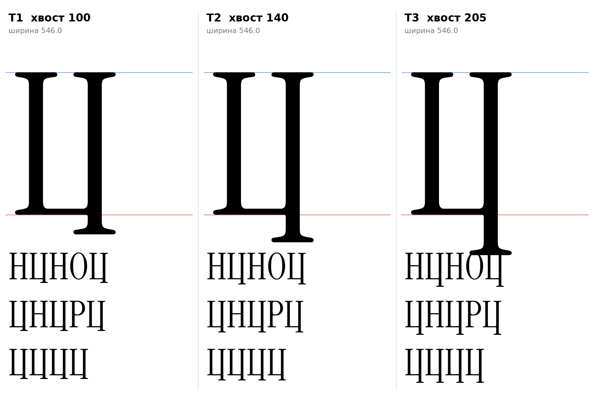

# Ц (U+0426, tse-cy), заглавная, прямое начертание

Статус на 15.10.2026: **основа T2** (хвост 140), T1 и T3 запасные; длина хвоста не измерена (D5), ждёт подтверждения автора проекта.

## Письмо (ductus) и F-пункты

Две стойки (как у П), общая нижняя горизонталь на базовой линии (как у Ш) и хвост справа: правая стойка продолжена ниже базовой линии (F8: хвосты под строкой). Метод тот же: стойки и засечки H оригинала без масштаба.

- Головные засечки H на обеих стойках; F2 опорные засечки на левой стойке внизу.
- Хвост: правая стойка вниз с опорной засечкой H на конце (как у p и q на −205); на базовой линии справа засечки нет, горизонталь входит в стойку.
- F1 к заглавным не относится.

## Конструкция

`tse_cap_sign` (`tools/glyphparts.py`): левая половина H без перекладины, правая половина H без перекладины и без правой нижней засечки (подкосная часть слева остаётся, как у левой стойки), горизонталь 30 (как перекладина H) от левой до правой стойки на y 0–30, хвост: стойка вниз и опорная засечка H, смещённая на длину хвоста. Внутренний угол под горизонталью скруглён радиусом 10 только в зоне шва стойки и хвоста (shapely); внутренние углы контрформы с подкосом H. Один контур, ширина 546 и поля H (19/19).

| Вариант | Хвост (ниже базовой линии) | Комментарий |
|---|---|---|
| T1 | 100 | короткий |
| T2 | 140 | стартовая догадка D5, основа |
| T3 | 205 | как нижний вынос p и q (−205) |

`[ОТКРЫТО]` Длина хвоста (D5) не измерена и это не измерение; T3 равен зоне −205, остальные догадки. Решение за автором проекта.

## Класс и правила

В `@serif_bl` по геометрии (левая стойка с засечкой внизу): перед Ц п получает `pe-cy.flag`. К `@head_tl` не относится (заглавная).

## Открыто

- `[ОТКРЫТО]` Длина хвоста (D5), форма хвоста (прямой с засечкой или с изгибом), ширина Ц, кернинг пар Ц с Н, О, П.
- Щ и Д строятся от Ц и Ш отдельно.

Файлы: `data/tse_cap/T1.glif`, `T2`, `T3` (`.glif`, `.svg`), `meta.json`; код: `tools/sketch_ge_tse_cap.py`.
