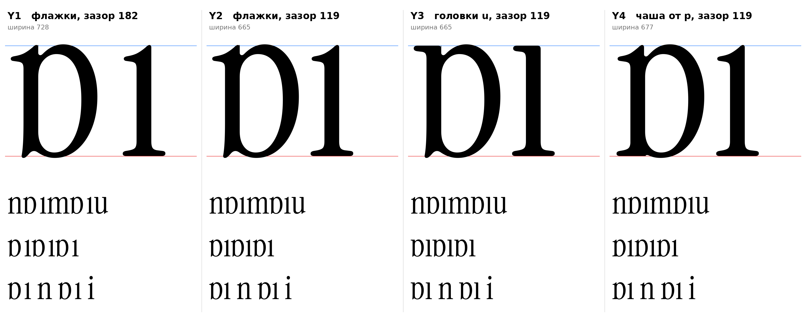

# ы (U+044B, yeru-cy), строчная, прямое начертание

Статус на 14.10.2026: **четыре эскиза, выбор не сделан** (D17).

Конструкция по инструкции (раздел 7): ь плюс правая стойка, расстояние между чашей и стойкой равно промежутку между стойками н, чаша ь не касается стойки.

## Эскизы

ь: латинская `b` со срезанным на 510 верхним выносным и головкой на x-height (стойка `b` 62–130, чаша до x=402). Правая стойка: `ı` (флажок, обе опорные засечки) или низ `ı` с головкой `u`.

| | Головки | Зазор между чашей и стойкой | Чаша | Ширина |
|---|---|---|---|---|
| **Y1** | флажок ı | 182 (контрформа `n`, по инструкции) | от `b` | 728 |
| **Y2** | флажок ı | 119 (rsb `b` 40 плюс отступ стойки `ı` 79) | от `b` | 665 |
| **Y3** | плоская засечка слева, как у `u` | 119 | от `b` | 665 |
| **Y4** | флажок, свой у `p` | 119 | от `p` (стойка 73–141, чаша до 414, спуск срезан, добавлена левая опорная засечка) | 677 |

- `[ИЗМЕРЕНО]` Верх 516 (овершут чаши), низ −9. Все четыре в границах зон оригинала.
- `[НАБЛЮДЕНИЕ]` Y1 по инструкции, но на отрисовке зазор выглядит рыхлым рядом с `n`. Y2 и Y3 держат серость строки лучше.
- `[НАБЛЮДЕНИЕ]` Y3 согласуется с R1 для ш (те же головки `u`). Y2 согласуется с R2.
- `[НАБЛЮДЕНИЕ]` Y4 теряет шпору внизу слева (F4), которая есть у `b`.

## Исправлено 14.10.2026

Первая версия эскизов была сломана:
- стойку `b` я срезал плоско на 512, а головку ı лишь наложил сверху, поэтому на ь оставался квадратный выступ вместо пика, и буква читалась как «D»;
- в Y3 остаток выносного `b` (2 единицы шириной) торчал зазубриной над плоской головкой;
- в строке-образце была кириллическая «м», которой в шрифте нет (квадрат вместо буквы);
- в Y4 спуск `p` не срезался целиком (его опорная засечка шире 150).

Теперь стойку `b` выше 400 убираем до x=128, верх берётся целиком от ı или u, остаток срезается ровно по верху головки (проверено: над головкой левее x=170 нет ни одной точки).

## Открытое

- `[ОТКРЫТО]` Чаша от `b` доходит до x-height, и между верхом стойки и верхом чаши остаётся узкая щель, из-за чего ь читается плотно, ближе к «D». В классических начертаниях чаша ь может быть ниже (ПРОВЕРИТЬ по образцам); если так, чашу придётся рисовать вручную, масштабировать чашу `b` нельзя (меняется контраст).
- `[ОТКРЫТО]` Какой зазор верен (182 или 119) и какие головки (флажки или как у `u`): решается вместе с ш (D15), чтобы буквы были согласованы.
- Эскиз, не финальный контур: сопряжения чаши со стойкой, форма щели и поля не отрисованы.

## Файлы

`tools/sketch_yery.py` (воспроизводит эскизы; общие функции в `tools/sketchlib.py`), `data/yery/Y1…Y4.glif` (имя `yeru-cy`), `Y1…Y4.svg`, `meta.json`.
