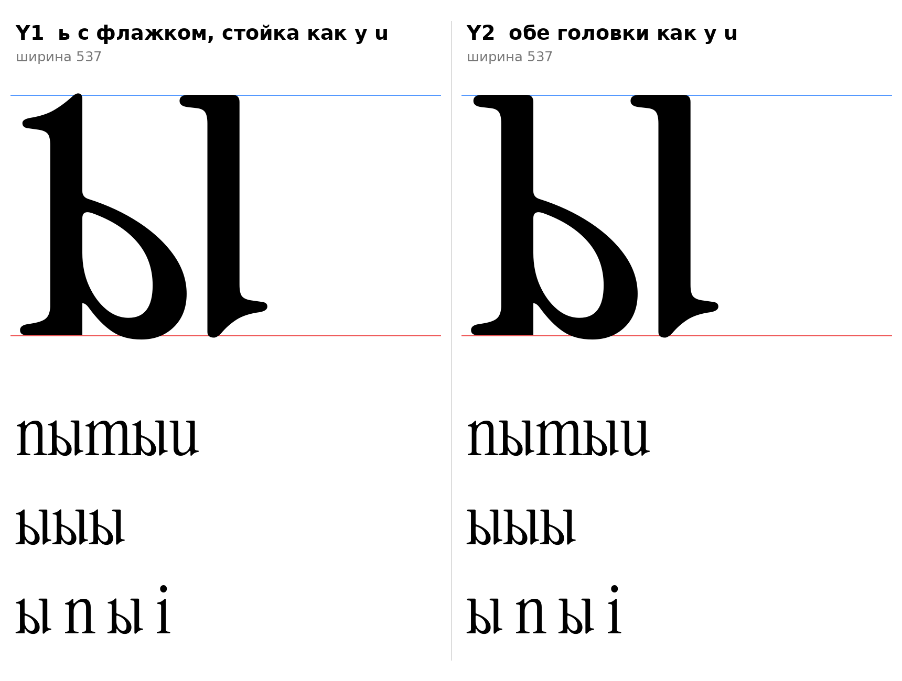

# ы (U+044B, yeru-cy), строчная, прямое начертание

Статус на 14.10.2026: **собрана по рисунку автора проекта, два варианта**. Основной Y1 (выбор автора проекта), Y2 сохранён.

## Конструкция

Рисунок автора проекта: ь и правая стойка раздельны (между ними зазор), у стойки сверху плоская головка слева, внизу острая ножка и хвост-выход справа. Это правая стойка латинской `u`. Контуры построены кодом, рисунок не обводился.

- Левая часть: ь (`docs/glyphs/soft.md`) из общего кода `tools/glyphparts.py`: одна форма ь в обеих буквах, при правке ь меняется и ы.
- Правая часть: стойка `u` (головка слева, стойка, ножка, хвост-выход справа внизу).
  - Головка берётся целиком (выше y=400 от x=250).
  - Левый край ниже: 312 до y=150, затем плавное сужение до 317 к y=62, где у `u` начинается прямой край ножки (измерено). Без сужения на стыке была ступенька в 5 единиц.
- Зазор между правым краем чаши ь (351) и левым краем стойки: **44**, снят с рисунка автора проекта.

| | ь | Головка правой стойки | Ширина |
|---|---|---|---|
| **Y1** | S3 (флажок) | плоская, как у `u` (рисунок слева) | 537 |
| **Y2** | S4 (головка как у `u`) | плоская, как у `u`: обе головки плоские (рисунок справа) | 537 |

- `[ИЗМЕРЕНО]` Три контура в каждом варианте: ь снаружи, контрформа чаши, правая стойка. Левая граница −2, правая 522, верх 513 (Y1) и 510 (Y2), низ −9. Поле справа 15, как у `u`.
- `[НАБЛЮДЕНИЕ]` Хвост справа внизу это F3: тот же хвост, что у `a`, `d`, `u`; он справа, как и положено.
- `[РЕШЕНИЕ]` Выбор автора проекта: основной Y1, Y2 не удалять.
- `[ОТКРЫТО]` Зазор 44 снят с рисунка на глаз (по размерам x-height на рисунке): уточнить при подборе поля и кернинга. Поле слева у ь не подобрано под строку.

## Что было неверно и исправлено

- Первая сборка по рисунку вливала чаша в стойку (заход 6 единиц), и буквы слиплись. На рисунке автора проекта между ними зазор. Моя ошибка чтения рисунка.
- Прямой срез левого края стойки по 312 давал ступеньку на стыке с ножкой.

## Что отброшено

- Первые эскизы ы с зазором между ь и стойкой ı (182 и 109) и с чашей от `b` и `p`: чаша от `b` и `p` читалась как «D»; стойка ı не соответствует рисунку автора проекта.

Эскиз из деталей оригинала, не финальный контур.

## Файлы

`tools/sketch_yery.py` (воспроизводит эскизы), `tools/glyphparts.py` (общая ь), `tools/sketchlib.py`, `data/yery/Y1.glif`, `Y2.glif` (имя `yeru-cy`), `Y1.svg`, `Y2.svg`, `meta.json`.

## Правка 15.10.2026

Левый край правой стойки ы (Y1 и Y2) теперь прямая вертикаль по всей длине (раньше сужалась на 5 единиц к ножке). Правило автора проекта, общая функция `_u_edge_fix` (`tools/glyphparts.py`, `tools/sketch_yery.py`); зазор между чашей ь и стойкой теперь одинаков вдоль всей стойки.
