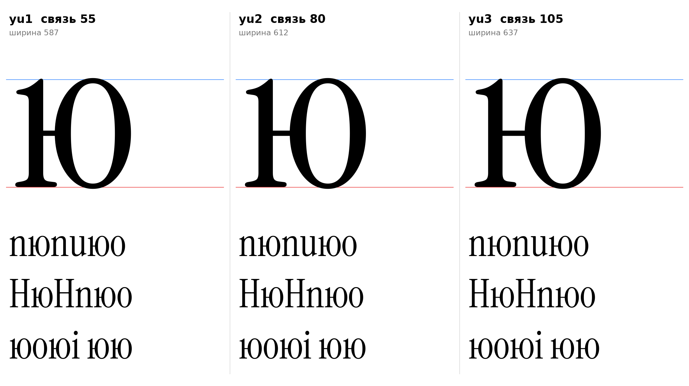

# ю (U+044E, yu-cy), строчная, прямое начертание

Статус на 15.10.2026: **основа yu2** (связь 80), yu1 и yu3 запасные (D28: ждёт подтверждения автора проекта).

## Письмо (ductus) и F-пункты

Инструкция, раздел 7: стойка слева, соединительная горизонталь на середине x, овал справа. Овал равен о по высоте и овершуту, соединение тонкое, овал не касается стойки.

- F1: свободный верх левой стойки (флажок ı).
- F2: ножка стойки (опорная засечка ı).
- F3, F4, F5: не применяются.

## Конструкция

Построено `yu_sign` (`tools/glyphparts.py`): стойка это ı оригинала, овал это о оригинала (516 / −9), оба без масштаба.

| Деталь | Значение | Источник |
|---|---|---|
| Овал | о без изменений, высота 516, овершут −9 | `[ИЗМЕРЕНО]` о оригинала |
| Горизонталь | 25 | `[ИЗМЕРЕНО]` e: 25; «соединение тонкое» (инструкция) |
| Центр горизонтали | 254 (центр овала) | `[РЕШЕНИЕ]` у н центр 264 (51,8%, оптическая поправка H), у ю горизонталь встаёт по центру овала |
| Горизонталь входит в овал | на 8 | `[РЕШЕНИЕ]` без шва |
| Зазор между стойкой и овалом | равен длине связи (проверено: расстояние между контурами 55, 80, 105) | `[ИЗМЕРЕНО]` проверка shapely: стойка и овал не касаются |
| Поля | 15 слева, 25 справа | `[ИЗМЕРЕНО]` ı 15, о 25; `[РЕШЕНИЕ]` |

## Варианты

| | Длина связи | Ширина |
|---|---|---|
| yu1 | 55 | 587 |
| **yu2 (основа)** | 80 | 612 |
| yu3 | 105 | 637 |

- `[РЕШЕНИЕ]` Основа yu2: зазор 80 примерно равен ширине просвета у ь и ы (44) и n (контрформа 182) в середине; yu1 в строке кажется тесным, yu3 разрывает букву на две.
- `[ОТКРЫТО]` Поля, кернинг, курсивная ю, слитность овала с о в строке («юо»).

## Файлы

`data/yu/yu1..yu3.glif`, `.svg`, `meta.json`; код: `tools/sketch_yu.py`, `tools/glyphparts.py`.
