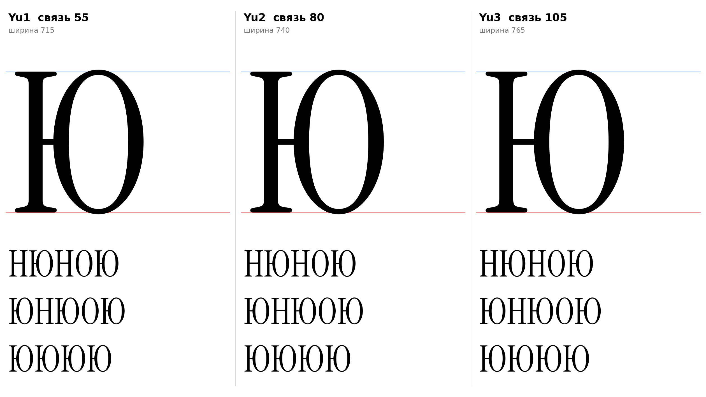

# Ю (U+042E, yu-cy), заглавная, прямое начертание

Статус на 15.10.2026: **основа Yu1** (связь 55, как у выбранной строчной ю), Yu2 и Yu3 запасные (ждёт подтверждения автора проекта).

## Письмо (ductus) и F-пункты

Инструкция, раздел 7 (ю): стойка слева, соединительная горизонталь, овал справа; овал не касается стойки. Метод как у П и Ш: детали H и О оригинала без масштаба.

- F2: опорная засечка внизу стойки (от H); головная засечка H вверху стойки.
- F1 к заглавным не относится; F3, F4, F5 не применяются.
- Овал на овершутах заглавной О: 730 / −9, на плоские линии 720 и 0 круглая форма не ставится (стойка на 720 и 0, овал выступает).

## Конструкция

`yu_cap_sign` (`tools/glyphparts.py`): левая половина H (стойка 89–160 с засечками) без перекладины; овал О оригинала сдвинут так, что расстояние от правого края стойки (160) до левого края овала (у О 40) равно длине связи; горизонталь толщиной 30 (как перекладина H) входит в овал на 8. Центр горизонтали 361, по центру овала (730 − 9) / 2 = 360,5, как у строчной ю. Два контура (внешний и контрформа овала), поля 19 слева (H) и 40 справа (О).

| Вариант | Связь | Ширина | Просвет засечка до овала |
|---|---|---|---|
| Yu1 | 55 | 715 | 55 |
| Yu2 | 80 | 740 | 80 |
| Yu3 | 105 | 765 | 105 |

Просвет измерен по горизонтальным срезам контура стойки с засечками и овала (шаг 5); он равен связи, потому что ближе всего они на середине высоты, а засечки овала не касаются.

## Класс и правила

В `@serif_bl` по геометрии (A x=19, B 70, C True): перед Ю п получает `pe-cy.flag`. К `@head_tl` не относится (заглавная).

## Открыто

- `[РЕШЕНИЕ]` Горизонталь 30 и центр 361 это выбор проекта по аналогии со строчной ю и H; подтверждение автора проекта.
- `[ОТКРЫТО]` Ширина Ю, кернинг пар Ю с О, Н, П.

Файлы: `data/yu_cap/Yu1.glif`, `Yu2`, `Yu3` (`.glif`, `.svg`), `meta.json`; код: `tools/sketch_yu_cap.py`.
