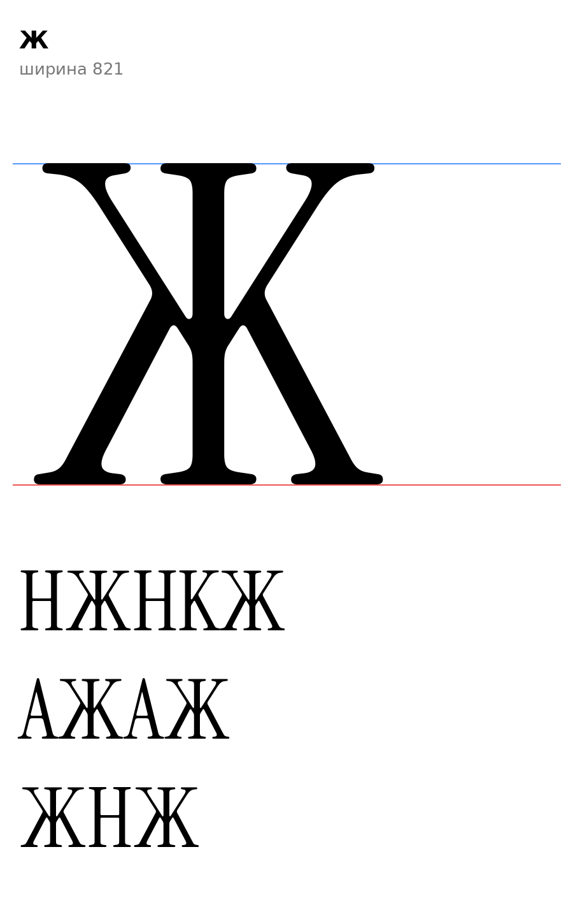

# Ж (U+0416, Zhe-cy), заглавная

Статус на 15.10.2026: по просьбе автора проекта («может быть Ж»; идея из старой разработки, контур нарисован заново).

## Конструкция

`zhe_sign`: правая половина K оригинала (от оси стойки x=124,5) и её зеркало относительно оси, по правилу 16.2 инструкции (Ж из двух половин K: роли штрихов от K, верхняя ветвь тонкая 30, нижняя толстая 67–70, стойка 68–71). Левый край 19, как у K.

- Ширина 821, x 19–802, y 0…720, один контур. Высота `[ИЗМЕРЕНО]` 720.
- Ветви и засечки от K оригинала: головки на кончиках верхних ветвей, опорные засечки у ног и у стойки.
- F-пункты: F2 (опорные засечки), F6 (верхи диагоналей: у K плоские 720, овершут не ставится).
- Старая Ж была уже: 736 против нашей 821. `[ОТКРЫТО]` Длина ветвей (у K они длинные), можно укоротить; ширина и поля 19/19, кернинг.
- Правило `serif_bl`: входит в класс (ножки с засечками слева внизу).

Файлы: `data/zhe/zhe.glif`, `.svg`; код: `tools/sketch_batch2.py`, `tools/glyphparts.py`.
