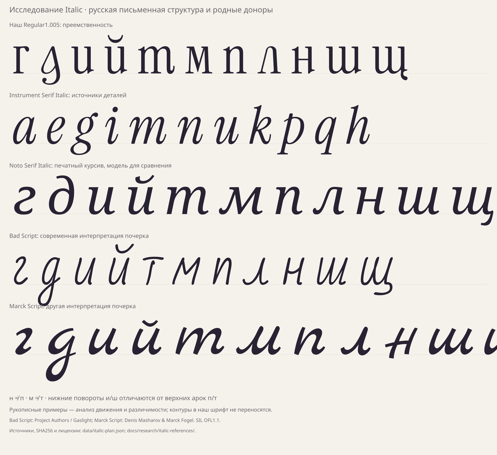

# Italic: русская письменная основа и экономная разработка

[РЕШЕНИЕ · 16.10.2026] Это исследование и план будущего Italic. Рабочая
Regular1.005 остаётся текущей сборкой. Для курсива выбрана русская модель
чтения строчных, а рисунок и контраст должны продолжать Instrument Serif.
Задача — два вида преемственности: узнаваемое русское письмо и единая
семья с нашим Regular и родной латиницей Italic.

[РЕШЕНИЕ · 17.10.2026] Нормативные правила построения (числа, допуски, приёмка): [italic-rules.md](italic-rules.md).



## 1. Что проверено по источникам

[ИЗМЕРЕНО] Основной источник — `Instrument_Serif_Italic.glyphs`, тот же
эталон65c0ef2. Контуры, экспортированные размеры и метрики сопоставлены
с `InstrumentSerif-Italic.ttf`. Измерения и исходные/экспортированные
якоря находятся в `data/params.json → italic.research`. Пустой список
якорей в исходном слое не означает, что их нет в экспортированном GPOS:
часть привязок генерируется при экспорте.

| Параметр | Значение / значение для разработки |
|---|---|
| Наклон мастера |13° вправо; `post.italicAngle`=−13 |
| Номинальный x-height |510; верх округлой арки n=516 |
| Cap height / ascender / descender мастера |720 /740 /−205 |
| Измеренные d,b / f / g нижний вынос |743 /748 /−216 |
| Ширина n: Regular → Italic |470 →521 |
| Ширина u: Regular → Italic |454 →508 |
| Ширина a: Regular → Italic |399 →474 |
| Отрицательные левые вылеты |H−36, p−89, g−68 |

[ИЗМЕРЕНО] Старое `italic.vertical.flat_x=516` оказалось подписью к
фактическому верху n, а не к линии мастера. Исправлено на510;516 сохранено
как `n_outline_top`. Изменение записано в журнале параметров. Ось нажима
округлых около15° и наклон стоек13° — разные измерения, смешивать их нельзя.
Ширины и кернинг Regular не являются готовыми данными для Italic.
Флаг p достигает583, ухо g —598: обрезать все доноры по510 нельзя,
иначе потеряются намеренные входы и окончания.

[НАБЛЮДЕНИЕ] У родных a/e/k/m/n/u/y иной рисунок, чем у наклонённого
Regular. a одноэтажная, g двухэтажная с отдельной нижней петлёй. У i/n/u
входы и выходы сменяют обычные ножки; при этом у p действительно есть
нижняя опора. Правило «в курсиве вообще нет засечек» неверно для этого
шрифта. Капители также нужно брать из собственных Italic-доноров.

[НАБЛЮДЕНИЕ] Для русской структуры сопоставлены Noto Serif Italic
(печатный курсив) и **Bad Script / Marck Script** (современные авторские
интерпретации почерка, обе с кириллицей). Последние — не нормативные
прописи и не единственно возможное русское письмо. Они показывают
устойчивые различия и допустимые варианты. SHA256, ссылки и сведения
об источниках — `data/italic-plan.json`; лицензии —
`docs/research/italic-references/`. Из этих примеров не берутся контуры
для Very Peri. Порядок движений пера ниже — конструкционная модель,
а не восстановленная по шрифтовым контурам запись настоящего письма.

## 2. Русский курсив: какие различия обязательны

| Буква | Рекомендуемая отправная модель | Что нельзя смешивать |
|---|---|---|
| и, й |u-образный нижний поворот; й=и+бреве |Не наклонённая прописная И |
| п |n-образная верхняя арка |Не назначать n также букве н |
| т |m-образная форма как основной кандидат |Не назначать m также букве м |
| н |Две стойки и различимая поперечная связь, смягчённая движением |Не превращать в п |
| м |Своя конструкция с центральным прогибом и письменными входом/выходом |Не латинская m; проверять отдельно от т |
| ш |Три стойки, нижние повороты |Не три верхние арки, как у т |
| ц, щ |Структура и/ш с нижним окончанием |Хвост не должен ломать чтение основы |
| л |Низкий входной крюк, подъём и правая нисходящая часть |Не простое сжатие Л и не копия u |
| г |Плавные встречные повороты письменной г |Не автоматически прежняя Г и не латинская g |
| д |Для рукописной преемственности — кандидат с одной чашей и нижней петлёй |Не автоматически двухэтажная g родной латиницы |

[РЕШЕНИЕ] Исправлены ошибочные указания старой инструкции «н как n» и
«м как m». Буквы должны различаться направлением поворотов и устройством
узла, а не только шириной. Для т есть и рукописные варианты с верхней
чертой, что видно у Bad Script; это не основание делать черту обязательной
в основном начертании. Аналогично учебные подчёркивания ш не переносятся
автоматически в текстовый шрифт.

[ОТКРЫТО] Одночашная петлевая д — рекомендуемая стартовая модель,
но её окончание нужно сравнить в словах. В печатных курсивных традициях
встречается также форма с верхним выносом: она видна у Noto и не должна
ошибочно объявляться «единственной рукописной». Цель пользователя делает
нижнюю петлю приоритетным кандидатом. Родная двухэтажная g даёт отдельные
детали и характер кривых, но не готовую д целиком.

[ОТКРЫТО] Финальные л/м, степень петлевости в/б, выносная альтернатива з
и длина выходов требуют пилота. Эти варианты нельзя решать только
наклоном и переносом деталей.

[РЕШЕНИЕ] Почерк задаёт логику движения: тонкий подъём, несущую нисходящую
часть, разворот и выход. Готовый текстовый Italic не обязан соединять
каждую букву с соседней. Массовые соединительные лигатуры не нужны.
Правила русского чтения — основной режим; сербские/болгарские варианты
не подменяют его молча. Возможный `locl` — отдельное расширение.

## 3. Преемственность с нашим Regular и казахским набором

[НАБЛЮДЕНИЕ] В нашем Regular уже выбраны арочные п/т и u-образная и.
Поэтому одного добавления арок в Italic недостаточно. Его отличие дадут
собственные одноэтажная а, наклонные оси, пропорции, входы/выходы и узлы
родного Italic. Смысл уже выбранных фирменных деталей сохраняется.

[РЕШЕНИЕ] Капля хвостов ц/щ/қ/ң остаётся семейным мотивом, прежняя версия
может сохранять смысл `ss09`. Но обе курсивные формы нужно строить по
курсивному движению и сопряжению; вставка вертикального SVG-хвостика
Regular без адаптации создаст чужой узел.

[РЕШЕНИЕ] Казахские производные строятся после соответствующих баз:
ғ←г, қ←к, ң←н, ө←о, ұ←ү и прописные аналоги. У ү/ұ сохраняются узкая
развилка и **прямой вынос вдоль курсивной оси**, а не хвост обычной y.
«Прямой» в Italic не означает вертикальный относительно экрана.
Пара У/Ү дополнительно проверяется по языковой различимости и выбранной
семейной модели. Ә/ә требуют собственных открытых чаш и перекладин;
поворот e — только схема для поиска, не готовый контур.

## 4. На чём действительно экономим

[ИЗМЕРЕНО] Карта покрывает все84 позиции русского/казахского набора:
**26 прямых донорских кандидатов,24 компонентных и34 требующих отдельной
конструкции**. Это категории работы, а не процент готовности и не обещание
экономии определённого количества часов. Даже прямые кандидаты проходят
проверку ширины, диакритики, чтения и кернинга.

Прямые кандидаты:

| Ряд | Кириллица → родной Italic |
|---|---|
| Прописные |А/A, В/B, Е/E, Ё/Edieresis, К/K, М/M, Н/H, О/O, Р/P, С/C, Т/T, Х/X, І/I |
| Строчные |а/a, е/e, ё/edieresis, и/u, о/o, п/n, р/p, с/c, т/m, у/y, х/x, і/i, һ/h |

[РЕШЕНИЕ] Для точных совпадений выгоднее копировать родной глиф с его
шириной и пригодными hint-инструкциями, чем многократно перегонять его
через SVG и обратно. Кириллические имена лучше оставить отдельными:
общий glyph ID для латинской n и кириллической п осложнит выборочные
контекстные подстановки в смешанном тексте.

[РЕШЕНИЕ] Библиотека деталей должна содержать небольшой набор:

| Деталь | Источник / применение |
|---|---|
| Наклонная стойка с входом/выходом |i/dotlessi/l; новые н/к/ь и соединения |
| Верхняя арка |n/h/m; семейство п/т и узлы без повторной отрисовки |
| Нижний поворот |u; и/ш/ц/щ, с общей стойкой вместо наложения целых u |
| Овал и соединение чаши |a/o/p/q; б/в/ф/ю и варианты д |
| Петля/выход ниже строки |g/j/y как источники деталей; новая д и хвосты |
| Ветви и окончания |k/K/x; к/ж и производные, с проверкой нужной высоты |
| Диакритика и перекладины |Родные акценты и тонкие элементы Italic |

[РЕШЕНИЕ] Латинская k имеет верхний вынос, кириллической к он не нужен.
Экономия здесь — короткая стойка плюс подходящие ветви, а не сжатие всей k.
Так же нельзя получить м зеркальным копированием одной половины v без
проверки нажима и терминалов.

[РЕШЕНИЕ] Удобная система сборки: `u=x−s·y`, где s=tan13°. Это координата
поперёк оси для анализа, размещения модулей и якорей. При переносе вдоль
оси на Δy учитывать Δx=s·Δy. Простое зеркало наклонённого контура меняет
правый наклон на левый; зеркалить можно конструкционную схему с последующей
отрисовкой, но не объявлять зеркальный контур готовой буквой. Обезнаклонная
система сама по себе не делает геометрию Regular пригодной для Italic.

[РЕШЕНИЕ] Техническая экономия:

1. Общая параметризованная сборка Regular/Italic: свой источник латиницы,
   мастер, рецепты, правила контекста и якорей. Без копии большого скрипта
   и подмен глобальных переменных между импортёрами.
2. Граф зависимостей: изменение н обновляет ң, изменение г — ғ, изменение
   хвоста — все его производные. Сборка должна видеть происхождение детали.
3. Кэш контуров, профилей и проб по SHA256+стилю+advance+настройкам;
   после локальной правки пересчитывать затронутые стороны пар.
4. Предпросмотр модулей/GLIF до полной сборки. Полный набор пар и тяжёлые
   проверки — на согласованных этапах, а не после каждого движения узла.
5. Сохранять родные Latin GSUB/GPOS/GDEF. Текущие тесты и векторный аудит
   переиспользовать, но сравнивать с исходным Italic, а не бинарно с Regular.

## 5. Последовательность разработки

[РЕШЕНИЕ] Сначала пилот **г д и т м п л н ш ц щ** в одном кегле и строке.
Он проверяет почти все риски русской письменной логики. Далее:

1. Проверить `нп`, `мт`, `иш`, `ти`, `гд`, `лм` и слова ниже.
2. Закрепить стойку, верхнюю арку, нижний поворот, крюк л и петлю д.
3. Добавить овальные и двухчашные б/в/з/ь/ы/ъ/ф/ю/я, затем капители.
4. Собрать казахские производные; отдельно проверить ү/ұ и Ә/ә.
5. Перенести смысл согласованных альтернатив; контекстные п/к/қ включать
   только при доказанной пользе. У Regular правило «перед ножкой» опирается
   на его собственные окончания и не переносится в Italic автоматически.
6. Настроить собственные поля и кернинг; проверить акценты и стиль-связку
   семейства (Italic subfamily, fsSelection/macStyle, post и caret).

[РЕШЕНИЕ] Контрольные строки:

- **пишитешишки, лишили, тишина, штрихи** — верхние арки против нижних поворотов;
- **минимум, туман, письмо, мимо** — м/т/п/и и ритм повторов;
- **дядя, дело, долго, город, глагол** — д/г и петли;
- **малый, лилия, малина, нить** — л/м/н и входы;
- **күн, гүл, үміт; ұлт, ұлы, құс; қазақ, жаңғырық** — казахские формы;
- **й́ ё́ і́ Ә́** — бреве, диерезис, удаление точки и размещение акцентов.

[РЕШЕНИЕ] Читать в словах и абзацах на малом/среднем/крупном кегле,
на белом и тёмном фоне. Совпадение толщин измерять поперёк наклонного
штриха; горизонтальный срез даёт другое число. Якоря нельзя центрировать
по прямоугольнику advance: например, у исходной I верхний якорь x232
при advance250, что связано с наклоном и собственным положением стойки.

[ОТКРЫТО] До пилота не объявляются утверждёнными д/л/м/з и курсивная
капля. Следующее конкретное действие — лист этих одиннадцати букв,
а не генерация всего алфавита из наклонённых контуров.

## Воспроизведение исследования

```sh
python -I tools/analyze_italic.py
```

Нужны имеющийся эталон, зависимости проекта и glyphsLib. Рукописные
референсы загружаются в игнорируемый `build/italic-research/` по открытым
ссылкам; их SHA256 зафиксированы в карте. Шрифтовые бинарники в репозиторий
не добавлены. Лист — исследовательское сравнение, не образец уже собранного
кириллического Italic Very Peri.
