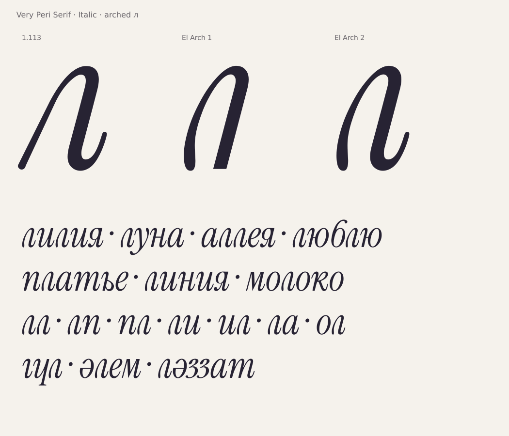

# Строчная курсивная л: арка и выходной хвост

**В 1.115 стала основной в Italic; в 1.114 была альтернативой ss10.**
[Скачать основной шрифт и посмотреть изменение](el-default-1.115.md).
Отдельный El Arch 2 ниже сохранён как историческая проба.

Второй вариант по схеме Yerbolat Rakhatuly (DEW) от 26.10.2026:
левая дуга и верх первого арочного варианта, правая ножка с окончанием
от принятой л из 1.113. Выходной штрих продолжает движение в следующую букву.



**[Скачать El Arch 2](../dist/VeryPeriSerif-ElArch2.zip)** ·
[Образец в PDF](specimen/VeryPeriSerif-ElArch2.pdf) ·
[Первый вариант без выходного хвоста](italic-el-arch.md)

Установить **VeryPeriSerifElArch2-Italic.ttf** из архива и выбрать семейство
**Very Peri Serif El Arch 2**, начертание **Italic**. В архиве также OTF и WOFF2.
Это самостоятельная проба рядом с основным выпуском 1.113.

## Что соединено

У первой арки заменён только участок между (326,394) и (263,404).
Все остальные её точки сохранены точно. Нижняя часть старой л перенесена
на −51 по x; масштабирование и повторная аппроксимация хвоста не применялись.
Одна управляющая точка входа изменена с (247,91) на (247,93): это уменьшает
унаследованный излом 1,777° до менее 1°, смещение самой дуги — не более 1 единицы.
Правая стойка и хвост соединены в одном непрерывном контуре.

Ширина с полями — 392, левое поле — 10, свесы — −9 / 516.
56 сохранённых точек; математически лишних точек не найдено.
[GLIF](../data/italic-el-arch-2/uni043B.glif) и
[параметры с происхождением деталей](../data/italic-el-arch-2/manifest.json).

## Проверка

**2 940 проверок, 0 ошибок; 899 пар с л.** Проверены все 491 глиф и
экспортированные TTF/OTF/WOFF2. Изменена только л и её метрики, пары и якоря.
Сохранение точек арки и перенесённого хвоста проверяется независимо от GLIF.
Другие глифы, hints, GSUB и метрики сохранены; посторонние части GPOS
побайтно совпадают с эталоном, все прочие CFF-программы также сохранены.

В новом контуре детектор не обнаружил разрывов касательных от 1,5°,
нулевых/коротких сегментов, пересечений или поперечных ступенек.
Кандидаты скачков кривизны и изгибов сохранены в
[отчёте](qa/el-arch-2.json): это диагностические отметки, не автоматическая
браковка и не приёмка всей гарнитуры. Сама л просмотрена в русских и казахских
словах, разных кеглях и с ударениями; нативные приложения отдельно не проверялись.
OFL и уведомления об авторах сохранены.

Повторить сборку:

```sh
python3 -I tools/build_el_arch_variant.py --variant 2
```

Версионные архивы не перезаписываются отличающимися файлами. Оба варианта
и основной шрифт находятся в единственной рабочей ветке репозитория.
