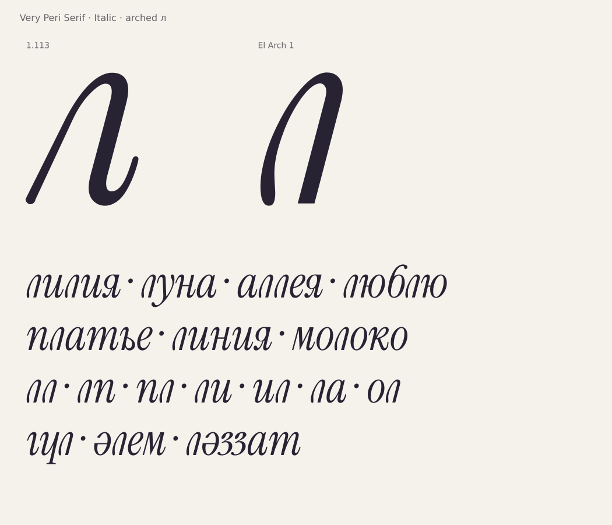

# Строчная курсивная л: El Arch 1

Вариант по рисунку Yerbolat Rakhatuly (DEW) от 26.10.2026: одна арка,
округлое левое окончание и прямая правая ножка с плоским основанием.
Правый выходной хвост убран. Это отдельная установочная проба Italic.

[Второй вариант: та же арка с выходным хвостом прежней л](italic-el-arch-2.md).



**[Скачать вариант](../dist/VeryPeriSerif-ElArch1.zip)** ·
[Образец в PDF](specimen/VeryPeriSerif-ElArch1.pdf)

Установить `VeryPeriSerifElArch1-Italic.ttf` из архива; в приложении выбрать
**Very Peri Serif El Arch 1**, начертание **Italic**. В архиве также есть OTF
для альтернативной установки и WOFF2 для сайта. Достаточно установить TTF
или OTF. Основной комплект по ссылке `VeryPeriSerif-latest.zip` остаётся 1.113;
этот вариант можно установить рядом с ним.

## Рисунок и источник

Исходник — [GLIF](../data/italic-el-arch/uni043B.glif), параметры и рецепт —
[manifest.json](../data/italic-el-arch/manifest.json).

У правого плеча сохранены координаты верхней части родной Italic n со сдвигом
−125 по x. Масштабирование не применялось. Левая дуга и округлое окончание
нарисованы заново под силуэт референса. Правая ножка продолжает наклон и толщину
плеча; её основание имеет ширину 66 единиц. Круглые свесы — −9 / 516,
как у родной латиницы. Ширина с полями — 350; левое поле — 10.

Сохранено 37 точек TrueType; математически лишних точек проверка не обнаружила.
GLIF — окончательный редактируемый контур; кубический рецепт в манифесте
документирует его построение, но не заменяет координаты сохранённого GLIF.
На скриншоте нет исходных векторных координат, поэтому точное совпадение
с его контурами не заявляется.

## Проверка и сборка

```sh
python3 -I tools/build_el_arch_variant.py
```

Зависимости — существующее окружение проекта. Сборка берёт опубликованные
шрифты из локального тега `v1.113`, проверяет SHA256 эталона и GLIF и создаёт
`dist/VeryPeriSerif-ElArch1.zip`. Сборщик основного выпуска не менялся.

Проверяются все 491 глиф: изменена только `uni043B`. У остальных сохранены
контуры, hints и метрики. Исходные GSUB, GDEF, cmap и глобальный хинтинг
сохранены. В GPOS меняются только якоря этой л и добавляются только её пары;
после обратного удаления этих изменений GPOS побайтно совпадает с эталоном.
Все остальные CFF-программы также совпадают с 1.113.

Кернинг измеряется заново для обоих порядков пар с л, включая альтернативы
и знаки. Минимальный растровый просвет — 20 единиц для буквенных пар,
5 для остальных. Это проверка профилей при 1000 px/em, не гарантия для
любого отрицательного трекинга. Якоря ударения и нижних знаков перенесены
к новой арке и ножке. Проверены русские и казахские слова, малые кегли
и поддержанные комбинируемые знаки.

TTF/OTF/WOFF2 проходят OpenType Sanitizer. Для новой л при экспорте в CFF
абсолютные управляющие округляются к сетке 16.16 до вычисления относительных
дельт: это предотвращает накопление округлений и микросегмент в замыкании.
Пересечения, нулевые сегменты и короткие ступеньки проверяются на экспортированных
файлах. Два угла плоского основания намеренные. Остальные кандидаты детектора
сохранены в [отчёте](qa/el-arch-1.json); они не объявляются дефектами автоматически.
Оптически просмотрены сама л и приведённые слова, а не вся гарнитура заново.

Встроенное имя автора — **Yerbolat Rakhatuly (DEW)**. Исходные уведомления
Instrument/Cormorant и OFL сохранены; в журнал архива добавлена запись о варианте.
