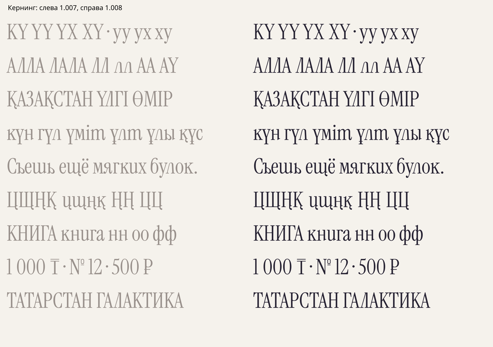

[РЕШЕНИЕ · 16.10.2026] Текущая1.005 уточняет описанную ниже1.004:
защита верхних частей и выносных элементов усилена, добавлен независимый
векторный аудит. Актуальные числа и изменения — [доводка Regular](regular-polish.md).
Таблица1.003/1.004 ниже остаётся историей первого полного прохода.

# Кернинг Regular 1.004

[РЕШЕНИЕ · 16.10.2026] Выполнен полный попарный проход по текущему
русскому и казахскому набору. Контуры и ширины всех490 глифов сохранены
из1.003; изменения касаются позиционирования. Родной Latin/Latin кернинг
Instrument Serif сохранён.



## Охват

[ИЗМЕРЕНО] Все84×84 = **7056 упорядоченных пар букв**, включая регистры
и сочетания русского/казахского алфавитов. Геометрия рассчитана также
для всех устанавливаемых альтернатив, смешанных пар с родными глифами,
цифрами, валютами и пунктуацией: всего**91 080 пар**. Пробелы, знаки
с нулевым advance и пунктирный круг не получают кернинговых поправок.
В новой добавленной таблице53 648 ненулевых пар; нулевые пары тоже
прошли расчёт и не требуют отдельного правила GPOS.

[ИЗМЕРЕНО] HarfBuzz проверил каждую из7056 пар в десяти конфигурациях:
основная; ss01/ss08/ss09 по отдельности; три их попарные комбинации;
все три вместе; aalt; aalt+ss09. Сюда входят контекстные п/к/қ и
переключение старых хвостов. Ещё14 280 смешанных пар проверены в обеих
последовательностях. Итого84 840 проверок кириллицы/смешанного набора.

[ИЗМЕРЕНО] Дополнительно сравнены**110 889 пар родных Unicode-символов**
с оригинальным шрифтом: имена выходных глифов, advances и смещения
совпали, включая лигатуры и акценты. Суммарно195 729 парных проверок
HarfBuzz без ошибок. WOFF2 сохраняет GSUB/GPOS/GDEF после декодирования.
Результаты привязаны к SHA256 текущего TTF в `kerning-validation.json`.

## Метод

[РЕШЕНИЕ] Одного наследования донорских групп было недостаточно:
авторские ц/щ/қ/ң, контекстные варианты и изменённые пропорции дают
другие наружные края. Теперь для каждого глифа строятся левые/правые
профили при1000px/em, с шагом2 единицы по высоте. Оптический просвет
оценивается мягким минимумом расстояний между обращёнными краями;
результат калибруется по соответствующей паре исходного Instrument Serif.

[РЕШЕНИЕ] Мягкость55 единиц, ограничение оптической поправки±90 и
округление к2 единицам — параметры этого прохода, а не измерения
исходного шрифта. Отдельные решения в `font/kerning-overrides.json`
задают исходный ориентир; после него применяются геометрическая поправка
и ограничение сближения. Проверяется весь вертикальный диапазон,
включая нижние хвосты и диакритику, а не только середина букв.

[РЕШЕНИЕ] Характерные контакты засечек оригинала сохранены лишь при
близкой оптической оценке (разница менее3 единиц) и высоте
контакта (разница не более12 единиц). Для отличающихся краёв требуется
положительный просвет. Поэтому отрицательный минимум в отчёте может
означать унаследованный контакт исходной пары; он не является сам по
себе новым дефектом. Все91 080 результатов проходят выбранный допуск.
У6632 пар ограничение сближения скорректировало исходное предложение.

| Пара, с учётом текущего calt | 1.003 | 1.004 |
|---|---:|---:|
| Га |−50|−140|
| Го |−55|−144|
| лл |−12|−29|
| ЛЛ |−10|−37|
| ЦЦ |0|−66|
| цщ |0|−84|
| ҚА |−30|−104|
| қн |−12|−56|
| үң |−8|−40|
| фф |0|+24|
| АА |−24|−24|

[ИЗМЕРЕНО] Значения — полная поправка advance в единицах шрифта,
полученная реальным формированием строки, а не только текстом FEA.
Некоторые пары требуют дополнительного воздуха, поэтому положительный
кернинг предусмотрен намеренно. Пара лл остаётся двумя буквами.

## Просмотр всех комбинаций

- [PDF:124 страницы](../dist/VeryPeriSerifDraft/kerning-all-pairs.pdf):
  первые84 — каждая буква перед всеми84 буквами; следующие40 —
  двадцать альтернатив по очереди слева и справа.
- [Интерактивный HTML](../dist/VeryPeriSerifDraft/kerning-proof.html):
  скачать и открыть в браузере. Оба шрифта встроены, сеть не нужна.
  Есть выбор буквы, стороны, группы символов, режима kern/ss01/ss08/ss09
  и собственного текста. Серый —1.003, чёрный —1.004.
- [CSV-матрица84×84](../dist/VeryPeriSerifDraft/kerning-matrix.csv):
  фактические поправки в основном режиме, с учётом calt.
- Сводки: `font/kerning-review.json` и `dist/VeryPeriSerifDraft/kerning-validation.json`.

[НАБЛЮДЕНИЕ] Визуально проверены сравнительные строки и подробные листы
Г/Л/Т/Ң/қ/ө/п.flag, в том числе плотные головные засечки, хвосты,
русские и казахские слова, суммы и №. Это полный расчёт и машинная
проверка всех пар с визуальной проверкой характерных групп; здесь не
заявляется, что каждая из91 080 пар отдельно доведена вручную.
Математическая проверка не заменяет окончательной оценки в макете.

## Воспроизведение

```sh
python -I tools/build_draft_font.py
python -I tools/check_draft_font.py
python -I tools/kerning_proof.py
python -I tools/package_draft_font.py
```

Алгоритм — `tools/optical_kerning.py`; полная парная проверка —
`tools/check_kerning.py`. Вспомогательный подробный геометрический
отчёт генерируется в игнорируемом `build/kerning/pairs.json`.
Публикуемые отчёты и листы просмотра проверяются по SHA256 перед упаковкой.
