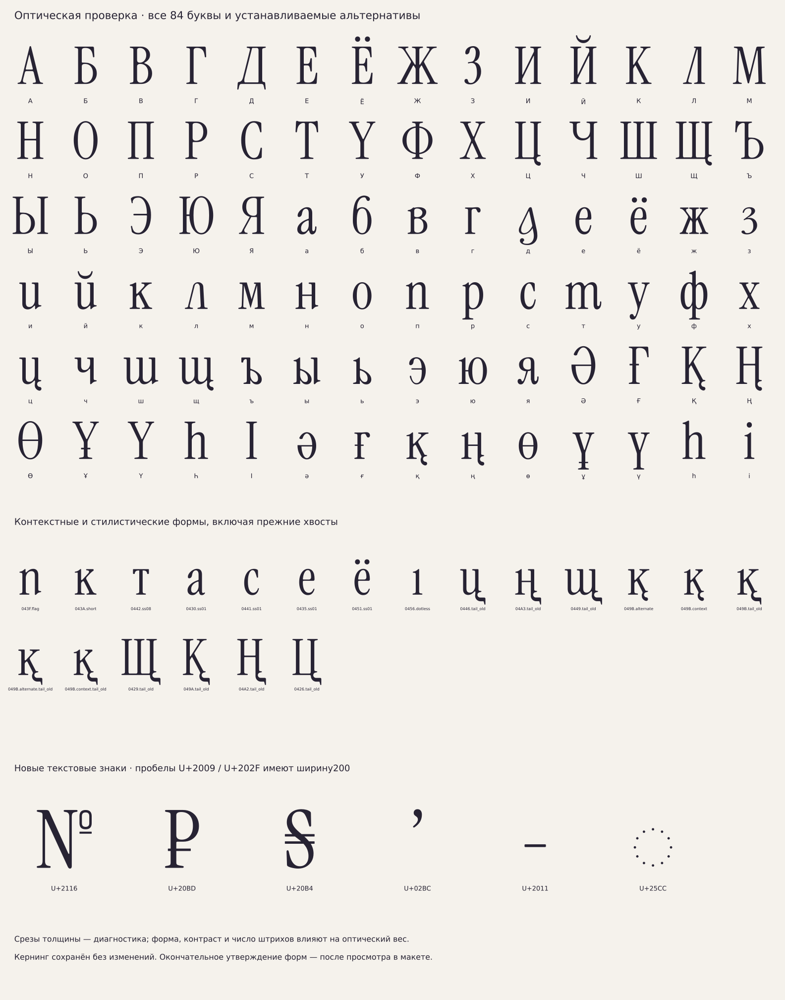
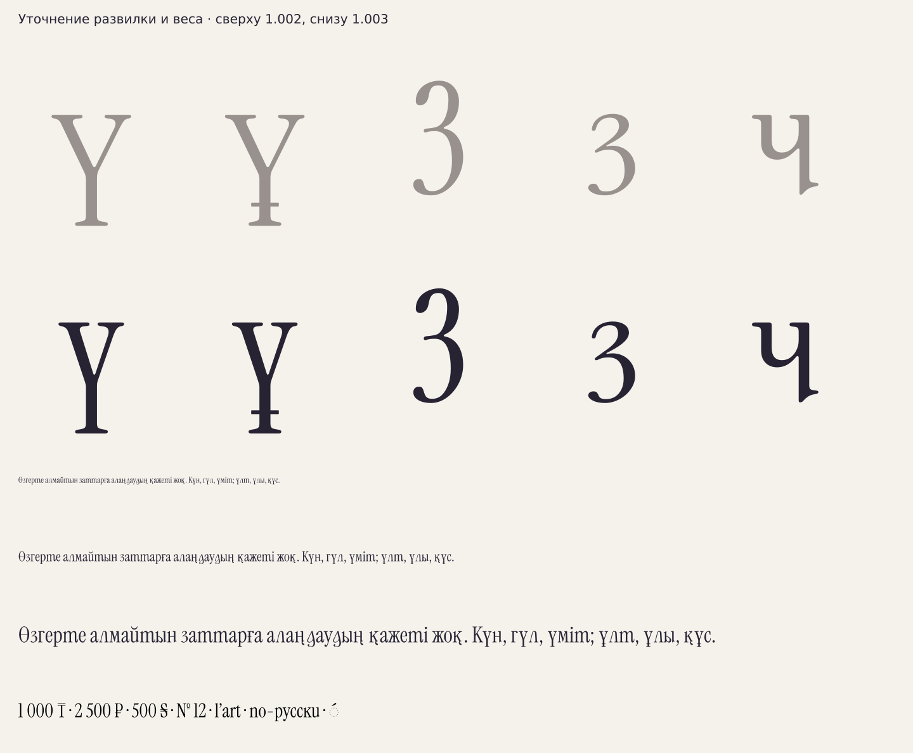

# Оптическая проверка Regular 1.003

[НАБЛЮДЕНИЕ · 16.10.2026] Просмотрен пользовательский `Frame 279.pdf`:
макеты Life / Жизнь / Өмір, русский и латинский текст, примеры «книга»
и казахская строка. PDF содержит экспортированные контуры FigmaGlyphs
Type3: по нему нельзя достоверно определить версию установленного TTF.
SHA256 и сведения об образце — `data/regular-refinement/review-reference.json`.

[ИЗМЕРЕНО] Проверены все84 основные буквы русского/казахского набора
и20 устанавливаемых контекстных/стилистических альтернатив. У112
используемых GLIF проверены конечность координат, замкнутость и SHA256;
кандидатов на самопересечение семплированных колец не найдено.
Один дополнительный глиф і без точки берётся непосредственно из донора.
Прочитаны новые формы в крупном размере и казахская строка в18/30/48px.



## Изменения

[РЕШЕНИЕ] У строчных ү/ұ ветви приближены друг к другу; головные засечки
перенесены на45 единиц внутрь каждая, без горизонтального сжатия.
Связки с диагоналями согласованы по касательным. Вертикальный вынос,
ножка, высота510 и ширина набора477 сохранены. Угол между наружными
прямыми ветвей уменьшен примерно с52° до37,4°. Это уточнение формы,
а не изменение заглавных Ү/Ұ. Прежние варианты сохранены.

[РЕШЕНИЕ] Локально усилены внутренние стенки чаш З/з, не меняя внешнего
силуэта и не утолщая тонкие горизонтали. Нижняя часть стойки ч расширена
с63 до68 единиц, в согласии с n/p/d. Остальные буквы не подвергались
общему утолщению.

| Диагностический срез основного штриха | До | После |
|---|---:|---:|
| З |71|76|
| з |68|73|
| ч |63|68|

[ИЗМЕРЕНО] Таблица — медиана наибольшего горизонтального чёрного отрезка
на51 уровнях между25% и75% высоты корпуса, при растре1000px/em.
Она помогает найти расхождения, но не измеряет толщину по нормали и
не является универсальной оценкой оптического веса. Полный набор84
измерений — `data/regular-refinement/optical-review.json`.

[НАБЛЮДЕНИЕ] Разница «в разы» у основных несущих штрихов не подтвердилась.
Высокий контраст самого Instrument Serif, открытые чаши и тонкие ветви
Л/Д/М дают различие плотности; превращать все штрихи в одинаково толстые
нельзя. Это один полный проход проверки, а не обещание окончательного
оптического равенства всех форм. Следующий макет поможет оценить правки.



## Текстовые знаки

[РЕШЕНИЕ] Добавлены восемь ранее отсутствовавших символов:
№ U+2116, ₽ U+20BD, ₴ U+20B4, ʼ U+02BC, ‑ U+2011,
тонкий пробел U+2009, узкий неразрывный пробел U+202F,
пунктирный круг ◌ U+25CC. ₸ из1.002 сохранён.

Базовые части №/₽/₴ взяты из N/P/S без масштаба; малое кольцо №
построено отдельно. Апостроф и неразрывный дефис используют геометрию
родных quoteright/hyphen. Пробелы пустые, шириной200 единиц; неразрывность
U+202F/U+2011 задаётся их свойствами Unicode в редакторе. Круг состоит
из12 круглых точек и поддерживает привязку комбинируемого акцента.
Это не добавляет всю украинскую или расширенную кириллицу.

[РЕШЕНИЕ] Кернинг отложен по просьбе пользователя: **все21088 существующих
пар и их значения сохранены из1.002**. Новые знаки имеют базовые интервалы;
новых кернинговых поправок для них в этом проходе не добавлялось.
Контекстные классы букв повторно проверены по геометрии.

## Воспроизведение

```sh
python -I tools/finish_regular.py
python -I tools/build_draft_font.py --keep-kerning
python -I tools/check_draft_font.py
python -I tools/review_regular.py
```

Для повторной проверки нужны зависимости из `requirements.txt`.
Финальные отчёты HarfBuzz/FontBakery/OTS — в `dist/VeryPeriSerifDraft/`.
Проверка сохранения старых пар входит в функциональные тесты сборки.
