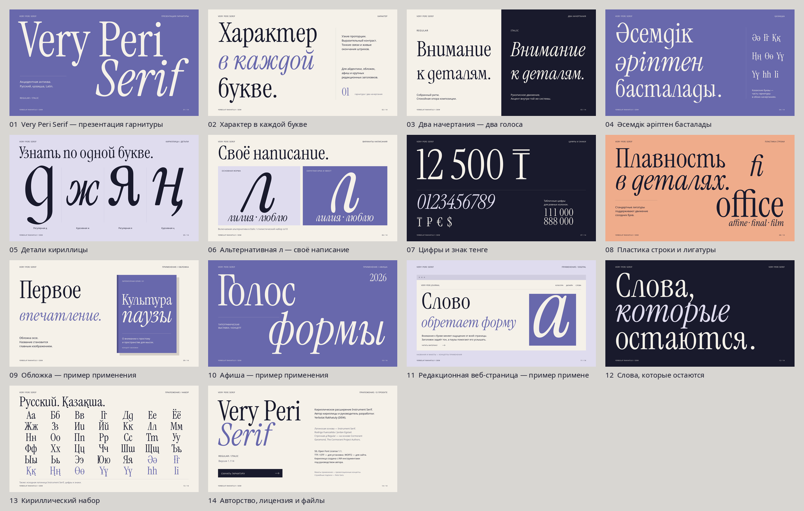

# Very Peri Serif — презентация заказчику

**[Скачать PDF, 14 слайдов](VeryPeriSerif-Presentation.pdf)** ·
[PowerPoint](VeryPeriSerif-Presentation.pptx) ·
[Полный комплект](../../dist/VeryPeriSerif-Presentation-1.114.zip)



Редакционная подача гарнитуры: характер, Regular и Italic, русский и казахский
набор, детали кириллицы, альтернативная л, цифры и лигатуры. Затем — концепты
обложки, афиши и журнальной веб-страницы. Авторство и условия использования
вынесены в приложение.

Материал набран реальными файлами **Very Peri Serif 1.114**. Кириллица —
**Yerbolat Rakhatuly (DEW)**. Латинская основа — Instrument Serif; полное
происхождение и сведения Cormorant приведены на заключительном слайде.

Это зафиксированная презентация 1.114. Начиная с 1.115 арочная л стала основной,
а ss10 возвращает прежнюю форму. Для повторной сборки именно этой презентации
используйте коммит `d793202` с исходниками и шрифтами 1.114.

В комплекте:

- Векторный PDF 16:9: можно отправить заказчику, шрифты для просмотра не нужны.
- PowerPoint с векторными SVG и резервными PNG для совместимости.
- Три постера 4:5 в PNG **2160×2700**, со своими SVG.
- SVG всех слайдов и превью **2400×1350**.
- Автономная HTML-версия со стрелками переключения.

В PDF, PPTX и SVG надписи переведены в контуры. Для изменения текста доступны
сценарий [presentation.py](../../tools/presentation.py) и исходные строки в нём;
SVG можно редактировать как вектор. Макеты применения — презентационные концепты.

Проверены состав файлов, все страницы PDF, сохранение векторных контуров,
ссылка скачивания, разрешение изображений и отсутствие пересечений между
надписями. PowerPoint проверен структурно; нативное приложение Office отдельно
не запускалось. [Отчёт проверки](../qa/presentation-1.114.json).

Сборка из корня репозитория:

```sh
python tools/presentation.py
python tools/check_presentation.py
```

Зависимости: `fonttools`, `uharfbuzz`, `Pillow`, `numpy`, `cairosvg`, `python-pptx`,
`pypdf`. Служебные подписи используют Noto Sans из системной папки шрифтов;
путь указан в сценарии. Генерация материалов не меняет файлы гарнитуры.
