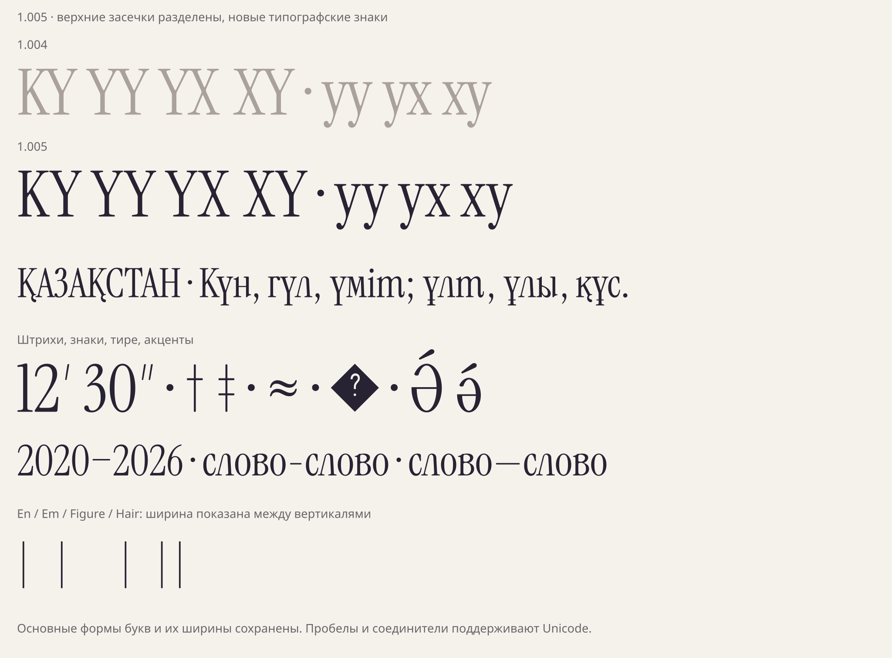

# Доводка Regular 1.005

[РЕШЕНИЕ · 16.10.2026] Исправлены реальные недочёты сборки1.004,
дополнен рекомендуемый набор типографики. Основные контуры букв,
пользовательские хвостики, альтернативы и существующие ширины сохранены.



## Что было недоработано

[ИЗМЕРЕНО] Прежний геометрический допуск сохранял некоторые контакты
засечек исходного Instrument Serif. Он разрешал не только нижние ножки,
но и слияния наверху: например, у КУ пересечение достигало1268 единиц²
в зоне y695…720. Такие пары проходили предыдущий тест, потому что
повторяли допуск донора, а не проверялись на отсутствие пересечения.

[РЕШЕНИЕ] Нижние контакты ножек могут сохраняться, однако выше y55
и ниже y−25 требуется минимум8 единиц просвета. Это параметр доводки,
а не замер донора. Защита распространяется на все101 519 рассчитанных
пар с добавленными глифами, включая альтернативы, смешанные сочетания,
диакритику и новые знаки. Родные Latin/Latin пары не переписываются.

[ИЗМЕРЕНО] Независимый векторный тест вычисляет настоящие пересечения
контуров после подстановок и позиционирования. У25 709 разных сочетаний
выходных глифов и положений не найдено пересечений защищённой области
(допуск площади0,1 единицы²). Он работает независимо от растровой
модели кернинга и проверяет также смешанные пары.

## Дополнение типографики

[РЕШЕНИЕ] Добавлены18 символов:

- дефис ‐ U+2010, цифровое тире ‒ U+2012, горизонтальная черта ― U+2015;
- штрихи ′ ″ U+2032/U+2033; это отдельные наклонные штрихи, а не апостроф;
- † ‡ U+2020/U+2021, ≈ U+2248, явный символ замены � U+FFFD;
- en/em/figure/hair spaces U+2002/U+2003/U+2007/U+200A;
- zero-width space U+200B, word joiner U+2060 и U+FEFF;
- латинские Ə/ə U+018F/U+0259 с формами и акцентными привязками Ә/ә.

[РЕШЕНИЕ] Пробелы имеют ширину500/1000/460/100 единиц соответственно;
figure space соответствует нулю родного шрифта. Управляющие символы
имеют нулевую ширину и не содержат рисунка. Переносами управляет
Unicode-движок редактора. Дефисы используют неизменённые родные контуры;
цифровое тире центрировано на ширине нуля. Знак≈ состоит из двух родных
волн без масштаба. Все исходники и решения сохранены в
`data/typographic-completion/`.

## Проверки и воспроизведение

[ИЗМЕРЕНО]862 функциональные проверки;197 577 парных проверок HarfBuzz,
включая все7056 кириллических пар в10 режимах,16 128 смешанных пар
и110 889 родных Unicode-пар. У всех490 ранее установленных глифов
сохранены контуры и advances. WOFF2 сохраняет таблицы подстановок и
позиционирования. Новые пробелы, управляющие символы и привязки Ə/ə
проверены отдельно. OpenType Sanitizer проходит; отчёт FontBakery
с ограничениями сетевых проверок сохранён в комплекте.

```sh
python -I tools/complete_text_symbols.py
python -I tools/build_draft_font.py
python -I tools/check_draft_font.py
python -I tools/kerning_proof.py
python -I tools/polish_proof.py
python -I tools/package_draft_font.py
```

[РЕШЕНИЕ] Это доводка текущего Regular. Курсив и дополнительное
языковое расширение остаются отдельными задачами; они не выдаются за
завершённую часть этой сборки. Окончательные эстетические решения по
открытым вариантам букв требуют оценки автора в макете.
