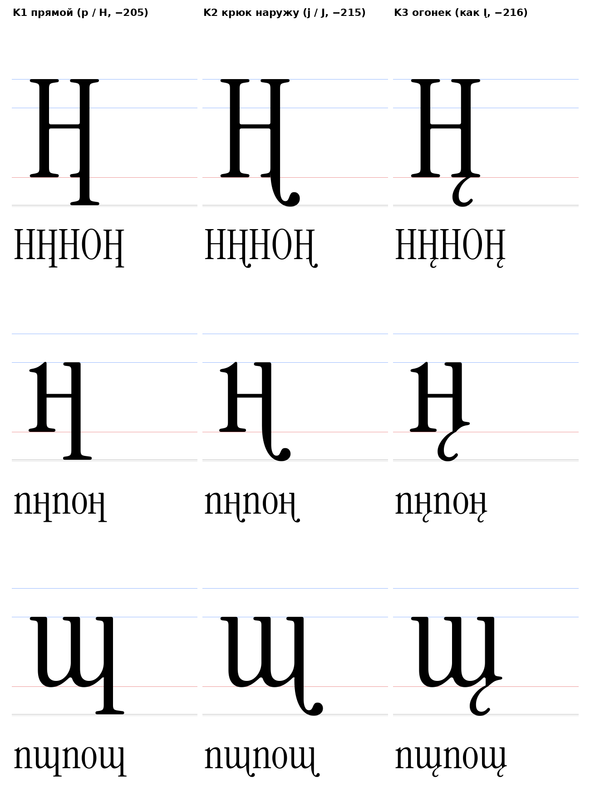
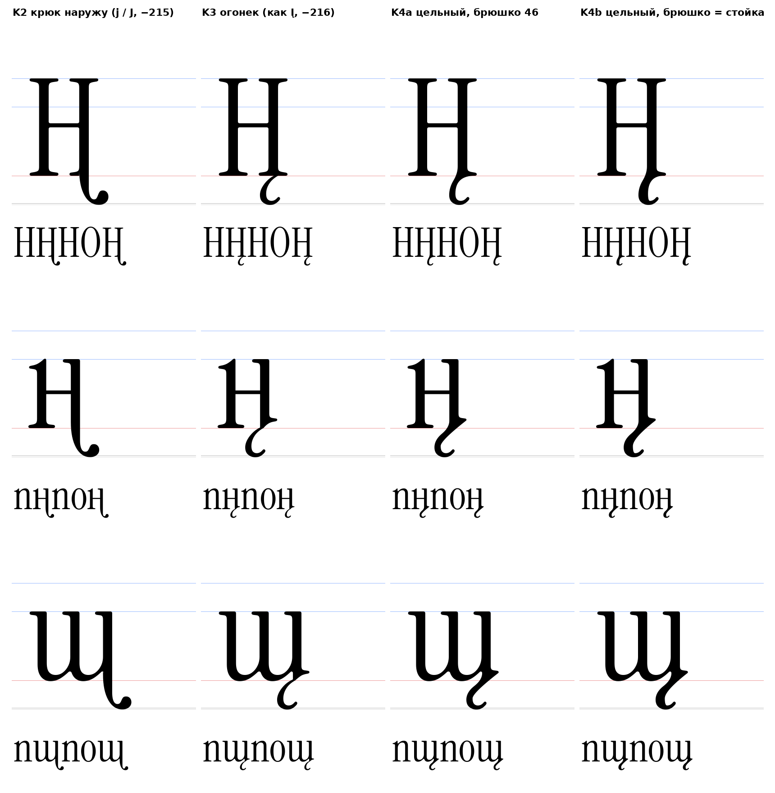

# Хвосты под строкой: анализ исходника и принцип

15.10.2026. Хвост встречается во многих буквах (Ц Щ Д ц щ д Қ Ң қ ң и дальше), поэтому решается один раз как принцип, а не под одну букву. Всё ниже снято скриптами с исходника (`reference/instrument-serif`, коммит 65c0ef2): `tools/tails.py`, `tools/sketch_tails.py`.

## 1. Что есть в исходнике `[ИЗМЕРЕНО]`

82 глифа уходят ниже базовой линии. Структурно это пять семейств:

| Семейство | Глифы | Низ | Как устроено |
|---|---|---|---|
| A. Вынос с засечкой | p, q, þ | −205 | стойка 68 идёт прямо до −150, затем плоская опорная засечка (у p 190 на −205, 211 на −195) |
| B. Крюк с каплей | j, J, ŋ, Ŋ (и хвост y) | −215 | стойка уходит под строку, сторона крюка остаётся прямой до −110, противоположная сужается, крюк заканчивается каплей |
| C. Огонек | Ą Ę Į Ų ą ę į ų | −216 | отдельный компонент `ogonekcomb`, вешается на якорь `ogonek` базы; ножка базы остаётся |
| D. Отдельные знаки | ç Ç ş Ş (седиль), ģ ķ ļ ņ ŗ ș ț (запятая) | −215, −305 | не связаны со стойкой, к хвостам не относятся |
| E. Хвост Q | Q | −215 | выход из нижней части овала вправо, плоский конец |

Пунктуация (запятая −163, „ −132, скобки −108) к буквенным хвостам не относится.

### B. Крюк: один профиль на четыре буквы

Ширина стойки по мере ухода под строку (стойка от прямого края до сужающегося):

| y | 0 | −20 | −50 | −80 | −110 | −140 | −160 |
|---|---|---|---|---|---|---|---|
| j | 67 | 65 | 61 | 55 | 46 | 37 | 34 |
| ŋ | 67 | 65 | 61 | 55 | 46 | 37 | 34 |
| Ŋ | 67 | 65 | 61 | 55 | 46 | 37 | 34 |
| J | 70 | 68 | 64 | 58 | 49 | 40 | 37 |

Профиль совпадает до единицы: это один модуль, повторённый в j, ŋ, Ŋ и (с прописной стойкой 71) в J. Капля 79 в поперечнике, низ −215, крюк уходит от прямого края стойки на 142–145. У ŋ и Ŋ это буквально правая стойка буквы, продолженная под строку; опорной засечки у такой стойки нет.

### C. Огонек: компонент и якоря

`ogonekcomb`: якорь `_ogonek` (194, 0). На базовой линии 32 (тонкое крепление), к −140 толщина растёт до 46, конец загибается вверх вправо до −156…−183, низ −216. Якоря `ogonek` у баз: u (336, 0), U (334, 0), I (160, 0), A (421, 0), E (385, 0), a (344, 0), e (239, 0). У стоечной I якорь стоит на правом краю стойки (160), у u и a в точке ножки-выхода.

## 2. Выводы из исходника `[ИЗМЕРЕНО]`

1. Глубин только две: −205 у прямых окончаний (засечка), −215 (−216) у изогнутых (крюк, огонек, Q, g). Коротких хвостов в шрифте нет. Стартовая догадка D5 (−140) исходником не подтверждается.
2. Хвост в шрифте модульный: огонек это один компонент на якорях, крюк один профиль на четыре буквы. Правка в одном месте меняет все буквы.
3. Стойка, уходящая под строку, теряет опорную засечку (ŋ, Ŋ, j); подвесной хвост-огонек засечку не трогает (Į).
4. Крюк может выходить за ширину буквы: j xmin −63, J −56. Ширина буквы под хвост не увеличивается.

## 3. Принцип `[РЕШЕНИЕ]`, ждёт подтверждения автора проекта

1. **Модуль.** Хвост не рисуется заново: берётся модуль оригинала без масштаба. Строчный от j (стойка 68), прописной от J (стойка 71). Прямой вариант: строчный от p, прописной от стойки H с опорной засечкой, опущенной на −205.
2. **Механизм.** Как огонек в оригинале: в UFO хвост это один компонент на регистр (`tail-cy`, `tail-cy.case`), база получает якорь `tail` (левый край стойки, y = 0). Правка модуля сразу меняет все буквы с хвостом.
3. **Крепление.** Стойка базы обрезается ниже y = 60 (ножка, засечка) и правее стойки ниже y = 120 (остаток хвоста-выхода у н и ш), модуль начинается на y = 60 той же ширины: шов идёт по прямой стойке. Проверено аудитом узлов: ступенек и лишних точек на шве нет (K1, K2).
4. **Направление.** Крюк всегда наружу буквы: у правой стойки вправо, у левой влево (зеркальный модуль). Внутрь нельзя: ң с крюком внутрь читается как ŋ (Eng), а у щ крюк упёрся бы в арку.
5. **Глубина.** Крюк −215, прямой −205, по зонам оригинала (F8).
6. **Ширина.** Ширина базы не меняется, крюк выходит за правое поле, как j и J за левое; расстояние решает кернинг.
7. **Классы.** Нижний левый угол базы не меняется, поэтому `@serif_bl` и `@head_tl` для буквы с правым хвостом те же, что у базы (проверять `tools/check_context_classes.py`).

### Типы на пробе (картинка вверху)

| Тип | Донор | Низ | Оценка |
|---|---|---|---|
| K1 прямой | p (строчные), стойка и засечка H (прописные) | −205 | читается как вынос p; шов чистый |
| K2 крюк наружу | j (строчные), J (прописные), зеркально | −215 | основной кандидат: самая частая форма выноса в шрифте (j J ŋ Ŋ y), заканчивается каплей (F5); шов чистый |
| K3 огонек | `ogonekcomb` без изменений, как в Į | −216 | польская форма; для кириллицы брать только механизм (компонент и якорь), не форму; при слиянии контуров даёт мелкие точки, поэтому в UFO только компонентом |
| K4 цельный огонек | брюшко и кончик `ogonekcomb`, вместо тонкого крепления продолжение стойки | −216 | альтернатива по рисунку автора проекта 15.10.2026: оба края хвоста идут от стойки одной гладкой линией; K4a брюшко 46, K4b брюшко в ширину стойки; принцип в разделе 3.1 |

### 3.1 K4 цельный огонек: принцип применения `[РЕШЕНИЕ]`, ждёт выбора автора проекта

Основа K2 (выбрана автором проекта), K3 и K4 альтернативы. Автор проекта показал на ң: линии хвоста должны быть едины и непрерывны. У K3 огонек висит отдельно, поэтому на стыке с ножкой есть бугор: низ шпоры и внутренний край огонька не совпадают по касательной (у u нижний край шпоры уходит вниз под 50°, крепление огонька под 30°, плюс выступ ножки в точке (326, −5)). K4 убирает стык.

1. **Тело.** Нижняя часть огонька оригинала без изменений: от точек вертикальной касательной (наружная (60, −143), внутренняя (106, −133), ширина 46) вниз через брюшко до загнутого кончика, низ −216 `[ИЗМЕРЕНО]`. Тонкое крепление (точки 4–10 `ogonekcomb`) убирается, его место занимает стойка.
2. **Место.** Брюшко там же, где у K3, по якорю оригинала: у u-стойки как у u (336), то есть н 348, ш 584; у стойки H как у I (правый край стойки), Н 457 `[ИЗМЕРЕНО]`.
3. **Наружный край.** Одна S-линия от левого края стойки до наружной точки брюшка, на обоих концах касательная вертикальная. Уходит от стойки там, где у оригинала начинается нижняя деталь: у u-стойки высота примыкания чаши 54 (u, ш), у H начало подкоса засечки 67 `[ИЗМЕРЕНО]`. Ручки 50 у стойки и 55 у брюшка `[РЕШЕНИЕ]`: при 50 угол между аркой и хвостом у щ остаётся открытым, при 22 он сходится в щель.
4. **Внутренний край.** Продолжает правую нижнюю деталь базы, кончик детали остаётся носиком:
   - u-стойка (н, ш): от скругления кончика шпоры-выхода, в точке, где касательная идёт под 38° вниз (угол снят с рисунка автора проекта), одной дугой до внутренней точки брюшка; ручка в пересечении касательных;
   - стойка H (Н): от конца правой половины опорной засечки (512, 0) по её нижней линии (касательная горизонтальная); отход под 38° с кончика засечки давал клин и был отброшен.
5. **Чистота.** Контур квадратичный, на каждом стыке касательная непрерывна, новых угловых точек нет; аудит: один контур, отрезков короче 2 нет (ң 81 точка, Ң 97, щ 99). Длины ручек и угол 38° это решения, а не измерения.
6. **Вес брюшка.** K4a: 46, как у огонька оригинала. K4b: ширина стойки (68 у строчных, 71 у прописных), как на рисунке автора проекта; внутренний изгиб счётчика у K4b теснее.
7. **Применение.** Правая стойка, которая заканчивается на базовой линии: Ң ң, Щ щ, Ц ц (как вариант к K2). Не применяется к наклонным ногам (Қ қ): наружная S-линия рассчитана на вертикальную стойку. Д и д `[ОТКРЫТО]`: у левой ноги огонек пришлось бы зеркалить, в оригинале зеркального огонька нет.
8. **Риск чтения** `[ОТКРЫТО]`: хвост K3 и K4 уходит влево под букву; если в набор войдут буквы с хвостом влево (например Ӊ ӊ, эн с хвостом), их нужно сверить с K3/K4, чтобы не спутать.

## 4. Куда применяется

| Буква | Где хвост | Модуль | Статус |
|---|---|---|---|
| Ц, Щ | правая стойка | прописной | Ц удалена по просьбе автора проекта, Щ не построена |
| ц, щ | правая стойка | строчный | щ на пробе (ш R1 + модуль) |
| Ң / ң | правая стойка Н / н | прописной / строчный | на пробе |
| Д / д | обе ножки, левая влево, правая вправо | оба зеркала | Д и д не построены |
| Қ / қ | конец диагональной ноги | `[ОТКРЫТО]` | нога наклонная, модуль на прямую стойку не встаёт: нужен отдельный вариант |

## 5. Открыто

- `[ОТКРЫТО]` Основа K2 выбрана автором проекта; K3, K4a, K4b альтернативы; Қ и қ.
- `[ОТКРЫТО]` D5: принять глубину по зонам оригинала (−205 / −215) вместо догадки −140.

Файлы: `tools/tails.py` (модули и крепление), `tools/sketch_tails.py` (пробы), `data/tails/*.glif`, `.svg`, `meta.json`.
