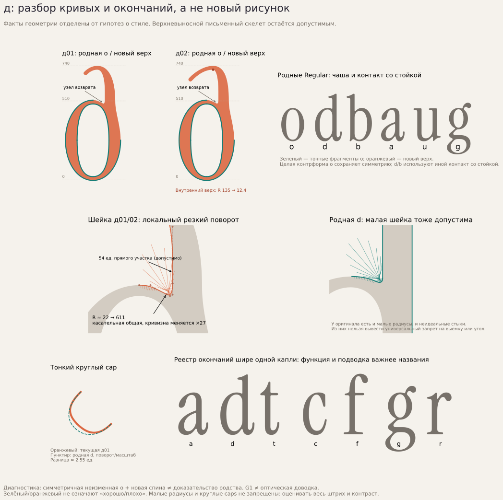
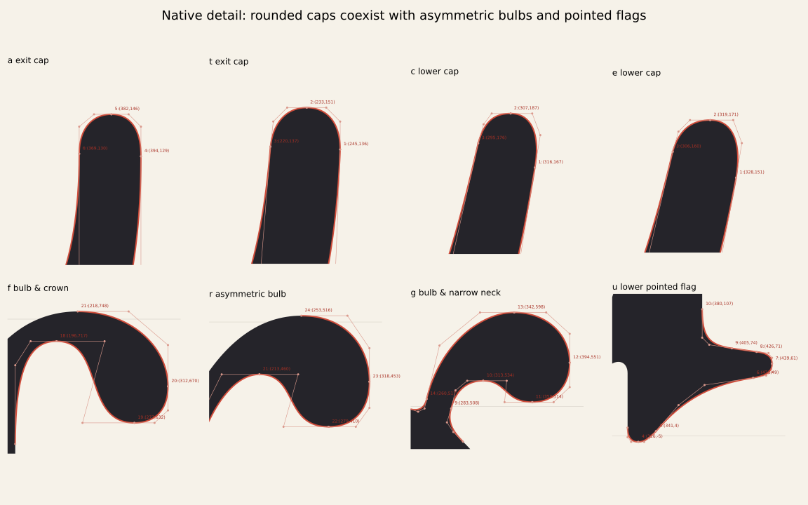
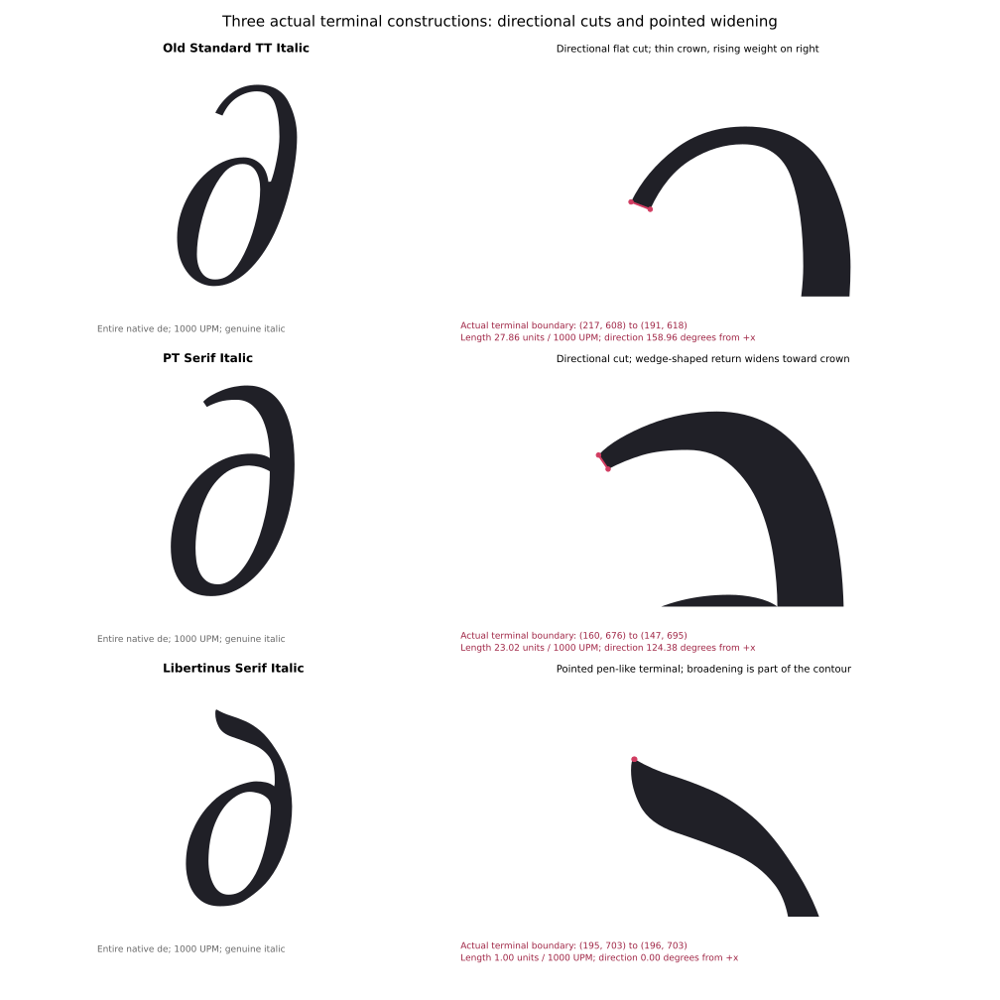

# д: исследование кривых и окончаний после отклонённых проб

`[РЕШЕНИЕ · 15.10.2026]` Пользователь отклонил «Сдержанный загиб» и
«Открытую дугу», затем уточнил главную проблему: **«Кривые и окончания»**.
Это не утверждение и не запрет верхневыносного письменного скелета.
Исследование разбирает исполнение линии. Новая буква в этой работе не создаётся.

**Главный вывод:** точное использование части o, совпадение толщин и общая
касательная не обеспечили стилевого единства. Проверять нужно целый ход:
подводку → изменение толщины → поворот → окончание → возврат. Качество
окончания зависит от соседних кривых и просвета, а не только от его формы.

**Проверенная база.** Исходный Instrument Serif Regular, мастер m01,
UPM 1000, коммит `65c0ef225f386a3c7e87570a4aa9cc0262c2fd81`, SHA исходника
`e7dd989a8d17b7cdc13130b79597d44bdd4b9dd043c801639468ef38d58a706f`.
Измерены кубические пути a/d/u/t/f/g/r/c/e/o; отдельно просмотрены остальные
глифы мастера, чтобы не превращать свойства небольшой выборки в общий запрет.
Авторское описание определяет шрифт как condensed display serif с современной
интерпретацией old-style serifs; численный рецепт его кривых автором не заявлен.
Ссылки и SHA первичных документов: [primary/sources.json](primary/sources.json).

Внешний корпус закреплён на Google Fonts
`67bc647ce1910e92f461bcc82aae30f21d21a9cc`: **40 уникальных загруженных
семейств, из них 37 с U+0434**. Neuton, Gelasio и Cormorant Upright в этих
файлах кириллической д не содержат. Основной serif-лист: 12 семейств,
22 начертания, 1060 проверенных конфигураций HarfBuzz. Полный serif-аудит
дополнительно содержит Kurale и PT Serif Caption: 14 поддерживающих семейств,
25 начертаний, 1174 конфигурации. Эти числа относятся к разным срезам данных.
Другой обзор охватывает прямые, декоративные и локализованные формы;
их количество не выдаётся за количество разных скелетов.

**Где именно расходятся кривые наших д.**



В таблице приведены односторонние радиусы кривизны в общем узле двух
кубических сегментов. Меньший радиус означает более тесный локальный поворот.
Значения проверены независимым пересчётом производных исходных кубик.

| Место, UPM 1000 | Радиус до → после, ед. | Касательные | Что нужно оценить |
|---|---:|---:|---|
| д02, внутренний верх `(245,715)` | 135,482 → 12,398 | 0° | После пологого подхода сразу начинается очень тесный поворот |
| д01, внутренний верх `(231,715)` | 79,350 → 28,711 | 0° | Менее сильная, но родственная концентрация изгиба |
| Обе д, шейка `(266,495)` | 22,361 → 611,285 | 0° | Тесное закругление резко раскрывается в пологую дугу чаши |
| Родная f, внутренний верх `(196,717)` | 43,740 → 44,118 | 0° | В сопоставимом свободном верхнем возврате кривизна почти сохраняется |
| Родная f, наружный верх `(218,748)` | 120,386 → 118,021 | 0° | Наружный поворот также не получает подобного скачка |

`[ИЗМЕРЕНО]` У д02 внутренняя кривизна на стыке усиливается примерно
в 10,93 раза; в шейке обеих д, наоборот, ослабевает примерно в 27,34 раза.
Прежняя проверка G1 оценивала направление касательной и не обнаруживала
эти различия. Исправление округления TTF не могло изменить данное поведение
кубического рисунка: источник оставался тем же.

`[НАБЛЮДЕНИЕ]` Эти места дают предметную гипотезу о пережатости и
неравномерном напряжении линии. **Числа не доказывают эстетическую ошибку
сами по себе.** У оригинала тоже встречаются небольшие расхождения касательных,
сильные локальные изменения кривизны и намеренные углы. Родная f здесь —
сопоставимый местный ориентир, а не закон G2 для всего шрифта.

Обе пробы оставляют одинаковую контрформу o и почти одну шейку/спину.
Перекрытие заливок по IoU составляет приблизительно 96,03% при дискретизации
600 отрезков на кубику. Большое сходство альтернатив само по себе допустимо;
здесь оно показывает, что смена длины верхнего входа почти не проверяла
другую организацию проблемного сопряжения.

**Что действительно повторяется у оригинала.**



| Родные детали | Измеренный факт | Практическое значение |
|---|---|---|
| Выходы a/d | Четыре последовательные кубики точно совпадают после переноса на `+58 x` | Повторяется целый выход и возврат к стойке, а не одна крышка кончика |
| Тонкий cap a/d | Хорда 25,020; глубина около 16,518; радиус на вершине 14,700 | Окончание асимметрично; это не автоматически построенная полуокружность |
| Выход t | Та же хорда 25,020, но глубина около 14,520 и другая подводка | Даже родственные окончания не обязаны быть одной копией |
| Нижние окончания c/e | Один сегмент совпадает после переноса; соседние сегменты различаются | Небольшие локальные отличия являются частью рисунка |
| Верхние головы f/r/g | Родственное вогнуто-выпуклое соединение с математическим перегибом внутри кубики | Капля развивается из штриха, а не приклеивается кругом |
| Низ u справа | Раскрывающееся флажковое окончание с локальными скруглениями | Это другая семья, её нельзя автоматически приравнивать к тонкому выходу d |
| o | Внешний и внутренний контуры построены отдельно; верхние/нижние ручки отличаются на 1–2 ед. | Геометрическая эллиптичность и постоянный offset не являются правилами оригинала |

У выхода a последние измеренные станции дают нормальные толщины
38,106 → 28,554 → 25,479. Они относятся к `t=.60/.75/.90` одной конкретной
кубики; t — параметр Безье, не равномерная длина дуги. Так подтверждается
локальное сужение к кончику. Лучи в других местах могут пересечь соседнюю
часть буквы, поэтому ширины нельзя читать без номера пересечённого сегмента.

Круглый cap наших д **не опровергнут** размером или углом: хорды
24,759/25,456 близки к родным, а в оригинальном мастере найдены и наклонные
округлые детали. Следовательно, ни запрет округления, ни обязательная капля
не следуют из исследования. Пересматривать нужно подводку, развитие внутренней
и наружной дуги, возврат и переход к чаше вместе.

Подробные методы, координаты и ограничения:
[native/REPORT.md](native/REPORT.md),
[native/native-curve-facts.json](native/native-curve-facts.json),
[critique/critique.md](critique/critique.md),
[critique/metrics.json](critique/metrics.json).

**Что добавил внешний корпус.**



Old Standard TT демонстрирует направленный срез на тонком возврате;
PT Serif — срез при клиновидном наборе массы; Libertinus — острое перьевое
расширение. В Viaoda Libre и Cormorant Garamond локализованные нижние
возвраты полезны изменением толщины перед асимметричным терминалом.
Их нижний скелет не предлагается взамен нашего верхнего. Caveat используется
только как контроль связного движения, без переноса рукописной фактуры.

Это разные принципы развития штриха, **не донорские контуры или готовые
численные нормы для Instrument**. Длины срезов, углы и радиусы других шрифтов
в нашу букву не переносятся. Разность максимумов внешней/внутренней дуги
не считается нормальной толщиной, если максимумы находятся в разных x.
Короткий сегмент в 1 ед. у Libertinus реально присутствует в исходнике;
автоматическое удаление всех коротких участков исказило бы такое окончание.

Все показанные д, б, g и контекст набраны родными контурами соответствующих
шрифтов. Наклон Italic сохранён; применяется только нормализация целого em,
не растяжение отдельной буквы. Работающие locl/ss/cv проверены HarfBuzz.
Именованный глиф без реального переключения не выдаётся за локализацию.
Копии одного рисунка не считаются независимыми скелетами.

- [Serif: выводы и 22 начертания](serif/FINDINGS.md),
  [контактный лист](serif/native-serif-corpus.svg),
  [15 курсивных форм](serif/native-cursive-terminal-relations.svg).
- [Прямые и локализованные формы: выводы](localized/README.md),
  [10 контролей окончания](localized/terminal-controls.svg),
  [полные листы 1](localized/full-survey-1.svg),
  [2](localized/full-survey-2.svg), [3](localized/full-survey-3.svg),
  [4](localized/full-survey-4.svg).
- Источники и SHA: [serif/sources.json](serif/sources.json),
  [localized/reference-sources.json](localized/reference-sources.json).
  Лицензии 40 семейств сохранены в licenses/. Бинарники не включены.

**Порядок следующей отрисовки — рабочие предложения.**

1. Сохранить письменный принцип и открытый выбор верхневыносной д. Сначала
   описать движение штриха и функциональную роль окончания.
2. Выбрать сопоставимую родную семью и показать целый ход из нескольких
   сегментов: подход, поворот, окончание и возврат. Форма отдельного кончика
   не является самостоятельным доказательством родства.
3. Перестроить верх как взаимосвязанные внутренний и наружный контуры.
   Контролировать распределение чёрного и просвета через весь изгиб.
   Точная o — исходный ориентир. Сохранение всей её контрформы не обязательно,
   если оно мешает связать чашу с новым штрихом. Исходная латинская o в шрифте
   и ранее выбранные кириллические глифы при этом не меняются.
4. Обосновать локально каждый новый тесный поворот, перелом и смену толщины.
   Сверять кривизну с родной аналогией, не навязывая равенство радиусов везде.
   Сохранять намеренные углы, срезы и асимметрию.
5. Проверять в реальных сочетаниях с выбранными б/г/и и исходными a/d/o/f/r/g.
   Отдельно рассматривать плотность шейки и узнаваемость. Для 01/02 пробовать
   различие в поведении кривой, а не только длину того же верхнего отростка.
6. Техническую проверку точек, пересечений и экспорта вести отдельно от
   оценки стиля. Пройденный G1 или отсутствие дублей не дают статуса
   «попал в гарнитуру». Окончательная оценка рисунка остаётся за пользователем.

**Повторяемость.** Родные измерения и диаграммы воспроизводятся из
закреплённого источника и сохранённого снимка отвергнутых контуров:

```bash
python3 tools/prepare_reference.py
python3 tools/de_research/native_supplement.py
python3 tools/de_research/native_cap_scan.py
python3 tools/de_research/critique_context.py
```

Нужны зависимости requirements-fonts.txt. Результаты создаются в игнорируемом
build/research-deep; исследования и шрифты не перезаписываются.
Кривизна вычисляется аналитически `det(B′,B″)/|B′|³`, радиус — `1/|κ|`.
Площадь, IoU, глубина caps и часть профилей ширины используют численную
выборку с описанными допусками. Это диагностика, не универсальная теория
эстетики или восстановленный авторский метод проектирования.

Новые глифы и шрифты здесь не собраны. Прежние версии сохранены.
FontBakery/Hyperglot не запускались: эта работа исследует рисунок исходников,
а не принимает готовый релиз.
