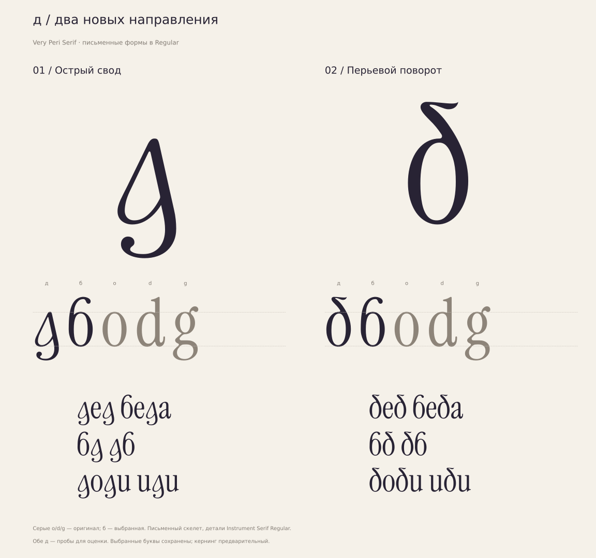

# д — два новых письменных скелета

**[ОТКРЫТО · 15.10.2026]** Новые рисунки по просьбе пользователя
«переделывай суть буквы д». Ни один не выбран основной формой.



| Вариант | Новая конструкция | Пробный шрифт |
|---|---|---|
| 01 «Острый свод» | Тонкий левый подъём, острый асимметричный просвет, тяжёлый правый спуск и открытый нижний возврат | [TTF](de-01.ttf), [WOFF2](de-01.woff2), [Glyphs](de-01.glyphs), [SVG](de-01.svg) |
| 02 «Перьевой поворот» | Направленный верхний вход, перьевой разворот и диагональный спуск в заново построенную чашу | [TTF](de-02.ttf), [WOFF2](de-02.woff2), [Glyphs](de-02.glyphs), [SVG](de-02.svg) |

**[НАБЛЮДЕНИЕ]** Различаются силуэт, распределение массы, положение выноса
и организация просвета. Прежняя схема «точная o + округлый верхний крючок»
не используется. Чужие контуры и готовая латинская g не переносятся.
Узнаваемость и соответствие гарнитуре требуют визуальной оценки пользователя.

**[РЕШЕНИЕ]** Начертание остаётся Regular. Выбранные б/г/ж/з/и,
альтернативы и исходная латиница сохраняются. Четыре сочетания к/й
предоставлены для каждой д; наличие технического исходного шрифта не
выбирает основную к или кратку й. `ss06` сохраняет историческую петлевую д02;
новая д02 доступна отдельным файлом, через `ss06` не переключается.
Все прежние исследования остаются в своих папках.

**[ИЗМЕРЕНО]** Оба advance 416. Границы: 01 `(33,-215)…(391,516)`,
02 `(23,-9)…(391,740)`. Кубических узлов: 62/57. По два контура и одному
просвету. Единственные намеренные угловые узлы — соединение чаши со спуском
в 01 и острие верхнего окончания в 02; остальные исходные стыки имеют общую
касательную. Это технические свойства, не подтверждение оптического успеха.

Контуры и описание движения:
[de-reimagined-outlines.json](../../../data/de-reimagined-outlines.json).
Измерения сборки: [metrics.json](metrics.json).
Плотная выборочная проверка топологии, направлений контуров и отклонения
TTF от кубического источника: [outline-audit.json](outline-audit.json).
Восемь сборок открыты повторно; остальные глифы, их метрики и GSUB сохранены.
Слова на презентации набраны настоящими контурами пробных шрифтов;
серые o/d/g — исходная латиница, б — выбранная кириллическая.

Воспроизведение из корня репозитория с requirements-fonts.txt:

```bash
python3 tools/prepare_reference.py
python3 tools/build_de_reimagined.py
python3 tools/audit_de_reimagined.py
```

Результат создаётся в игнорируемой build/regular/de-reimagined.
Кернинг новых д предварительный. FontBakery/Hyperglot не запускались;
это пробы конструкций, не готовый релиз.

Источник: Instrument/instrument-serif,
`65c0ef225f386a3c7e87570a4aa9cc0262c2fd81`, Regular m01, UPM 1000.
Производная работа; [SIL OFL 1.1](OFL.txt).
