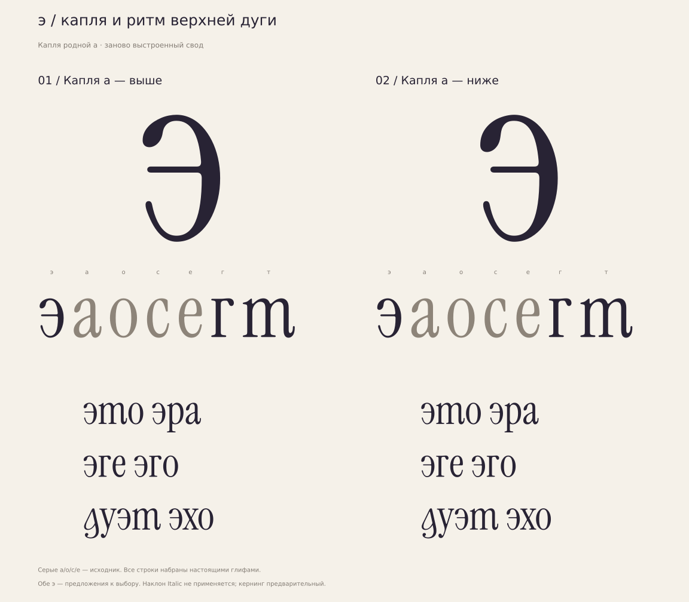

# э — капля a и заново выстроенный свод

**[РЕШЕНИЕ · 15.10.2026]** Основная э —02 «Капля a — ниже».
Пользователь: «оставь 02».01 «Капля a — выше» сохранена отдельной альтернативой.
Оба контура и метрики сохранены точно; контрольные hash и hmtx —
[selected-ereversed.json](../../../data/selected-ereversed.json).



| Вариант | Рисунок | Файлы |
|---|---|---|
| 01 «Капля a — выше» | Больше воздуха над перекладиной | [TTF](ereversed-01.ttf), [WOFF2](ereversed-01.woff2), [Glyphs](ereversed-01.glyphs), [SVG](ereversed-01.svg) |
| 02 «Капля a — ниже» | Капля опущена на20 единиц, вход длиннее | [TTF](ereversed-02.ttf), [WOFF2](ereversed-02.woff2), [Glyphs](ereversed-02.glyphs), [SVG](ereversed-02.svg) |

**[РЕШЕНИЕ]** Прежние [ereversed01/02](../ereversed/) отклонены пользователем
и сохранены. [Сравнение старых и новых рисунков](evolution.svg).

**[НАБЛЮДЕНИЕ]** В прежнем верху плоская левая половина свода соединялась
с более крутой правой дугой o; возле капли была тесная обратная впадина.
Новый вход использует родную левую каплю a с направлением вправо-вверх.
Внешний и внутренний подводы к вершине нарисованы заново каждый одним
кубиком. Правый спуск o, тонкая перекладина e и нижний выход сохранены.

**[ИЗМЕРЕНО]** Два кубика капли a точно перенесены(−8,+55)/(−8,+35),
без отражения или масштабирования. Размах фрагмента83×61; низ382/362,
вертикальная апертура до бара302 —80/60. У прежней01 размах капли поx64.
Вершины516/491, толщина короны25. Локальные радиусы снаружи слева133,885,
справа133,057; внутри91,875 с обеих сторон. Это проверка конкретного
перехода, а не универсальное требование G2 к гарнитуре.

Advance368; bbox(23,−9)…(343,516); правое поле25. Перекладина277–302=25.
Один замкнутый контур,53 кубических узла;66/67 точек в TTF.
Рисунок капли и короны: [ereversed-refined-outlines.json](../../../data/ereversed-refined-outlines.json).
Локальные поправки округления TTF≤1ед.:
[ereversed-refined-export.json](../../../data/ereversed-refined-export.json).
[Измерения](metrics.json), [аудит контуров](outline-audit.json),
[размерные пробы12/24/100pt](sizes.svg).

**[ИЗМЕРЕНО]** Источник и экспорт проверены на самопересечения плотной
выборкой; явные гладкие стыки TTF имеют общую касательную, лишних соседних
точек нет. Отклонение экспорта от кубического рисунка в выборке≤1,081ед.
Во всех восьми сочетаниях к/й точно сохраняются выбранные г/д/т,
остальные существующие глифы и метрики. Техническая проверка не утверждает стиль.

**[РЕШЕНИЕ]** Основная02 используется в четырёх сочетаниях к/й;
альтернативная01 остаётся в четырёх отдельных пробных шрифтах.
Нового ss-переключателя нет.
Кернинг предварительный: справа наследуются пары o, левый открытый край
требует отдельной настройки. FontBakery/Hyperglot не запускались.

Воспроизведение с requirements-fonts.txt:

```bash
python3 tools/prepare_reference.py
python3 tools/build_ereversed.py --revision refined
```

Выход: игнорируемая build/regular/ereversed-refined. Без --revision refined
собирается прежняя версия; история воспроизводится отдельно.

Источник: Instrument/instrument-serif, commit
65c0ef225f386a3c7e87570a4aa9cc0262c2fd81, Regular m01, UPM1000.
Производные файлы под [SIL OFL1.1](OFL.txt).
